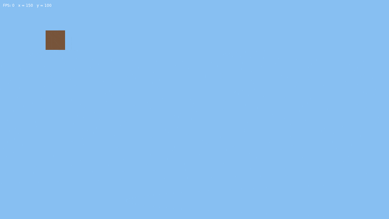
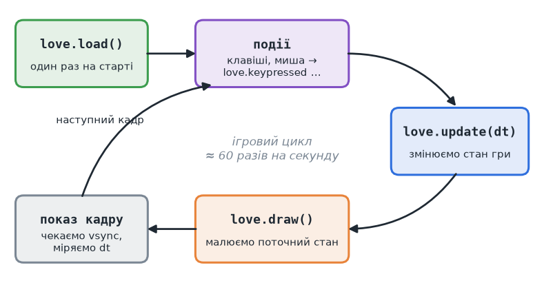
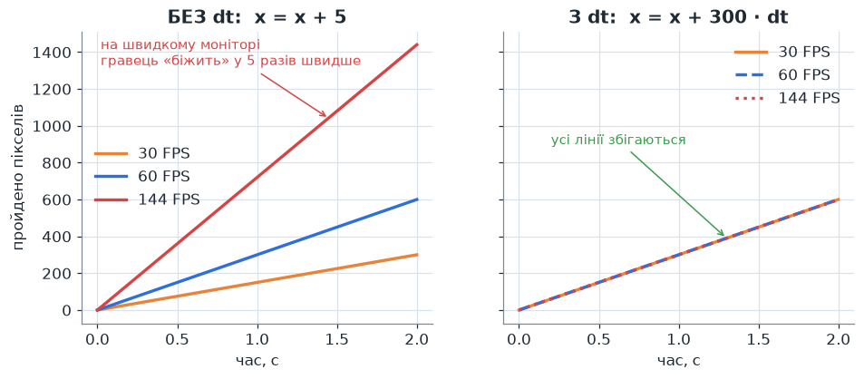

# Урок 1. Вікно та ігровий цикл

> **Результат уроку:** програма відкриває вікно з кольором неба, показує FPS, а коричневий квадрат рухається клавішами **W A S D**.

📦 **Код уроку:** [завантажити code.zip](code.zip). Розпакуйте архів і запустіть `love code`.



## Мета уроку

* Познайомитися з мовою **Lua** у межах, потрібних для курсу.
* Зрозуміти, як працює **ігровий цикл** LÖVE: `love.load`, `love.update`, `love.draw`.
* Навчитися рухати об'єкт з **однаковою швидкістю на будь-якому комп'ютері**: це забезпечує множник `dt`.

| Компетентність стандарту 4113 | Що саме тренуємо |
|---|---|
| ПК (ОС та ПЗ): установлення прикладного ПЗ | встановлення LÖVE, запуск програми з термінала |
| КК.2 Математична | швидкість, час, відстань: `s = v · t` |
| КК.1 Комунікативна (англ. термінологія) | *frame, frame rate, delta time, callback* |

---

## 1. Мінімум мови Lua

Lua — маленька мова, її синтаксис можна вивчити за вечір. Ось усе, що знадобиться в курсі:

```lua
-- Однорядковий коментар
local count = 10            -- змінна (local: видима лише в цьому файлі чи блоці)
local name = "stone"        -- рядок
local ok = true             -- логічне значення: true / false
local nothing = nil         -- «нічого», відсутнє значення

-- Таблиця — єдина складена структура даних у Lua.
-- Вона може бути і масивом, і словником (об'єктом).
local list = { "stone", "dirt", "grass" }   -- масив, індекси починаються з 1!
print(list[1])                             --> stone
local block = { name = "dirt", hardness = 2 }
print(block.name, block["hardness"])       --> dirt   2

-- Функції
local function add(a, b)
    return a + b
end

-- Умови та цикли
if count > 5 and ok then
    print("багато")
elseif count == 0 then
    print("нуль")
else
    print("мало")
end

for i = 1, 3 do print(i) end               -- 1, 2, 3
for index, value in ipairs(list) do end    -- обхід масиву
for key, value in pairs(block) do end      -- обхід словника

-- Нерівність записують як ~= (а не !=)
if name ~= "air" then end

-- Конкатенація рядків — дві крапки
print("block: " .. name)
-- Форматування рядка
print(("x = %.1f"):format(3.14159))        --> x = 3.1
```

> **Увага:** у Lua масиви починаються з **1**, а не з 0, як у C, Python чи JavaScript. Пізніше ми працюватимемо з координатами блоків, які починаються з 0, тож щоразу перевіряйте, у якій системі ви зараз рахуєте.

Ще дві можливості Lua (модулі через `require` та «класи» через метатаблиці) знадобляться пізніше, тому розберемо їх в [уроці 3](../03-perspective/README.md).

## 2. Що таке LÖVE

**LÖVE** (love2d.org) — безкоштовний рушій для ігор мовою Lua. Він бере на себе вікно, клавіатуру, мишу, звук і доступ до відеокарти через OpenGL, а від нас чекає лише функцій-**зворотних викликів** (*callbacks*) з певними іменами.

Програма для LÖVE — це **тека**, у корені якої лежить файл `main.lua` (і, за бажанням, `conf.lua`). Запуск:

```sh
cd 01-window/code
love .
```

### `conf.lua`: налаштування до старту

LÖVE читає цей файл **до** того, як створить вікно:

```lua
function love.conf(t)
    t.identity = "lesson-mcraft"   -- назва теки для збережень
    t.version = "11.5"             -- версія LÖVE, для якої написано гру

    t.window.title = "Урок 1: вікно та ігровий цикл"
    t.window.width = 1280
    t.window.height = 720
    t.window.resizable = true
    t.window.vsync = 1             -- синхронізація з частотою монітора
end
```

## 3. Ігровий цикл

Будь-яка гра — це нескінченний цикл, який багато разів на секунду виконує одне й те саме: **зібрати події → оновити стан → намалювати кадр**.



| Функція | Коли викликається | Що в ній робити |
|---|---|---|
| `love.load()` | один раз, на старті | завантажити ресурси, створити об'єкти |
| `love.update(dt)` | щокадру | змінити стан гри (позиції, логіку) |
| `love.draw()` | щокадру, після `update` | **лише малювати**, нічого не змінюючи |
| `love.keypressed(key)` | коли натиснуто клавішу | разові дії: вийти, стрибнути, перемкнути |

Важливе правило: у `love.draw` **не змінюємо стан** гри, а в `love.update` **нічого не малюємо**. Коли ці обов'язки розділено, код легше читати й налагоджувати.

## 4. Пишемо код

Відкрийте [`code/main.lua`](code/main.lua):

```lua
local SPEED = 300 -- пікселів за секунду
local SIZE = 64

local player = { x = 100, y = 100 }

function love.load()
    love.graphics.setBackgroundColor(0.53, 0.75, 0.95) -- колір неба
end

function love.update(dt)
    local dx, dy = 0, 0
    if love.keyboard.isDown("w") then dy = dy - 1 end
    if love.keyboard.isDown("s") then dy = dy + 1 end
    if love.keyboard.isDown("a") then dx = dx - 1 end
    if love.keyboard.isDown("d") then dx = dx + 1 end
    -- Множимо на dt: швидкість не залежить від частоти кадрів.
    player.x = player.x + dx * SPEED * dt
    player.y = player.y + dy * SPEED * dt
end

function love.draw()
    love.graphics.setColor(0.47, 0.33, 0.23) -- колір землі
    love.graphics.rectangle("fill", player.x, player.y, SIZE, SIZE)
    love.graphics.setColor(1, 1, 1)
    love.graphics.print(("FPS: %d   x = %.0f   y = %.0f"):format(love.timer.getFPS(), player.x, player.y), 10, 10)
end

function love.keypressed(key)
    if key == "escape" then
        love.event.quit()
    end
end
```

Розберемо ключові місця:

* **Кольори в LÖVE** задаються числами від `0` до `1`, а не від 0 до 255. Колір `(0.53, 0.75, 0.95)` — це приблизно `(135, 191, 242)` у звичній RGB-моделі.
* **Система координат екрана:** точка `(0, 0)` — **лівий верхній** кут, вісь Y спрямована **вниз**. Тому клавіша `W` («вгору») *зменшує* `y`.
* `love.keyboard.isDown` перевіряє, чи клавіша **утримується** просто зараз; для руху це те, що треба. Для разових дій (вийти з гри) краще підходить подія `love.keypressed`.

## 5. Навіщо потрібен `dt`

`dt` (*delta time*) — це час у секундах, що минув від попереднього кадру. При 60 FPS `dt ≈ 0.0167`, при 144 FPS `dt ≈ 0.0069`.

Формула зі шкільної фізики: **відстань = швидкість × час**. За один кадр квадрат має пройти `SPEED * dt` пікселів. Тоді за секунду він пройде рівно `SPEED` пікселів, незалежно від того, скільки кадрів уміститься в цю секунду.

### ⚠️ Типова помилка: рух без `dt`

```lua
-- НЕПРАВИЛЬНО
player.x = player.x + dx * 5
```

Програма начебто працює. Але швидкість тепер залежить від частоти кадрів: на моніторі 144 Гц гравець рухається майже **в 5 разів швидше**, ніж на ноутбуці, що видає 30 FPS. А коли гра «пригальмовує», гравець сповільнюється разом з нею.



Ліворуч рух без `dt`: три різні комп'ютери дають три різні швидкості. Праворуч рух з `dt`: усі три лінії збігаються.

> **Як перевірити самостійно:** у `conf.lua` встановіть `t.window.vsync = 0`, і FPS зросте до сотень. Порівняйте, як поводиться квадрат з `dt` і без нього.

## Підсумок

* Програма LÖVE — це тека з `main.lua`; запуск командою `love .`.
* `love.load` виконується один раз, а `love.update(dt)` і `love.draw()` — щокадру.
* Усе, що змінюється з часом, множимо на `dt`.

## Запитання для самоперевірки

1. Чому в `love.draw` не можна змінювати позицію гравця?
2. Скільки пікселів пройде квадрат за 0,5 с, якщо `SPEED = 300`? Чи залежить відповідь від FPS?
3. Як зробити так, щоб квадрат не виходив за межі вікна? (Підказка: `love.graphics.getDimensions()` і `math.max` / `math.min`.)

**Далі:** [Урок 2. Перший трикутник](../02-triangle/README.md)
