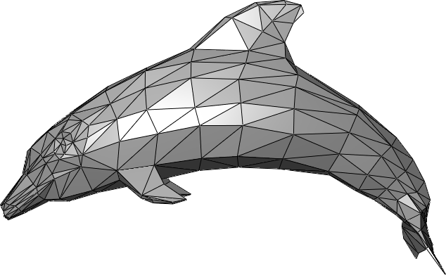
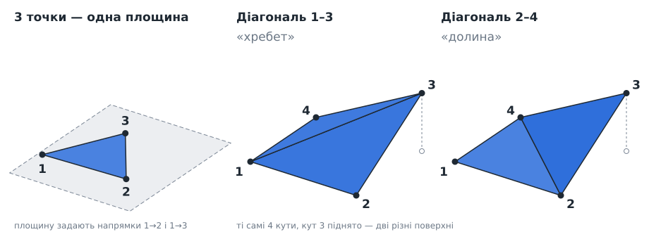
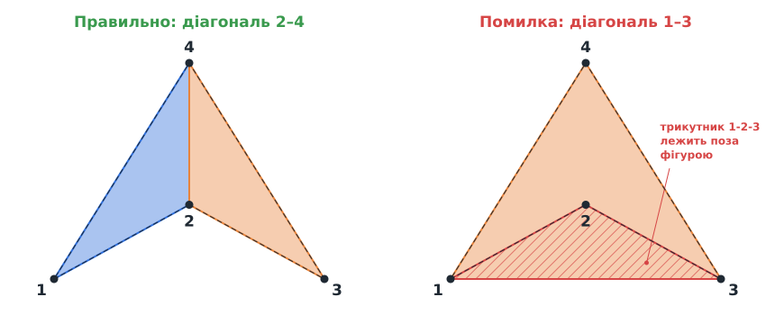
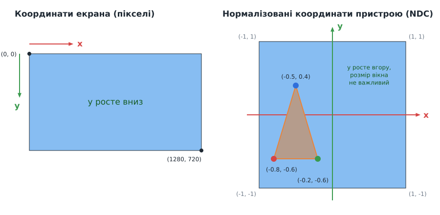

# Урок 2. Перший трикутник

> **Результат уроку:** програма малює різнокольоровий трикутник і квадрат, складений з двох трикутників. Клавіша **Tab** вмикає каркасний режим (*wireframe*), у якому видно, з яких трикутників складено фігури.

📦 **Код уроку:** [завантажити code.zip](code.zip). Розпакуйте архів і запустіть `love code`.


<iframe class="lesson-demo" src="demo/index.html?poster=../images/quad_ok.png" title="Демо: трикутник і квадрат, по черзі з каркасом" loading="lazy" tabindex="-1"></iframe>

## Мета уроку

* Зрозуміти, що будь-яка 3D-модель, від кубика до персонажа, складається з **трикутників**.
* Описати власні **вершини** та зібрати з них **сітку** (`Mesh`).
* Написати перший **шейдер** — маленьку програму, яку виконує відеокарта.
* Дізнатися про **нормалізовані координати пристрою (NDC)**.

---

## 1. Чому саме трикутники

Відеокарта вміє дуже швидко зафарбовувати **трикутники**, а складніших фігур вона «не знає». Трикутник обрано тому, що три точки **завжди лежать в одній площині** і задають її однозначно. Чотири точки вже можуть «зламатися» й не лягти в одну площину.

Тому квадрат = 2 трикутники, грань кубика = 2 трикутники, куб = 6 граней × 2 = **12 трикутників**. Увесь наш світ Minecraft теж складатиметься з тисяч таких трикутників.

Так само влаштовані й плавні на вигляд моделі. Ось дельфін: його поверхня — це сітка з кількох сотень трикутників, кожен зафарбовано своїм відтінком сірого. Що більше трикутників, то плавнішою виглядає модель:



*Зображення: Chrschn, [Wikimedia Commons](https://commons.wikimedia.org/wiki/File:Dolphin_triangle_mesh.png), суспільне надбання.*

<details class="more">
<summary>Детальніше: чому три точки завжди в одній площині, а чотири — ні</summary>

**Три точки.** Візьмімо точки 1, 2, 3. Від точки 1 ведуть два напрямки: до точки 2 і до точки 3. Будь-яку точку трикутника можна отримати, якщо пройти трохи вздовж першого напрямку і трохи вздовж другого. Два напрямки задають рівно одну площину, тому трикутник завжди плаский. Так само табурет на трьох ніжках ніколи не хитається, хоч яка нерівна підлога.

Єдиний виняток — коли всі три точки лежать на одній прямій. Тоді трикутник «вироджений»: у нього нульова площа, і відеокарта просто нічого не малює.

**Чотири точки.** Четверта ніжка у стола вже може не дістати підлоги, і стіл хитається. Так само четверта вершина може не потрапити в площину перших трьох. Піднімемо кут 3 квадрата трохи вгору:



Тепер «квадрат» зігнутий, і його можна натягнути двома способами:

* через діагональ **1–3**: поверхня згинається вгору, як дах із **хребтом**;
* через діагональ **2–4**: поверхня прогинається, як **долина**.

Кути однакові, а поверхні різні. Якби відеокарта приймала чотирикутники, їй довелося б самій вибирати один з варіантів, і на різних відеокартах той самий об'єкт міг би виглядати по-різному. З трикутником такого вибору немає: площина одна, і кожна точка всередині однозначно змішує значення трьох кутів (колір, текстурні координати, освітлення).

**Увігнуті фігури.** Навіть пласкі чотирикутники бувають підступні. Якщо один кут «вдавлено» всередину, то одна з діагоналей виходить за межі фігури:



У фігур із п'ятьма, шістьма й більше кутами варіантів поділу ще більше, і перевіряти треба і пласкість, і опуклість.

**Висновок.** Трикутник — найпростіша фігура, яка завжди пласка, завжди опукла і зафарбовується однозначно. Тому відеокарти приймають тільки трикутники, а програми для 3D-моделювання перед експортом самі ділять складніші грані на трикутники. Цей процес називають **тріангуляцією** (*triangulation*). У нашій грі всі грані — квадрати, тож ми поділимо їх на два трикутники вручну.

</details>

## 2. Як відеокарта малює трикутник


1. **Вершини** (*vertices*): ми передаємо координати кутів та їхні кольори.
2. **Вершинний шейдер** (*vertex shader*) виконується **окремо для кожної вершини** й вирішує, у якому місці екрана вона опиниться.
3. **Растеризація**: відеокарта визначає, які пікселі екрана покриває трикутник. Значення вершин (наприклад, колір) вона плавно **інтерполює** між кутами, тому трикутник з червоною, зеленою та синьою вершинами виходить райдужним.
4. **Піксельний шейдер** (*pixel / fragment shader*) виконується **для кожного пікселя** й вирішує, якого він кольору. Поки що беремо стандартний шейдер LÖVE; власний з'явиться в уроці 5, коли накладатимемо текстури.

Піксельний шейдер здатен на більше, ніж здається. Анімацію нижче повністю намальовано одним піксельним шейдером: жодних моделей чи текстур, лише формула, яку відеокарта обчислює для кожного пікселя кожного кадру. Анімація працює лише тоді, коли видима на екрані.

<script type="x-shader/x-fragment" id="creation-by-silexars">
// "Creation by Silexars" by Danguafer, https://www.shadertoy.com/view/XsXXDn
#define t iTime
#define r iResolution.xy

void mainImage(out vec4 fragColor, in vec2 fragCoord) {
    vec3 c;
    float l, z = t;
    for (int i = 0; i < 3; i++) {
        vec2 uv, p = fragCoord.xy / r;
        uv = p;
        p -= .5;
        p.x *= r.x / r.y;
        z += .07;
        l = length(p);
        uv += p / l * (sin(z) + 1.) * abs(sin(l * 9. - z - z));
        c[i] = .01 / length(mod(uv, 1.) - .5);
    }
    fragColor = vec4(c / l, t);
}
</script>

<div class="glsl-demo" data-shader="creation-by-silexars" data-start="10"></div>

<p class="glsl-credit">Шейдер: <a href="https://www.shadertoy.com/view/XsXXDn">«Creation by Silexars»</a>, автор — Danguafer (Shadertoy, ліцензія <a href="https://creativecommons.org/licenses/by-nc-sa/3.0/deed.uk">CC BY-NC-SA 3.0</a>).</p>

## 3. Нормалізовані координати пристрою (NDC)

Вершинний шейдер повертає позицію не в пікселях, а в **NDC** (*Normalized Device Coordinates*): `x` і `y` змінюються від `-1` до `1` незалежно від розміру вікна.



| | Координати екрана LÖVE | NDC |
|---|---|---|
| Початок `(0, 0)` | лівий верхній кут | центр вікна |
| Вісь Y | вниз | **вгору** |
| Межі | `0..ширина`, `0..висота` | `-1..1` по обох осях |

Невеликий недолік NDC: широке вікно розтягує картинку, адже `1` по X — це 640 пікселів, а `1` по Y — лише 360. Ми виправимо це в наступному уроці, коли врахуємо **співвідношення сторін** (*aspect ratio*).

## 4. Пишемо код

### Формат вершини

Спочатку описуємо, з яких даних складається одна вершина:

```lua
local VERTEX_FORMAT = {
    { "VertexPosition", "float", 2 }, -- x, y: два дробові числа
    { "VertexColor", "byte", 4 },     -- r, g, b, a: чотири байти (0..255 на відеокарті)
}
```

Назви `VertexPosition` і `VertexColor` **зарезервовані** в LÖVE: рушій сам передає їх у шейдер. Кольори в таблиці вершин ми все одно задаємо числами `0..1`, а LÖVE перетворює їх на байти.

### Шейдер

```lua
local VERTEX_SHADER = [[
vec4 position(mat4 transformProjection, vec4 vertexPosition) {
    return vertexPosition;
}
]]
```

Шейдери пишуть мовою **GLSL**, схожою на C. `[[ ... ]]` — це просто багаторядковий рядок у Lua. Функція `position` отримує вершину й повертає її позицію в NDC. Стандартний шейдер LÖVE множив би позицію на матрицю `transformProjection`, яка переводить пікселі в NDC. Ми цю матрицю ігноруємо, тому наші координати **одразу задано в NDC**.

`vec4` — вектор з чотирьох чисел `(x, y, z, w)`. Ми передали лише `x` і `y`, тож відеокарта доповнює решту: $z = 0$, $w = 1$. Навіщо потрібен $w$, з'ясуємо в уроці 3.

### Трикутник

```lua
triangle = love.graphics.newMesh(VERTEX_FORMAT, {
    { -0.8, -0.6, 1, 0, 0, 1 }, -- лівий нижній, червоний
    { -0.2, -0.6, 0, 1, 0, 1 }, -- правий нижній, зелений
    { -0.5, 0.4, 0, 0, 1, 1 },  -- верхній, синій
}, "triangles", "static")
```

* `"triangles"` — кожні **три** вершини утворюють окремий трикутник.
* `"static"` — підказка для відеокарти, що дані не змінюватимуться. Тоді вона може зберегти їх у швидшій пам'яті.

### Квадрат з двох трикутників

```lua
local corners = {
    { 0.2, -0.6 }, { 0.8, -0.6 }, { 0.8, 0.4 }, { 0.2, 0.4 },
}
local quadOrder = { 1, 2, 3, 1, 3, 4 } -- два трикутники зі спільною діагоналлю 1-3
```

Ми не повторюємо координати вручну. Чотири кути описано один раз, а таблиця `quadOrder` перелічує, які кути утворюють трикутники. Цей самий прийом (таблицю `QUAD_ORDER`) використаємо для кожної грані кожного блока у світі.

### Малювання

```lua
function love.draw()
    love.graphics.setShader(shader)
    love.graphics.setColor(1, 1, 1)
    love.graphics.draw(triangle)
    love.graphics.draw(quad)
    love.graphics.setShader()
    ...
end
```

Повний код: [`code/main.lua`](code/main.lua). Запуск: `love .` з теки `code`.

> **Чому підпис у вікні англійською?** Вбудований шрифт LÖVE не містить кириличних літер, тож український текст відображається квадратиками. Можна завантажити власний шрифт (`love.graphics.newFont("DejaVuSans.ttf", 14)`), але інтерфейс у нашій грі мінімальний, тому ми обходимося англійськими підписами.

## 5. ⚠️ Типова помилка: неправильний порядок вершин

Достатньо помилитися в одній цифрі, і квадрат розвалюється:

```lua
local quadOrder = { 1, 2, 3, 2, 3, 4 } -- НЕПРАВИЛЬНО
```


Другий трикутник `2-3-4` накриває ту саму праву частину, що й перший, а лівий трикутник `1-3-4` так і не малюється. Ось як це виглядає в програмі (праворуч каркасний режим):


**Як знайти таку помилку:** увімкніть каркасний режим (**Tab**). Діагональ має з'єднувати протилежні кути квадрата, а якщо лінії перетинаються «хрестом», порядок вершин переплутано.

Пізніше, у 3D, вам доведеться слідкувати ще й за **напрямком обходу** вершин (за годинниковою стрілкою чи проти неї). Від нього залежить, яку сторону трикутника відеокарта вважає «лицьовою». Про це в [уроці 7](../07-culling-chunks/README.md).

## Підсумок

* Відеокарта малює **трикутники**; квадрат = 2 трикутники.
* **Сітка** (`Mesh`) — це масив вершин разом з описом їхнього формату.
* **Вершинний шейдер** визначає положення вершини, **піксельний** визначає колір пікселя.
* Шейдер повертає позицію в **NDC**: `-1..1`, вісь Y спрямована вгору.

## Запитання для самоперевірки

1. Скільки вершин (у режимі `"triangles"`) потрібно, щоб намалювати куб з усіма 6 гранями?
2. Що буде, якщо всім трьом вершинам трикутника задати однаковий колір?
3. Змініть програму так, щоб квадрат складався з трикутників з діагоналлю `2-4`. Як тепер виглядатиме `quadOrder`?

**Далі:** [Урок 3. Перспектива: вектори, матриці та обертовий куб](../03-perspective/README.md)
