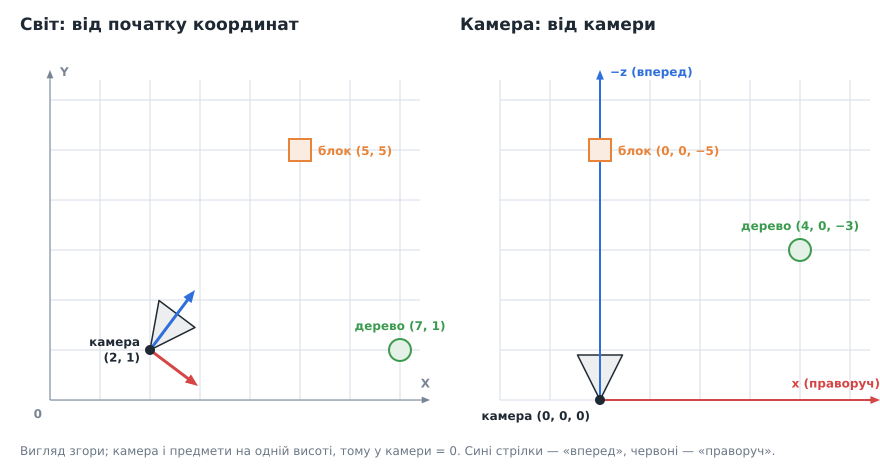
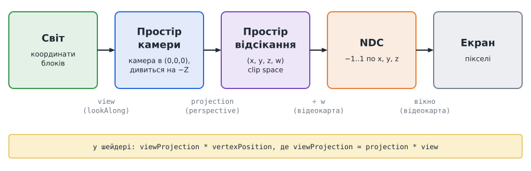
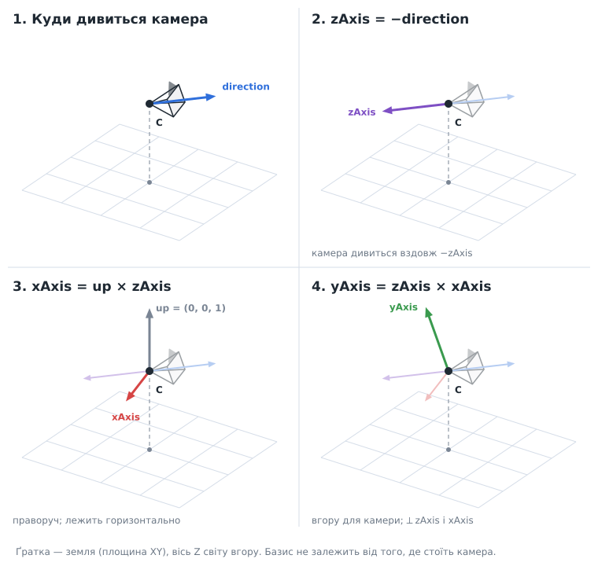
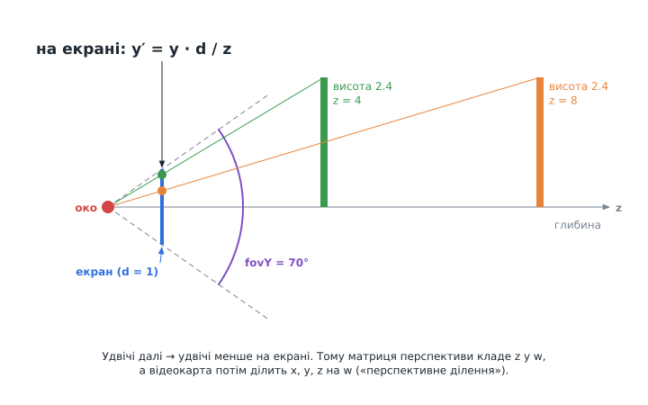
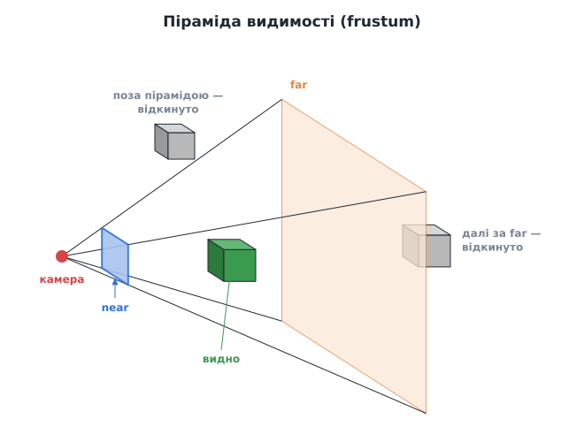
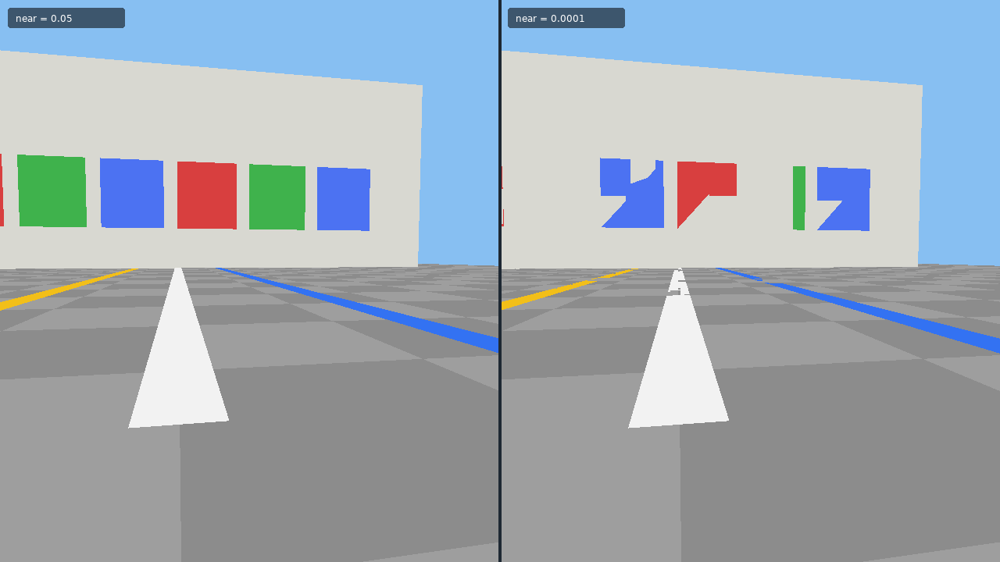

# Урок 3. Перспектива: вектори, матриці та обертовий куб

> **Результат уроку:** справжня 3D-сцена. Камера літає по колу навколо різнокольорового куба, і грані куба правильно перекривають одна одну.

📦 **Код уроку:** [завантажити code.zip](code.zip). Розпакуйте архів і запустіть `love code`.


<iframe class="lesson-demo" src="demo/index.html?poster=../images/orbit.gif" title="Демо: камера облітає куб" loading="lazy" tabindex="-1"></iframe>

## Мета уроку

* Організувати код у **модулі** (`require`) і створити перший «клас» за допомогою **метатаблиць**.
* Розібратися з **векторами**: додавання, скалярний і векторний добутки, нормалізація.
* Зрозуміти, як **матриці** перетворюють точку світу на піксель екрана: матриця виду, перспективна проєкція, піраміда видимості.
* Увімкнути **буфер глибини** і врахувати **співвідношення сторін** вікна.

---

## 1. Структура проєкту

З цього уроку код розходиться по кількох файлах:

```
03-perspective/code/
├── conf.lua
├── main.lua
└── src/
    └── math/
        ├── vec3.lua    -- 3D-вектор
        └── mat4.lua    -- матриця 4×4
```

### Модулі: `require`

Модуль у Lua — це файл, який **повертає** значення (зазвичай таблицю). Інший файл підключає його так:

```lua
local Vec3 = require("src.math.vec3")   -- крапки замість «/», без «.lua»
```

Lua виконує файл лише **один раз** і запам'ятовує результат. Повторний `require` того самого модуля повертає ту саму таблицю.

### Класи через метатаблиці

У Lua немає ключового слова `class`. Його замінюють **метатаблиці**: таблиці, що описують поведінку інших таблиць.

```lua
local Vec3 = {}
Vec3.__index = Vec3   -- «якщо поля немає в об'єкті, шукай його у Vec3»

function Vec3.new(x, y, z)
    return setmetatable({ x = x, y = y, z = z }, Vec3)
end

function Vec3.__add(a, b)          -- викликається для a + b
    return Vec3.new(a.x + b.x, a.y + b.y, a.z + b.z)
end

function Vec3:scaledBy(k)          -- двокрапка: прихований параметр self
    return Vec3.new(self.x * k, self.y * k, self.z * k)
end
```

Тепер можна писати `local c = a + b` та `c:scaledBy(2)`. Двокрапка — це скорочення: `c:scaledBy(2)` означає те саме, що `Vec3.scaledBy(c, 2)`. (Метод `scaledBy` тут лише для прикладу; у нашому `Vec3` множення на число записується оператором `v * 2`, див. розділ 3.)

Спеціальні поля метатаблиці (`__add`, `__sub`, `__mul`, `__unm`, `__tostring`) задають, як поводяться оператори `+`, `-`, `*`, унарний мінус і `tostring()`. Є й `__eq` для `==`; він знадобиться нам в уроці 9.

> **Домовленість:** наші вектори **незмінні**. Жоден метод не змінює `x`, `y`, `z`, а повертає новий вектор. Через це один вектор можна безпечно використовувати в багатьох місцях і не боятися, що хтось його непомітно змінить.

## 2. Система координат світу

Ми обираємо **праву систему координат, у якій вісь Z спрямована вгору**: X і Y лежать «на землі», Z показує висоту. Причина практична: у форматі `.vox`, з якого в уроці 8 завантажимо світ, вісь Z теж спрямована вгору. Якщо системи збігаються, при завантаженні не доведеться переставляти осі (і не буде помилки, яку ми покажемо в тому ж уроці).

### 2.1. Світ і камера: дві системи координат

Ту саму точку можна описати по-різному, залежно від того, **від чого рахувати**. Порівняйте: «будинок на перехресті 5-ї та 5-ї вулиць» і «будинок за п'ять кроків прямо перед тобою». Перше — як на мапі, однаково для всіх. Друге — відносно того, хто говорить, і змінюється, щойно він зробить крок або обернеться.



* **Світова система координат** одна на всю гру. Її початок і осі нерухомі, а координати блоків, дерев і самої камери записано саме в ній. Коли камера рухається, світові координати блока **не змінюються**.
* **Система координат камери** (*локальна*, прив'язана до камери) рухається разом з камерою. Її початок — у камері, вісь $x$ дивиться праворуч від камери, $y$ — вгору для камери, а «вперед» — це **$-z$** (така домовленість OpenGL). Коли камера рухається чи обертається, координати всіх предметів у цій системі **змінюються**.

На малюнку камера стоїть у точці $(2, 1)$ світу й дивиться «на північний схід». Для світу блок лежить у точці $(5, 5)$, а для камери — **рівно попереду на відстані 5**: $(0, 0, -5)$. Дерево у світі в $(7, 1)$, а для камери — на 4 праворуч і на 3 попереду: $(4, 0, -3)$.

**Навіщо перераховувати в систему камери.** Перспектива (далеке менше) залежить від того, наскільки предмет **попереду камери**, а це і є $-z$ у системі камери. У світових координатах такого числа немає: «далеко» залежить від того, де стоїть камера й куди вона дивиться. Тому першим кроком на шляху до екрана точку переводять зі світу в систему камери. Це робить **матриця виду** (розділ 4.2).

> Свою локальну систему може мати будь-який предмет, не лише камера. Наприклад, вершини куба зручно задати відносно його центру, а потім «поставити» куб у потрібне місце світу. У нашій грі блоки одразу задаються у світових координатах, тож нам вистачить двох систем: світу й камери.

## 3. Вектори: три операції, які знадобляться

| Операція | Формула | Навіщо |
|---|---|---|
| Довжина | $\lvert v \rvert = \sqrt{x^2 + y^2 + z^2}$ | відстань між точками |
| Нормалізація | $\hat{v} = \dfrac{v}{\lvert v \rvert}$ | напрямок без довжини (одиничний вектор) |
| Скалярний добуток $a \cdot b$ | $a_x b_x + a_y b_y + a_z b_z$ | проєкція одного вектора на інший; $0$, якщо вектори перпендикулярні |
| Векторний добуток $a \times b$ | $\begin{pmatrix} a_y b_z - a_z b_y \\ a_z b_x - a_x b_z \\ a_x b_y - a_y b_x \end{pmatrix}$ | вектор, **перпендикулярний** обом; у коді — `Vec3:cross` |

Векторний добуток — головний інструмент для побудови камери: маючи «вперед» і «вгору», ми отримуємо «праворуч».

У `src/math/vec3.lua` кожна формула з таблиці стає коротким методом:

```lua
function Vec3:dot(other)           -- скалярний добуток
    return self.x * other.x + self.y * other.y + self.z * other.z
end

function Vec3:cross(other)         -- векторний добуток self × other
    return Vec3.new(
        self.y * other.z - self.z * other.y,
        self.z * other.x - self.x * other.z,
        self.x * other.y - self.y * other.x)
end

function Vec3:length()             -- довжина: v · v = x² + y² + z²
    return math.sqrt(self:dot(self))
end

function Vec3:normalized()         -- той самий напрямок, довжина 1
    local length = self:length()
    return Vec3.new(self.x / length, self.y / length, self.z / length)
end
```

Нормалізувати нульовий вектор не можна: довжина 0, і ділення дасть `nan`. Цю пастку ми зустрінемо в розділі 4.2.

Решта операторів так само повертають **нові** вектори:

```lua
function Vec3.__sub(a, b)          -- a - b
    return Vec3.new(a.x - b.x, a.y - b.y, a.z - b.z)
end

function Vec3.__mul(a, b)          -- v * s: множення на число (число пишемо другим)
    return Vec3.new(a.x * b, a.y * b, a.z * b)
end

function Vec3.__unm(a)             -- -v
    return Vec3.new(-a.x, -a.y, -a.z)
end

function Vec3.__tostring(a)        -- tostring(v) і print(v): "(1, 2, 3)"
    return ("(%g, %g, %g)"):format(a.x, a.y, a.z)
end
```

`__mul` очікує число **другим**: `v * 2` працює, а `2 * v` ні, бо тоді Lua передасть число як `a`. Ми завжди пишемо вектор першим.

## 4. Шлях вершини до екрана



Щоб намалювати точку світу, її переводять через кілька систем координат. Кожен перехід виконує **матриця 4×4**. Матриці множать одна на одну заздалегідь, і в шейдер потрапляє одна сумарна матриця `viewProjection`.

У коді матриця — це таблиця з 16 чисел, записаних **по рядках**: спочатку чотири числа першого рядка, потім другого і так далі. Елемент у рядку `row` і стовпці `col` лежить за індексом $(\text{row} - 1) \cdot 4 + \text{col}$:

```lua
local Mat4 = {}
Mat4.__index = Mat4

function Mat4.new(values)
    assert(#values == 16, "a 4x4 matrix needs 16 values")
    return setmetatable(values, Mat4)
end

function Mat4:get(row, col)
    return self[(row - 1) * 4 + col]
end
```

`assert(умова, повідомлення)` зупиняє програму з повідомленням, якщо умова хибна. Так помилка (наприклад, 15 чисел замість 16) стає видимою одразу, а не десь далеко в шейдері.

### 4.1. Чому 4×4, а не 3×3

Матриця 3×3 вміє обертати й масштабувати, але **не вміє зсувати**. Щоб зсув (переміщення камери) теж записати множенням, до точки додають четверту координату $w = 1$: $(x, y, z, 1)$. Такі координати називають **однорідними** (*homogeneous*). Четверта координата знадобиться ще раз для перспективи.

<details class="more">
<summary>Детальніше: як матриця діє на точку (з інтерактивними прикладами)</summary>

**Множення матриці на точку.** Кожен рядок матриці множимо на точку: перемножуємо числа попарно й додаємо. Для площини (матриця 2×2):

$$\begin{pmatrix} a & b \\ c & d \end{pmatrix} \begin{pmatrix} x \\ y \end{pmatrix} = \begin{pmatrix} a x + b y \\ c x + d y \end{pmatrix}$$

**Стовпці — це нові осі.** Помножте матрицю на точку $(1, 0)$: вийде $(a, c)$, тобто **перший стовпець**. А точка $(0, 1)$ перейде у **другий стовпець** $(b, d)$. Отже, матрицю можна читати так: перший стовпець — куди потрапляє вісь X, другий — куди потрапляє вісь Y. Будь-яка точка $(x, y)$ — це «$x$ кроків уздовж X і $y$ кроків уздовж Y», тож вона рухається разом з осями.

**Чому 2×2 не вміє зсувати.** Підставте $(0, 0)$: $a \cdot 0 + b \cdot 0 = 0$. Хоч які числа в матриці, початок координат лишається на місці, а зсув якраз мав би його посунути. Рятує трюк з однорідними координатами: дописуємо до точки одиницю, $(x, y, 1)$, і беремо матрицю 3×3. Третій стовпець множиться на цю одиницю й просто **додається**: $x' = a x + b y + t_x$.

Спробуйте самі. Числа в матриці можна змінювати, кнопки ставлять готові приклади, а «Показати перехід» плавно переводить одиничну матрицю в поточну:

<div class="matrix-play" data-mode="2d"></div>

Що варто спробувати:

* **Поворот**: червона й зелена стрілки обертаються разом з F. У стовпцях з'являються $\cos$ і $\sin$ кута.
* **Дзеркало**: F перевертається, бо вісь X тепер дивиться ліворуч ($-1$ у першому стовпці).
* **Зсув (2, −1)**: перші два стовпці такі самі, як в одиничній матриці, змінився лише третій.
* Впишіть вручну перший стовпець $(0, 1)$ і другий $(-1, 0)$. Це поворот на 90°: вісь X стала «вгору», а вісь Y — «ліворуч».

**Те саме в 3D.** У просторі все повторюється на один вимір більше. Матриця 3×3 обертає й масштабує, але не зсуває, тому беремо 4×4 і точку $(x, y, z, 1)$:

$$\begin{pmatrix} X_x & Y_x & Z_x & t_x \\ X_y & Y_y & Z_y & t_y \\ X_z & Y_z & Z_z & t_z \\ 0 & 0 & 0 & 1 \end{pmatrix}$$

Перші три стовпці — куди потрапляють осі X, Y, Z, четвертий — зсув $t$. Нижній рядок зазвичай $0\ 0\ 0\ 1$, тоді й результат має $w = 1$. Матриця перспективи (розділ 4.3) змінює саме нижній рядок: $w$ стає залежним від відстані, а відеокарта потім ділить $x, y, z$ на $w$.

<div class="matrix-play" data-mode="3d"></div>

* **Поворот навколо Z** — той самий поворот, що й у площині вище, а вісь Z (синя) не змінюється.
* **Поворот і зсув**: одна матриця робить обидві дії одразу. Саме тому все зручно записувати 4×4.
* **w = 1 + 0,6·y**: змінено лише нижній рядок. З діленням на $w$ дальня (по Y) частина куба стискається — це перспектива в мініатюрі. Вимкніть ділення, і куб стане звичайним.

> У `Mat4.lookAlong` (розділ 4.2) осі камери стоять не в стовпцях, а в **рядках**. Ця матриця робить зворотне: не «поверни камеру», а «переведи світ у систему камери». Для поворотів обернена матриця — це просто та сама матриця, у якій рядки й стовпці помінялися місцями (*транспонована*).

</details>

### 4.2. Матриця виду (`Mat4.lookAlong`)

Матриця виду «пересуває світ так, щоб камера опинилася в початку координат і дивилася вздовж осі −Z». Іншими словами, вона переводить точку зі світових координат у координати камери (розділ 2.1). Для цього спершу треба знайти три осі камери, виражені у світових координатах:



```lua
function Mat4.lookAlong(eye, direction, up)
    local zAxis = (-direction):normalized()        -- камера дивиться в −Z
    local xAxis = up:cross(zAxis):normalized()     -- праворуч
    local yAxis = zAxis:cross(xAxis)               -- «вгору» для камери
    return Mat4.new({
        xAxis.x, xAxis.y, xAxis.z, -xAxis:dot(eye),
        yAxis.x, yAxis.y, yAxis.z, -yAxis:dot(eye),
        zAxis.x, zAxis.y, zAxis.z, -zAxis:dot(eye),
        0, 0, 0, 1,
    })
end
```

* Три рядки — це три осі камери. Множення на них (скалярні добутки) дає координати точки **з погляду камери**.
* Останній стовпець $-\text{axis} \cdot \text{eye}$ віднімає позицію камери, тобто зсуває світ.
* Перевірмо на прикладі з розділу 2.1. Камера в $\text{eye} = (2, 1, 0)$, $\text{xAxis} = (0.8, -0.6, 0)$, $\text{zAxis} = (-0.6, -0.8, 0)$, дерево в $(7, 1, 0)$. Від камери до дерева: $(7, 1, 0) - (2, 1, 0) = (5, 0, 0)$. Тоді $x = (5, 0, 0) \cdot \text{xAxis} = 4$ і $z = (5, 0, 0) \cdot \text{zAxis} = -3$, тобто $(4, 0, -3)$, як на малюнку.
* Обмеження: `direction` не може бути паралельним `up`, бо тоді $\text{up} \times \text{zAxis} = 0$ і нормалізувати нуль неможливо. У наступному уроці ми просто не дамо камері подивитися рівно вгору чи вниз.

### 4.3. Перспектива: чому далеке здається меншим



З подібних трикутників: точка на висоті $y$ і відстані $z$ потрапляє на екран на висоті

$$y' = \frac{y \cdot d}{z}.$$

**Ділення на $z$** і дає ефект перспективи.

Множенням матриці на вектор ділити неможливо. Тому матриця перспективи лише **копіює глибину в $w$** (останній рядок `0, 0, -1, 0`), а **ділення на $w$** відеокарта виконує сама після вершинного шейдера.

### 4.4. Піраміда видимості (frustum)



Камера бачить лише те, що потрапляє всередину зрізаної піраміди між площинами **near** і **far**. Кут розкриття піраміди по вертикалі називають **fovY** (*field of view*). Усе, що лежить поза пірамідою, відеокарта автоматично відкидає (*clipping*).

```lua
function Mat4.perspective(fovY, aspect, near, far)
    local f = 1 / math.tan(fovY / 2)
    return Mat4.new({
        f / aspect, 0, 0, 0,
        0, f, 0, 0,
        0, 0, (far + near) / (near - far), 2 * far * near / (near - far),
        0, 0, -1, 0,
    })
end
```

| Елемент | Зміст |
|---|---|
| $f = \dfrac{1}{\tan(\text{fovY}/2)}$ | що вужчий кут огляду, то більше збільшення (як зум у фотоапараті) |
| $f / \text{aspect}$ | стискає X на співвідношення сторін, щоб куб на широкому екрані не розтягувався |
| третій рядок | переводить глибину з діапазону $[\text{near}, \text{far}]$ у $[-1, 1]$ для буфера глибини |
| `0, 0, -1, 0` | кладе $-z$ у $w$ для перспективного ділення |

Значення в нашому коді: `fovY = 70°`, `near = 0.05`, `far = 100`.

> **Чому `near` не роблять нульовим?** Глибина зберігається з обмеженою точністю, і що менше `near`, то гірша точність удалині. Дуже мале `near` спричиняє «мерехтіння» далеких граней (*z-fighting*).

Ось як це виглядає. Ліворуч `near = 0.05`, як у нашому коді, праворуч `near = 0.0001`, решта сцени однакова. Кольорові смуги підняті над землею лише на 2 см, а квадрати стоять на 2 см перед стіною за 60 м. Праворуч буфер глибини вже не розрізняє такі близькі поверхні, і вони «прориваються» одна крізь одну, щокадру по-різному:



<iframe class="lesson-demo" src="samples/z-fighting/index.html?poster=../../images/z_fighting.png" title="Демо: z-fighting при замалому near" loading="lazy" tabindex="-1"></iframe>

Код прикладу: [`samples/z-fighting/main.lua`](samples/z-fighting/main.lua). Запустити його можна з теки уроку: `love samples/z-fighting`.

### 4.5. Порядок множення

`projection * view` означає: **спочатку** `view`, **потім** `projection` (матриці застосовуються справа наліво). Якщо переставити множники, отримаємо зовсім інше перетворення і, найімовірніше, порожній екран.

Оператор `*` для матриць задає метаметод `__mul`. Елемент результату в рядку `row` і стовпці `col` — це рядок матриці `a`, помножений на стовпець матриці `b` (попарні добутки, а потім сума):

```lua
function Mat4.__mul(a, b)
    local values = {}
    for row = 1, 4 do
        for col = 1, 4 do
            local sum = 0
            for k = 1, 4 do
                sum = sum + a:get(row, k) * b:get(k, col)
            end
            values[#values + 1] = sum      -- по рядках, як і в Mat4.new
        end
    end
    return Mat4.new(values)
end
```

<details class="more">
<summary>Детальніше: чому A · B ≠ B · A (інтерактивний приклад)</summary>

Точку множать на добуток справа: $(R \cdot T) \cdot p = R \cdot (T \cdot p)$. Отже, першою діє **права** матриця, а ліва — після неї.

Нижче поворот $R$ (навколо початку координат) і зсув $T$. Ліворуч спочатку зсув, потім поворот; праворуч навпаки. Пунктиром показано, де F опинилася після першого кроку:

<div class="matrix-play" data-mode="order"></div>

* Ліворуч F спершу від'їжджає від початку координат, а потім **обертається навколо початку**, тобто «по колу», і опиняється зовсім в іншому місці.
* Праворуч F обертається **на місці**, а потім від'їжджає. Зазвичай саме це й потрібно, коли повертаємо предмет і ставимо його у світ.
* При куті 0° або зсуві 0 картинки однакові: тоді порядок не важить. В усіх інших випадках добутки різні, і це видно з чисел під малюнком.

У нашому коді `projection * view`: спочатку `view` (світ → камера), потім `projection` (камера → екран).

</details>

Наші матриці зберігаються **по рядках**, а GLSL за замовчуванням чекає **стовпці**. Тому в шейдер передаємо з позначкою `"row"`:

```lua
shader:send("viewProjection", "row", projection * view)
```

## 5. Код уроку

Повний код: [`code/main.lua`](code/main.lua), [`code/src/math/vec3.lua`](code/src/math/vec3.lua), [`code/src/math/mat4.lua`](code/src/math/mat4.lua).

### Шейдер з матрицею

```glsl
uniform mat4 viewProjection;   // uniform: однакове значення для всіх вершин

vec4 position(mat4 transformProjection, vec4 vertexPosition) {
    return viewProjection * vertexPosition;
}
```

### Куб із таблиці граней

Вершина тепер має три координати, а не дві:

```lua
local VERTEX_FORMAT = {
    { "VertexPosition", "float", 3 },   -- x, y, z
    { "VertexColor", "byte", 4 },
}
```

Куб описуємо таблицею граней:

```lua
local FACES = {
    { color = { 0.85, 0.25, 0.25 }, corners = { { 1, 0, 0 }, { 1, 1, 0 }, { 1, 1, 1 }, { 1, 0, 1 } } }, -- +X
    { color = { 0.45, 0.10, 0.10 }, corners = { { 0, 1, 0 }, { 0, 0, 0 }, { 0, 0, 1 }, { 0, 1, 1 } } }, -- -X
    { color = { 0.25, 0.75, 0.30 }, corners = { { 1, 1, 0 }, { 0, 1, 0 }, { 0, 1, 1 }, { 1, 1, 1 } } }, -- +Y
    { color = { 0.10, 0.40, 0.15 }, corners = { { 0, 0, 0 }, { 1, 0, 0 }, { 1, 0, 1 }, { 0, 0, 1 } } }, -- -Y
    { color = { 0.30, 0.45, 0.95 }, corners = { { 0, 0, 1 }, { 1, 0, 1 }, { 1, 1, 1 }, { 0, 1, 1 } } }, -- +Z
    { color = { 0.10, 0.15, 0.45 }, corners = { { 0, 1, 0 }, { 1, 1, 0 }, { 1, 0, 0 }, { 0, 0, 0 } } }, -- -Z
}
local QUAD_ORDER = { 1, 2, 3, 1, 3, 4 }
```

Кожна грань — це 4 кути одиничного куба $[0, 1]^3$ та колір. Кути перелічено **проти годинникової стрілки, якщо дивитися ззовні**. Поки що цей порядок не важливий, але в уроці 7 він дозволить відеокарті не малювати задні грані.

Сітку будуємо так само, як квадрат в уроці 2: `QUAD_ORDER` перетворює кожну грань на два трикутники.

```lua
local function buildCube()
    local vertices = {}
    for _, face in ipairs(FACES) do
        for _, cornerIndex in ipairs(QUAD_ORDER) do
            local corner, color = face.corners[cornerIndex], face.color
            vertices[#vertices + 1] = {
                corner[1] - 0.5, corner[2] - 0.5, corner[3] - 0.5,   -- центр куба в (0, 0, 0)
                color[1], color[2], color[3], 1,
            }
        end
    end
    return love.graphics.newMesh(VERTEX_FORMAT, vertices, "triangles", "static")
end
```

Кути в таблиці лежать у $[0, 1]$, тобто куб стоїть **кутом** у початку координат. Камера ж облітатиме точку $(0, 0, 0)$, тому віднімаємо $0.5$ від кожної координати. Тоді куб стоїть у $[-0.5, 0.5]^3$, і його центр збігається з початком координат.

```lua
function love.load()
    love.graphics.setBackgroundColor(0.53, 0.75, 0.95)
    shader = love.graphics.newShader(VERTEX_SHADER)
    cube = buildCube()
end
```

### Камера по колу

```lua
local time = 0

function love.update(dt)
    time = time + dt
end

function love.draw()
    -- Камера рухається по колу радіусом 3 на висоті 1.5 і дивиться в центр куба.
    local angle = time * 0.6
    local eye = Vec3.new(3 * math.cos(angle), 3 * math.sin(angle), 1.5)
    local view = Mat4.lookAlong(eye, -eye, UP)       -- від камери до (0, 0, 0)

    local width, height = love.graphics.getDimensions()
    local projection = Mat4.perspective(FOV, width / height, NEAR, FAR)

    love.graphics.push("all")
    love.graphics.setShader(shader)
    shader:send("viewProjection", "row", projection * view)
    love.graphics.setDepthMode("lequal", true)       -- ближчі пікселі перекривають дальші
    love.graphics.draw(cube)
    love.graphics.pop()

    love.graphics.print(("eye = (%.1f, %.1f, %.1f)"):format(eye.x, eye.y, eye.z), 10, 10)
end
```

Константи `FOV = math.rad(70)`, `NEAR, FAR = 0.05, 100` і `UP = Vec3.new(0, 0, 1)` оголошено на початку файлу.

* `(cos t, sin t)` — точка на одиничному колі. Коли кут `t` зростає, камера рухається по колу. Напрямок до центру — це $(0, 0, 0) - \text{eye} = -\text{eye}$.
* `shader:send(назва, ...)` передає значення в `uniform`-змінну шейдера. Шейдер отримує нову матрицю щокадру, бо камера рухається.
* `love.graphics.push("all")` **запам'ятовує** весь поточний стан малювання: шейдер, колір, режим глибини тощо. `pop()` повертає його назад. Без цієї пари наш шейдер і режим глибини лишилися б увімкненими для `print`, і текст намалювався б через матрицю камери (тобто не там, де треба). Цю пару ми використовуватимемо щоразу, коли змінюємо стан лише для частини малювання.

### Буфер глибини

```lua
-- conf.lua
t.window.depth = 24        -- виділити буфер глибини (24 біти на піксель)

-- main.lua, у love.draw (див. вище)
love.graphics.setDepthMode("lequal", true)
```

**Буфер глибини** (*depth buffer, z-buffer*) зберігає для кожного пікселя відстань до найближчої вже намальованої поверхні. Новий піксель малюється, лише якщо він **ближчий або на тій самій відстані** (`"lequal"`), а `true` дозволяє записати його глибину в буфер.

## 6. ⚠️ Типові помилки

### Помилка 1: забули про буфер глибини

Видаліть рядок `setDepthMode` (або `t.window.depth`) і запустіть програму:


Праворуч видно задні темні грані крізь передні. Без буфера глибини виграє та грань, яку **намалювали останньою**, а не та, що ближче до камери. Порядок граней у масиві випадковий з погляду камери, тому при обертанні картинка постійно «ламається».

### Помилка 2: не врахували співвідношення сторін

```lua
local projection = Mat4.perspective(FOV, 1, NEAR, FAR)   -- НЕПРАВИЛЬНО: aspect = 1
```


NDC завжди «квадратні» (`-1..1` по обох осях), а вікно має пропорції 16:9. Якщо не стиснути X на `aspect`, куб розтягнеться по горизонталі. Так само він «поплив би» при кожній зміні розміру вікна. Тому ширину й висоту беремо **щокадру** з `love.graphics.getDimensions()`.

### Помилка 3: переплутали `"row"` і `"column"`

```lua
shader:send("viewProjection", "column", projection * view)   -- НЕПРАВИЛЬНО для нашого Mat4
```


Шейдер отримує **транспоновану** матрицю: рядки стають стовпцями. Зсув камери і перспективне ділення потрапляють не на свої місця, тому куб сплющується, вивертається навиворіт і «пливе» екраном. Якщо 3D-сцена виглядає дивно спотвореною, спочатку перевірте порядок множення матриць і спосіб їх передачі.

## Підсумок

* Модулі підключаються через `require`, «класи» будуються на метатаблицях.
* **Світові координати** однакові для всіх і не залежать від камери; **координати камери** рахуються від камери ($x$ праворуч, $y$ вгору, вперед — $-z$) і змінюються, коли вона рухається.
* Точка світу проходить ланцюжок: **світ → камера (view) → відсікання (projection) → NDC (÷ w) → екран**.
* Перспектива — це ділення на глибину; матриця кладе глибину в `w`, а ділить відеокарта.
* Без **буфера глибини** 3D-сцена малюється неправильно.

## Запитання для самоперевірки

1. Що станеться, якщо `fov` збільшити до `120°`? А якщо зменшити до `20°`?
2. Чому `Vec3.new(0, 0, 1):cross(Vec3.new(0, 0, 1))` дає нульовий вектор і чим це загрожує `lookAlong`?
3. Змініть програму так, щоб камера ще й плавно піднімалася та опускалася (підказка: `math.sin(time)` для координати Z).

**Далі:** [Урок 4. Вільна камера: миша і клавіатура](../04-camera/README.md)
