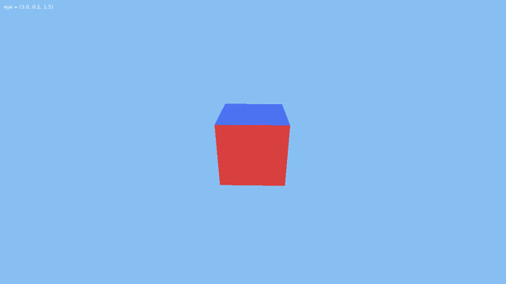
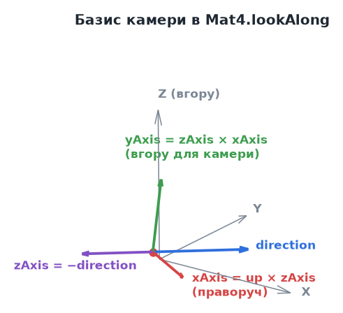
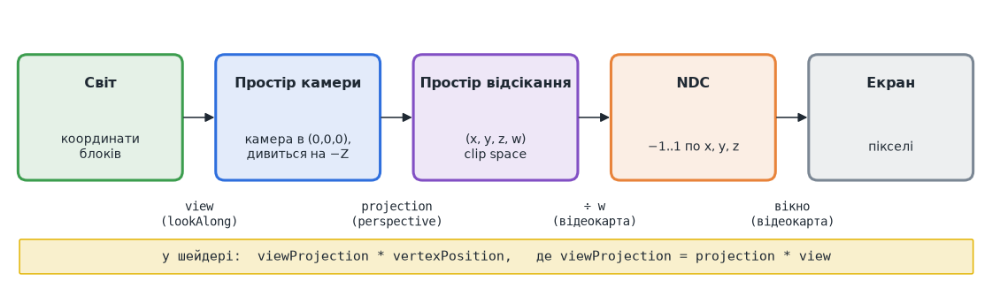
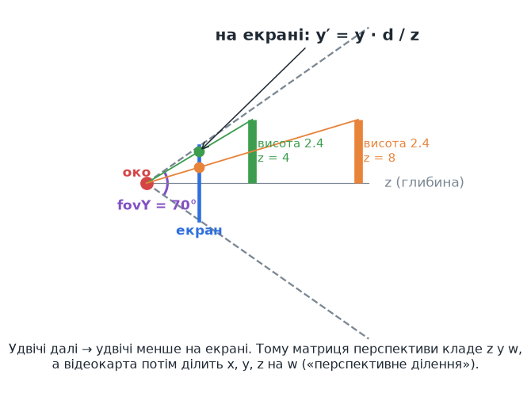
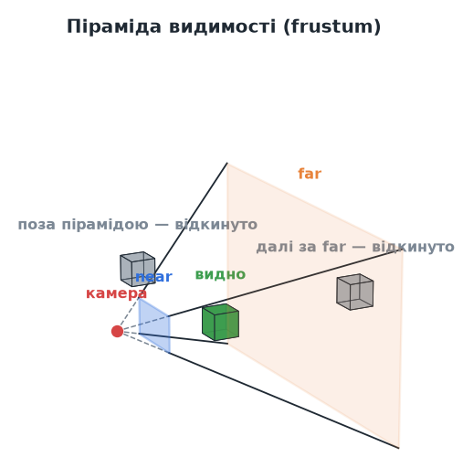
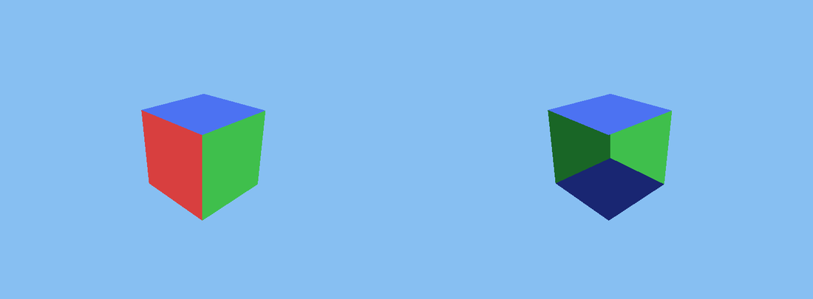
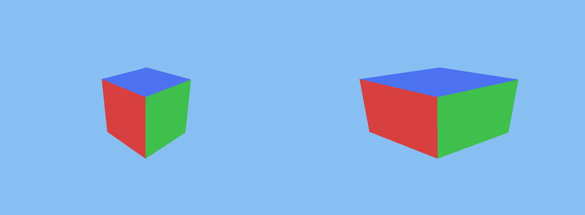
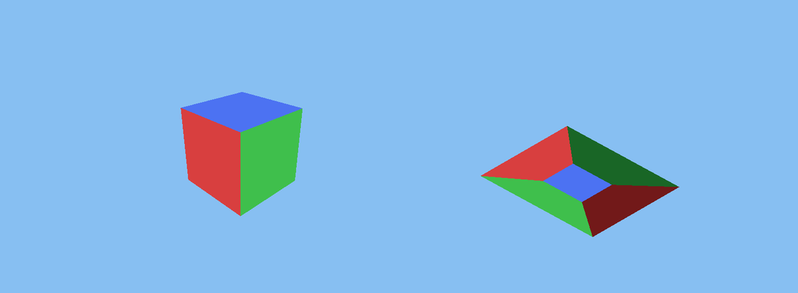

# Урок 3. Перспектива: вектори, матриці та обертовий куб

> **Результат уроку:** справжня 3D-сцена. Камера літає по колу навколо різнокольорового куба, і грані куба правильно перекривають одна одну.

📦 **Код уроку:** [завантажити code.zip](code.zip). Розпакуйте архів і запустіть `love code`.



## Мета уроку

* Організувати код у **модулі** (`require`) і створити перший «клас» за допомогою **метатаблиць**.
* Розібратися з **векторами**: додавання, скалярний і векторний добутки, нормалізація.
* Зрозуміти, як **матриці** перетворюють точку світу на піксель екрана: матриця виду, перспективна проєкція, піраміда видимості.
* Увімкнути **буфер глибини** і врахувати **співвідношення сторін** вікна.

| Компетентність стандарту 4113 | Що саме тренуємо |
|---|---|
| ПК 6: обробка тривимірних зображень | сцена, камера, рендеринг |
| КК.2 Математична | вектори, матриці, подібні трикутники, тригонометрія |
| КК.1 Англ. термінологія | *vector, matrix, dot / cross product, frustum, depth buffer, aspect ratio* |

---

## 1. Структура проєкту

З цього уроку код розходиться по кількох файлах:

```
03-perspective/code/
├── conf.lua
├── main.lua
└── src/
    └── math/
        ├── vec3.lua    -- 3D-вектор
        └── mat4.lua    -- матриця 4×4
```

### Модулі: `require`

Модуль у Lua — це файл, який **повертає** значення (зазвичай таблицю). Інший файл підключає його так:

```lua
local Vec3 = require("src.math.vec3")   -- крапки замість «/», без «.lua»
```

Lua виконує файл лише **один раз** і запам'ятовує результат. Повторний `require` того самого модуля повертає ту саму таблицю.

### Класи через метатаблиці

У Lua немає ключового слова `class`. Його замінюють **метатаблиці**: таблиці, що описують поведінку інших таблиць.

```lua
local Vec3 = {}
Vec3.__index = Vec3   -- «якщо поля немає в об'єкті, шукай його у Vec3»

function Vec3.new(x, y, z)
    return setmetatable({ x = x, y = y, z = z }, Vec3)
end

function Vec3.__add(a, b)          -- викликається для a + b
    return Vec3.new(a.x + b.x, a.y + b.y, a.z + b.z)
end

function Vec3:length()             -- двокрапка: прихований параметр self
    return math.sqrt(self:dot(self))
end
```

Тепер можна писати `local c = a + b` та `c:length()`. Двокрапка — це скорочення: `c:length()` означає те саме, що `Vec3.length(c)`.

Спеціальні поля метатаблиці (`__add`, `__sub`, `__mul`, `__unm`, `__tostring`, `__eq`) задають, як поводяться оператори `+`, `-`, `*`, унарний мінус, `tostring()` та `==`.

> **Домовленість:** наші вектори **незмінні**. Жоден метод не змінює `x`, `y`, `z`, а повертає новий вектор. Через це один вектор можна безпечно використовувати в багатьох місцях і не боятися, що хтось його непомітно змінить.

## 2. Система координат світу



Ми обираємо **праву систему координат, у якій вісь Z спрямована вгору**: X і Y лежать «на землі», Z показує висоту. Причина практична: у форматі `.vox`, з якого в уроці 8 завантажимо світ, вісь Z теж спрямована вгору. Якщо системи збігаються, при завантаженні не доведеться переставляти осі (і не буде помилки, яку ми покажемо в тому ж уроці).

## 3. Вектори: три операції, які знадобляться

| Операція | Формула | Навіщо |
|---|---|---|
| Довжина | `√(x² + y² + z²)` | відстань між точками |
| Нормалізація | `v / |v|` | напрямок без довжини (одиничний вектор) |
| Скалярний добуток `a·b` | `ax·bx + ay·by + az·bz` | проєкція одного вектора на інший; `0`, якщо вектори перпендикулярні |
| Векторний добуток `a×b` | див. `Vec3:cross` | вектор, **перпендикулярний** обом |

Векторний добуток — головний інструмент для побудови камери: маючи «вперед» і «вгору», ми отримуємо «праворуч».

## 4. Шлях вершини до екрана



Щоб намалювати точку світу, її переводять через кілька систем координат. Кожен перехід виконує **матриця 4×4**. Матриці множать одна на одну заздалегідь, і в шейдер потрапляє одна сумарна матриця `viewProjection`.

### 4.1. Чому 4×4, а не 3×3

Матриця 3×3 вміє обертати й масштабувати, але **не вміє зсувати**. Щоб зсув (переміщення камери) теж записати множенням, до точки додають четверту координату `w = 1`: `(x, y, z, 1)`. Такі координати називають **однорідними** (*homogeneous*). Четверта координата знадобиться ще раз для перспективи.

### 4.2. Матриця виду (`Mat4.lookAlong`)

Матриця виду «пересуває світ так, щоб камера опинилася в початку координат і дивилася вздовж осі −Z».

```lua
function Mat4.lookAlong(eye, direction, up)
    local zAxis = (-direction):normalized()        -- камера дивиться в −Z
    local xAxis = up:cross(zAxis):normalized()     -- праворуч
    local yAxis = zAxis:cross(xAxis)               -- «вгору» для камери
    return Mat4.new({
        xAxis.x, xAxis.y, xAxis.z, -xAxis:dot(eye),
        yAxis.x, yAxis.y, yAxis.z, -yAxis:dot(eye),
        zAxis.x, zAxis.y, zAxis.z, -zAxis:dot(eye),
        0, 0, 0, 1,
    })
end
```

* Три рядки — це три осі камери. Множення на них (скалярні добутки) дає координати точки **з погляду камери**.
* Останній стовпець `-axis·eye` віднімає позицію камери, тобто зсуває світ.
* Обмеження: `direction` не може бути паралельним `up`, бо тоді `up × zAxis = 0` і нормалізувати нуль неможливо. У наступному уроці ми просто не дамо камері подивитися рівно вгору чи вниз.

### 4.3. Перспектива: чому далеке здається меншим



З подібних трикутників: точка на висоті `y` і відстані `z` потрапляє на екран на висоті `y′ = y · d / z`. **Ділення на `z`** і дає ефект перспективи.

Множенням матриці на вектор ділити неможливо. Тому матриця перспективи лише **копіює глибину в `w`** (останній рядок `0, 0, -1, 0`), а **ділення на `w`** відеокарта виконує сама після вершинного шейдера.

### 4.4. Піраміда видимості (frustum)



Камера бачить лише те, що потрапляє всередину зрізаної піраміди між площинами **near** і **far**. Кут розкриття піраміди по вертикалі називають **fovY** (*field of view*). Усе, що лежить поза пірамідою, відеокарта автоматично відкидає (*clipping*).

```lua
function Mat4.perspective(fovY, aspect, near, far)
    local f = 1 / math.tan(fovY / 2)
    return Mat4.new({
        f / aspect, 0, 0, 0,
        0, f, 0, 0,
        0, 0, (far + near) / (near - far), 2 * far * near / (near - far),
        0, 0, -1, 0,
    })
end
```

| Елемент | Зміст |
|---|---|
| `f = 1 / tan(fovY/2)` | що вужчий кут огляду, то більше збільшення (як зум у фотоапараті) |
| `f / aspect` | стискає X на співвідношення сторін, щоб куб на широкому екрані не розтягувався |
| третій рядок | переводить глибину з діапазону `[near, far]` у `[-1, 1]` для буфера глибини |
| `0, 0, -1, 0` | кладе `-z` у `w` для перспективного ділення |

Значення в нашому коді: `fovY = 70°`, `near = 0.05`, `far = 100`.

> **Чому `near` не роблять нульовим?** Глибина зберігається з обмеженою точністю, і що менше `near`, то гірша точність удалині. Дуже мале `near` спричиняє «мерехтіння» далеких граней (*z-fighting*).

### 4.5. Порядок множення

`projection * view` означає: **спочатку** `view`, **потім** `projection` (матриці застосовуються справа наліво). Якщо переставити множники, отримаємо зовсім інше перетворення і, найімовірніше, порожній екран.

Наші матриці зберігаються **по рядках**, а GLSL за замовчуванням чекає **стовпці**. Тому в шейдер передаємо з позначкою `"row"`:

```lua
shader:send("viewProjection", "row", projection * view)
```

## 5. Код уроку

Повний код: [`code/main.lua`](code/main.lua), [`code/src/math/vec3.lua`](code/src/math/vec3.lua), [`code/src/math/mat4.lua`](code/src/math/mat4.lua).

### Шейдер з матрицею

```glsl
uniform mat4 viewProjection;   // uniform: однакове значення для всіх вершин

vec4 position(mat4 transformProjection, vec4 vertexPosition) {
    return viewProjection * vertexPosition;
}
```

### Куб із таблиці граней

```lua
local FACES = {
    { color = { 0.85, 0.25, 0.25 }, corners = { { 1, 0, 0 }, { 1, 1, 0 }, { 1, 1, 1 }, { 1, 0, 1 } } }, -- +X
    ...
}
```

Кожна грань — це 4 кути одиничного куба `[0, 1]³` та колір. Кути перелічено **проти годинникової стрілки, якщо дивитися ззовні**. Поки що цей порядок не важливий, але в уроці 7 він дозволить відеокарті не малювати задні грані. За таблицею `QUAD_ORDER = { 1, 2, 3, 1, 3, 4 }` з уроку 2 кожна грань перетворюється на два трикутники.

### Камера по колу

```lua
local angle = time * 0.6
local eye = Vec3.new(3 * math.cos(angle), 3 * math.sin(angle), 1.5)
local view = Mat4.lookAlong(eye, -eye, UP)       -- дивимось у центр (0, 0, 0)
local width, height = love.graphics.getDimensions()
local projection = Mat4.perspective(FOV, width / height, NEAR, FAR)
```

`(cos t, sin t)` — точка на одиничному колі. Коли кут `t` зростає, камера рухається по колу.

### Буфер глибини

```lua
-- conf.lua
t.window.depth = 24        -- виділити буфер глибини (24 біти на піксель)

-- main.lua
love.graphics.setDepthMode("lequal", true)
```

**Буфер глибини** (*depth buffer, z-buffer*) зберігає для кожного пікселя відстань до найближчої вже намальованої поверхні. Новий піксель малюється, лише якщо він **ближчий або на тій самій відстані** (`"lequal"`), а `true` дозволяє записати його глибину в буфер.

## 6. ⚠️ Типові помилки

### Помилка 1: забули про буфер глибини

Видаліть рядок `setDepthMode` (або `t.window.depth`) і запустіть програму:



Праворуч видно задні темні грані крізь передні. Без буфера глибини виграє та грань, яку **намалювали останньою**, а не та, що ближче до камери. Порядок граней у масиві випадковий з погляду камери, тому при обертанні картинка постійно «ламається».

### Помилка 2: не врахували співвідношення сторін

```lua
local projection = Mat4.perspective(FOV, 1, NEAR, FAR)   -- НЕПРАВИЛЬНО: aspect = 1
```



NDC завжди «квадратні» (`-1..1` по обох осях), а вікно має пропорції 16:9. Якщо не стиснути X на `aspect`, куб розтягнеться по горизонталі. Так само він «поплив би» при кожній зміні розміру вікна. Тому ширину й висоту беремо **щокадру** з `love.graphics.getDimensions()`.

### Помилка 3: переплутали `"row"` і `"column"`

```lua
shader:send("viewProjection", "column", projection * view)   -- НЕПРАВИЛЬНО для нашого Mat4
```



Шейдер отримує **транспоновану** матрицю: рядки стають стовпцями. Зсув камери і перспективне ділення потрапляють не на свої місця, тому куб сплющується, вивертається навиворіт і «пливе» екраном. Якщо 3D-сцена виглядає дивно спотвореною, спочатку перевірте порядок множення матриць і спосіб їх передачі.

## Підсумок

* Модулі підключаються через `require`, «класи» будуються на метатаблицях.
* Точка світу проходить ланцюжок: **світ → камера (view) → відсікання (projection) → NDC (÷ w) → екран**.
* Перспектива — це ділення на глибину; матриця кладе глибину в `w`, а ділить відеокарта.
* Без **буфера глибини** 3D-сцена малюється неправильно.

## Запитання для самоперевірки

1. Що станеться, якщо `fov` збільшити до `120°`? А якщо зменшити до `20°`?
2. Чому `Vec3.new(0, 0, 1):cross(Vec3.new(0, 0, 1))` дає нульовий вектор і чим це загрожує `lookAlong`?
3. Змініть програму так, щоб камера ще й плавно піднімалася та опускалася (підказка: `math.sin(time)` для координати Z).

**Далі:** [Урок 4. Вільна камера: миша і клавіатура](../04-camera/README.md)
