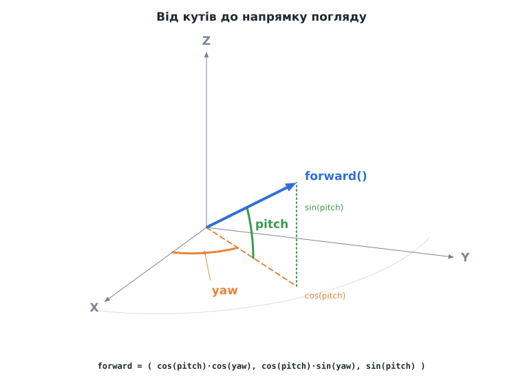

# Урок 4. Вільна камера: миша і клавіатура

> **Результат уроку:** ми літаємо над полем із кубів, як у режимі «спостерігача» в Minecraft. Миша повертає погляд, **W A S D** рухають камеру, **Space / Shift** піднімають і опускають, **Ctrl** прискорює, **Esc** закриває гру.

📦 **Код уроку:** [завантажити code.zip](code.zip). Розпакуйте архів і запустіть `love code`.


<iframe class="lesson-demo" src="demo/index.html?poster=../images/fly.gif" title="Демо: політ над полем" loading="lazy" tabindex="-1"></iframe>

## Мета уроку

* Описати орієнтацію камери двома кутами: **yaw** (поворот) і **pitch** (нахил).
* Перетворити кути на **вектор напрямку** за допомогою тригонометрії.
* Зчитувати мишу у **відносному режимі** і клавіатуру без прив'язки до частоти кадрів.
* Винести камеру в окремий модуль `src/render/camera.lua`.

---

## 1. Структура

```
04-camera/code/
├── conf.lua
├── main.lua               -- сцена, клавіатура, миша
└── src/
    ├── math/vec3.lua      -- без змін з уроку 3
    ├── math/mat4.lua      -- без змін з уроку 3
    └── render/camera.lua  -- НОВЕ: вільна камера
```

## 2. Два кути замість матриці

Можна було б зберігати напрямок погляду одразу вектором. Проте мишею ми керуємо **кутами**: рух ліворуч-праворуч змінює один кут, вгору-вниз змінює інший. Тому камера зберігає:

| Поле | Що означає | Діапазон |
|---|---|---|
| `yaw` | поворот навколо вертикальної осі Z, від осі +X проти годинникової стрілки | $0 \ldots 2\pi$ (по колу) |
| `pitch` | нахил угору (+) або вниз (−) | $-89^\circ \ldots +89^\circ$ |



Камера — ще один «клас» на метатаблицях (урок 3):

```lua
local Camera = {}
Camera.__index = Camera

local MAX_PITCH = math.rad(89)   -- не даємо дивитися рівно вгору чи вниз
local UP = Vec3.new(0, 0, 1)

function Camera.new(position, yaw, pitch, fov, near, far)
    local camera = setmetatable({
        position = position, yaw = yaw, pitch = 0,
        fov = fov, near = near, far = far,
    }, Camera)
    camera:rotate(0, pitch)      -- нахил задаємо через rotate, щоб спрацювало обмеження
    return camera
end

function Camera:rotate(deltaYaw, deltaPitch)
    self.yaw = (self.yaw + deltaYaw) % (2 * math.pi)
    self.pitch = math.max(-MAX_PITCH, math.min(MAX_PITCH, self.pitch + deltaPitch))
end
```

* `% (2 * math.pi)` тримає `yaw` у межах одного оберту. Без цього після кількох обертів кут ріс би до тисяч радіан, хоча напрямок той самий.
* `math.max(a, math.min(b, x))` — стандартний прийом, щоб «затиснути» (*clamp*) число `x` у межах `[a, b]`. Нахил не виходить за $\pm 89^\circ$. Чому саме так, показано в розділі 7.

Вектор напрямку отримуємо тригонометрією. Спочатку нахиляємо одиничний вектор на кут `pitch`: його «тінь» на землі має довжину $\cos(\text{pitch})$, а висота дорівнює $\sin(\text{pitch})$. Потім повертаємо тінь на кут `yaw`:

```lua
function Camera:forward()
    local cosPitch = math.cos(self.pitch)
    return Vec3.new(cosPitch * math.cos(self.yaw), cosPitch * math.sin(self.yaw), math.sin(self.pitch))
end
```

Довжина результату завжди дорівнює 1, бо

$$\cos^2(\text{pitch}) \cdot \big(\cos^2(\text{yaw}) + \sin^2(\text{yaw})\big) + \sin^2(\text{pitch}) = \cos^2(\text{pitch}) + \sin^2(\text{pitch}) = 1.$$

> **Радіани.** Тригонометричні функції Lua (`math.sin`, `math.cos`) працюють з **радіанами**: $180^\circ = \pi$. Для перетворень є `math.rad(градуси)` і `math.deg(радіани)`.

## 3. Рух камери

```lua
function Camera:move(dt, forward, right, up, speed)
    local rightDirection = Vec3.new(math.sin(self.yaw), -math.cos(self.yaw), 0)
    local velocity = self:forward() * forward + rightDirection * right + UP * up
    local length = velocity:length()
    if length > 0 then
        self.position = self.position + velocity * (speed * dt / length)
    end
end
```

* `forward`, `right`, `up` — числа `-1`, `0` або `1` з клавіатури.
* **«Вперед»** — уздовж погляду, тож, дивлячись униз, ми й летимо вниз (як спостерігач у Minecraft).
* **«Праворуч»** — вектор, перпендикулярний до `yaw`, **завжди горизонтальний**: кут `yaw − 90°` дає `(sin yaw, −cos yaw, 0)`.
* **«Вгору»** — завжди світова вісь Z, незалежно від того, куди ми дивимося.

### Чому ділимо на довжину


Якщо одночасно натиснути **W** і **D**, сума векторів має довжину $\sqrt{2} \approx 1.41$, і камера по діагоналі летить на 41 % швидше. Ділення на `length` (нормалізація) вирівнює швидкість у всіх напрямках.

### Матриця камери

Матриці з уроку 3 тепер живуть усередині камери: позиція, напрямок погляду й кут огляду — це все, що потрібно для `lookAlong` і `perspective`.

```lua
function Camera:viewProjection(aspect)
    local projection = Mat4.perspective(self.fov, aspect, self.near, self.far)
    return projection * Mat4.lookAlong(self.position, self:forward(), UP)
end
```

Порівняйте з уроком 3: там `eye` рахувалося з кута на колі, а напрямок був `-eye`. Тепер обидва значення беремо з камери.

## 4. Миша у відносному режимі

```lua
love.mouse.setRelativeMode(true)
```

У звичайному режимі курсор упирається в край екрана, і далі повертатися неможливо. **Відносний режим** (*relative mode*) ховає курсор і повідомляє лише **зміщення** `dx, dy`. Повертатися можна нескінченно.

```lua
function love.mousemoved(_, _, dx, dy)
    if love.mouse.getRelativeMode() then
        look.yaw = look.yaw - dx * MOUSE_SENSITIVITY
        look.pitch = look.pitch - dy * MOUSE_SENSITIVITY
    end
end
```

* Мишу праворуч (`dx > 0`) ми перетворюємо на поворот **праворуч**. У математиці кути ростуть проти годинникової стрілки, тому yaw **зменшується**.
* Екранна вісь Y спрямована вниз, тому мишу вгору (`dy < 0`) перетворюємо на **збільшення** pitch.
* Подія `mousemoved` може надійти кілька разів за кадр, тож зміщення **накопичуємо** в `look`, а застосовуємо один раз в `love.update`.

> **Чому мишу не множимо на `dt`?** Зміщення миші вже є «відстанню», а не «швидкістю». Якщо за кадр рука зсунула мишу на 10 пікселів, камера має повернутися на $10 \times \text{чутливість}$, а скільки часу тривав кадр, значення не має.

### Ввічливість до користувача

```lua
function love.focus(focused)
    if not focused then
        love.mouse.setRelativeMode(false)   -- Alt+Tab — і миша знову вільна
    end
end

function love.mousepressed()
    love.mouse.setRelativeMode(true)        -- клік у вікно — знову керуємо камерою
end
```

Гра, яка «не відпускає» мишу після перемикання вікон, дуже дратує.

## 5. Клавіатура: допоміжна функція `axis`

```lua
local MOVE_SPEED = 8                -- блоків за секунду
local FAST_MULTIPLIER = 3
local MOUSE_SENSITIVITY = 0.0025    -- радіан на піксель руху миші

local look = { yaw = 0, pitch = 0 } -- рух миші, накопичений з минулого кадру

local function axis(positiveKey, negativeKey)
    return (love.keyboard.isDown(positiveKey) and 1 or 0) - (love.keyboard.isDown(negativeKey) and 1 or 0)
end

function love.update(dt)
    camera:rotate(look.yaw, look.pitch)   -- застосовуємо накопичений рух миші
    look.yaw, look.pitch = 0, 0

    local speed = MOVE_SPEED * (love.keyboard.isDown("lctrl") and FAST_MULTIPLIER or 1)
    camera:move(dt, axis("w", "s"), axis("d", "a"), axis("space", "lshift"), speed)
end
```

Конструкція `умова and A or B` у Lua працює як тернарний оператор `умова ? A : B`. Якщо одночасно натиснути **W** і **S**, вони взаємно знищуються і дають `0`. Так само **Ctrl** утричі збільшує швидкість.

## 6. Сцена: поле з кубів

`buildScene` додає до одного масиву вершин 256 кубів трави і кілька кам'яних стовпів. Кожна грань має **яскравість** (`shade`): верх найсвітліший, боки темніші, низ найтемніший. Так ми без жодного розрахунку освітлення імітуємо сонце згори, і куби вже не зливаються в одну пляму.

```lua
local FACES = {
    { shade = 0.8, corners = { { 1, 0, 0 }, { 1, 1, 0 }, { 1, 1, 1 }, { 1, 0, 1 } } }, -- +X
    { shade = 0.8, corners = { { 0, 1, 0 }, { 0, 0, 0 }, { 0, 0, 1 }, { 0, 1, 1 } } }, -- -X
    { shade = 0.65, corners = { { 1, 1, 0 }, { 0, 1, 0 }, { 0, 1, 1 }, { 1, 1, 1 } } }, -- +Y
    { shade = 0.65, corners = { { 0, 0, 0 }, { 1, 0, 0 }, { 1, 0, 1 }, { 0, 0, 1 } } }, -- -Y
    { shade = 1.0, corners = { { 0, 0, 1 }, { 1, 0, 1 }, { 1, 1, 1 }, { 0, 1, 1 } } }, -- +Z, верх
    { shade = 0.5, corners = { { 0, 1, 0 }, { 1, 1, 0 }, { 1, 0, 0 }, { 0, 0, 0 } } }, -- -Z, низ
}

local GRASS = { 0.37, 0.62, 0.21 }
local STONE = { 0.49, 0.49, 0.49 }
```

Кути ті самі, що в уроці 3, лише замість кольору грані тепер її яскравість. Колір дає блок, а яскравість грані його затемнює:

```lua
--- Додає до vertices усі 6 граней куба з мінімальним кутом (x, y, z).
local function addCube(vertices, x, y, z, color)
    for _, face in ipairs(FACES) do
        for _, cornerIndex in ipairs(QUAD_ORDER) do
            local corner = face.corners[cornerIndex]
            vertices[#vertices + 1] = {
                x + corner[1], y + corner[2], z + corner[3],     -- зсуваємо куб у (x, y, z)
                color[1] * face.shade, color[2] * face.shade, color[3] * face.shade, 1,
            }
        end
    end
end

local function buildScene()
    local vertices = {}
    for x = 0, 15 do
        for y = 0, 15 do
            addCube(vertices, x, y, 0, GRASS)
            if x % 5 == 2 and y % 5 == 2 then              -- кожна п'ята клітинка
                for z = 1, 1 + (x + y) % 4 do              -- стовп висотою 1..4
                    addCube(vertices, x, y, z, STONE)
                end
            end
        end
    end
    return love.graphics.newMesh(VERTEX_FORMAT, vertices, "triangles", "static")
end
```

Усі куби лежать в **одній** сітці: відеокарта малює все поле одним викликом. На відміну від уроку 3, куби не центруємо: куб з кутом $(x, y, z)$ займає рівно клітинку $[x, x+1] \times [y, y+1] \times [z, z+1]$. Цією домовленістю ми користуватимемося для блоків до кінця курсу.

Залишилося створити камеру й малювати сцену через її матрицю:

```lua
function love.load()
    love.graphics.setBackgroundColor(0.53, 0.75, 0.95)
    shader = love.graphics.newShader(VERTEX_SHADER)
    scene = buildScene()
    -- позиція, yaw 45°, pitch −25° (трохи вниз), кут огляду 70°, near, far
    camera = Camera.new(Vec3.new(-4, -4, 6), math.rad(45), math.rad(-25), math.rad(70), 0.05, 1000)
    love.mouse.setRelativeMode(true)
end

function love.draw()
    local width, height = love.graphics.getDimensions()
    love.graphics.push("all")
    love.graphics.setShader(shader)
    shader:send("viewProjection", "row", camera:viewProjection(width / height))
    love.graphics.setDepthMode("lequal", true)
    love.graphics.draw(scene)
    love.graphics.pop()

    local p = camera.position
    love.graphics.print(("position (%.1f, %.1f, %.1f)   yaw %d   pitch %d"):format(
        p.x, p.y, p.z, math.deg(camera.yaw), math.deg(camera.pitch)), 10, 10)
end
```

Повний код: [`code/main.lua`](code/main.lua), [`code/src/render/camera.lua`](code/src/render/camera.lua).

## 7. ⚠️ Типова помилка: камера «перекидається»

Обмеження нахилу легко вважати зайвим і прибрати:

```lua
self.pitch = self.pitch + deltaPitch   -- НЕПРАВИЛЬНО: без обмеження
```


Коли нахил переходить через −90°, `cos(pitch)` стає від'ємним і вектор погляду «перевертається» назад. `lookAlong` при цьому досі вважає, що «вгору» — це +Z, тому світ на екрані **перевертається догори дриґом**, а рух миші вгору-вниз починає працювати навпаки. Точно на ±90° напрямок погляду паралельний до `up`, векторний добуток дорівнює нулю, і матриця виду руйнується повністю.

Саме тому `Camera:rotate` (розділ 2) обмежує нахил трохи менше ніж 90°:

```lua
self.pitch = math.max(-MAX_PITCH, math.min(MAX_PITCH, self.pitch + deltaPitch))   -- MAX_PITCH = 89°
```

## Підсумок

* Орієнтацію камери зберігаємо двома кутами, **yaw** і **pitch**, а напрямок обчислюємо через `sin` і `cos`.
* Вектор руху **нормалізуємо**, щоб по діагоналі не літати швидше.
* Миша працює у **відносному режимі**; при втраті фокусу її відпускаємо.
* Нахил **обмежуємо ±89°**.

## Запитання для самоперевірки

1. Чому вектор «праворуч» не залежить від `pitch`?
2. Що зміниться, якщо в `Camera:move` замість `self:forward()` використати горизонтальний вектор `(cos yaw, sin yaw, 0)`? Як тоді поводитиметься камера, коли ми дивимося вниз і тиснемо **W**?
3. Додайте клавішу, яка повертає камеру в початкову позицію.

**Далі:** [Урок 5. Текстури та UV-координати](../05-textures/README.md)
