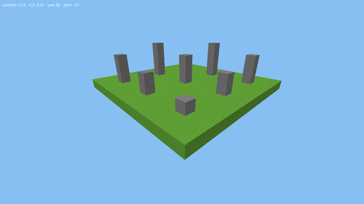
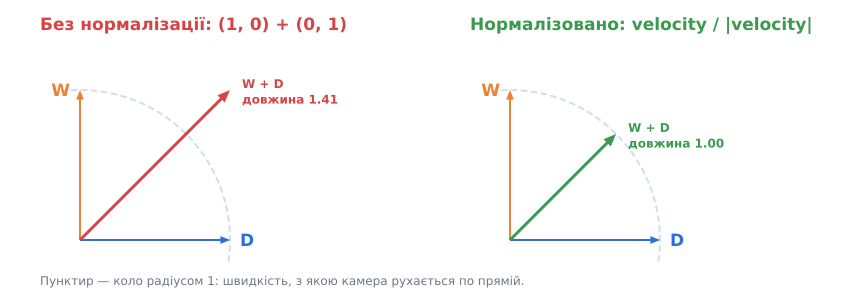
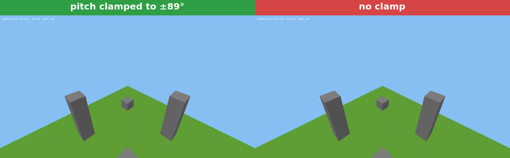

# Урок 4. Вільна камера: миша і клавіатура

> **Результат уроку:** ми літаємо над полем із кубів, як у режимі «спостерігача» в Minecraft. Миша повертає погляд, **W A S D** рухають камеру, **Space / Shift** піднімають і опускають, **Ctrl** прискорює, **Esc** закриває гру.

📦 **Код уроку:** [завантажити code.zip](code.zip). Розпакуйте архів і запустіть `love code`.



## Мета уроку

* Описати орієнтацію камери двома кутами: **yaw** (поворот) і **pitch** (нахил).
* Перетворити кути на **вектор напрямку** за допомогою тригонометрії.
* Зчитувати мишу у **відносному режимі** і клавіатуру без прив'язки до частоти кадрів.
* Винести камеру в окремий модуль `src/render/camera.lua`.

---

## 1. Структура

```
04-camera/code/
├── conf.lua
├── main.lua               -- сцена, клавіатура, миша
└── src/
    ├── math/vec3.lua      -- без змін з уроку 3
    ├── math/mat4.lua      -- без змін з уроку 3
    └── render/camera.lua  -- НОВЕ: вільна камера
```

## 2. Два кути замість матриці

Можна було б зберігати напрямок погляду одразу вектором. Проте мишею ми керуємо **кутами**: рух ліворуч-праворуч змінює один кут, вгору-вниз змінює інший. Тому камера зберігає:

| Поле | Що означає | Діапазон |
|---|---|---|
| `yaw` | поворот навколо вертикальної осі Z, від осі +X проти годинникової стрілки | `0 .. 2π` (по колу) |
| `pitch` | нахил угору (+) або вниз (−) | `−89° .. +89°` |


Вектор напрямку отримуємо тригонометрією. Спочатку нахиляємо одиничний вектор на кут `pitch`: його «тінь» на землі має довжину `cos(pitch)`, а висота дорівнює `sin(pitch)`. Потім повертаємо тінь на кут `yaw`:

```lua
function Camera:forward()
    local cosPitch = math.cos(self.pitch)
    return Vec3.new(cosPitch * math.cos(self.yaw), cosPitch * math.sin(self.yaw), math.sin(self.pitch))
end
```

Довжина результату завжди дорівнює 1, бо `cos²·(cos² + sin²) + sin² = 1`.

> **Радіани.** Тригонометричні функції Lua (`math.sin`, `math.cos`) працюють з **радіанами**: `180° = π`. Для перетворень є `math.rad(градуси)` і `math.deg(радіани)`.

## 3. Рух камери

```lua
function Camera:move(dt, forward, right, up, speed)
    local rightDirection = Vec3.new(math.sin(self.yaw), -math.cos(self.yaw), 0)
    local velocity = self:forward() * forward + rightDirection * right + UP * up
    local length = velocity:length()
    if length > 0 then
        self.position = self.position + velocity * (speed * dt / length)
    end
end
```

* `forward`, `right`, `up` — числа `-1`, `0` або `1` з клавіатури.
* **«Вперед»** — уздовж погляду, тож, дивлячись униз, ми й летимо вниз (як спостерігач у Minecraft).
* **«Праворуч»** — вектор, перпендикулярний до `yaw`, **завжди горизонтальний**: кут `yaw − 90°` дає `(sin yaw, −cos yaw, 0)`.
* **«Вгору»** — завжди світова вісь Z, незалежно від того, куди ми дивимося.

### Чому ділимо на довжину



Якщо одночасно натиснути **W** і **D**, сума векторів має довжину `√2 ≈ 1.41`, і камера по діагоналі летить на 41 % швидше. Ділення на `length` (нормалізація) вирівнює швидкість у всіх напрямках.

## 4. Миша у відносному режимі

```lua
love.mouse.setRelativeMode(true)
```

У звичайному режимі курсор упирається в край екрана, і далі повертатися неможливо. **Відносний режим** (*relative mode*) ховає курсор і повідомляє лише **зміщення** `dx, dy`. Повертатися можна нескінченно.

```lua
function love.mousemoved(_, _, dx, dy)
    if love.mouse.getRelativeMode() then
        look.yaw = look.yaw - dx * MOUSE_SENSITIVITY
        look.pitch = look.pitch - dy * MOUSE_SENSITIVITY
    end
end
```

* Мишу праворуч (`dx > 0`) ми перетворюємо на поворот **праворуч**. У математиці кути ростуть проти годинникової стрілки, тому yaw **зменшується**.
* Екранна вісь Y спрямована вниз, тому мишу вгору (`dy < 0`) перетворюємо на **збільшення** pitch.
* Подія `mousemoved` може надійти кілька разів за кадр, тож зміщення **накопичуємо** в `look`, а застосовуємо один раз в `love.update`.

> **Чому мишу не множимо на `dt`?** Зміщення миші вже є «відстанню», а не «швидкістю». Якщо за кадр рука зсунула мишу на 10 пікселів, камера має повернутися на `10 × чутливість`, а скільки часу тривав кадр, значення не має.

### Ввічливість до користувача

```lua
function love.focus(focused)
    if not focused then
        love.mouse.setRelativeMode(false)   -- Alt+Tab — і миша знову вільна
    end
end

function love.mousepressed()
    love.mouse.setRelativeMode(true)        -- клік у вікно — знову керуємо камерою
end
```

Гра, яка «не відпускає» мишу після перемикання вікон, дуже дратує.

## 5. Клавіатура: допоміжна функція `axis`

```lua
local function axis(positiveKey, negativeKey)
    return (love.keyboard.isDown(positiveKey) and 1 or 0) - (love.keyboard.isDown(negativeKey) and 1 or 0)
end

camera:move(dt, axis("w", "s"), axis("d", "a"), axis("space", "lshift"), speed)
```

Конструкція `умова and A or B` у Lua працює як тернарний оператор `умова ? A : B`. Якщо одночасно натиснути **W** і **S**, вони взаємно знищуються і дають `0`.

## 6. Сцена: поле з кубів

`buildScene` додає до одного масиву вершин 256 кубів трави і кілька кам'яних стовпів. Кожна грань має **яскравість** (`shade`): верх найсвітліший, боки темніші, низ найтемніший. Так ми без жодного розрахунку освітлення імітуємо сонце згори, і куби вже не зливаються в одну пляму.

```lua
local FACES = {
    { shade = 0.8, corners = { ... } }, -- +X
    ...
    { shade = 1.0, corners = { ... } }, -- +Z, верх
    { shade = 0.5, corners = { ... } }, -- -Z, низ
}
```

Повний код: [`code/main.lua`](code/main.lua), [`code/src/render/camera.lua`](code/src/render/camera.lua).

## 7. ⚠️ Типова помилка: камера «перекидається»

Обмеження нахилу легко вважати зайвим і прибрати:

```lua
self.pitch = self.pitch + deltaPitch   -- НЕПРАВИЛЬНО: без обмеження
```



Коли нахил переходить через −90°, `cos(pitch)` стає від'ємним і вектор погляду «перевертається» назад. `lookAlong` при цьому досі вважає, що «вгору» — це +Z, тому світ на екрані **перевертається догори дриґом**, а рух миші вгору-вниз починає працювати навпаки. Точно на ±90° напрямок погляду паралельний до `up`, векторний добуток дорівнює нулю, і матриця виду руйнується повністю.

Виправлення — обмежити нахил трохи менше ніж 90°:

```lua
local MAX_PITCH = math.rad(89)
self.pitch = math.max(-MAX_PITCH, math.min(MAX_PITCH, self.pitch + deltaPitch))
```

`math.max(a, math.min(b, x))` — стандартний прийом, щоб «затиснути» (*clamp*) число `x` у межах `[a, b]`.

## Підсумок

* Орієнтацію камери зберігаємо двома кутами, **yaw** і **pitch**, а напрямок обчислюємо через `sin` і `cos`.
* Вектор руху **нормалізуємо**, щоб по діагоналі не літати швидше.
* Миша працює у **відносному режимі**; при втраті фокусу її відпускаємо.
* Нахил **обмежуємо ±89°**.

## Запитання для самоперевірки

1. Чому вектор «праворуч» не залежить від `pitch`?
2. Що зміниться, якщо в `Camera:move` замість `self:forward()` використати горизонтальний вектор `(cos yaw, sin yaw, 0)`? Як тоді поводитиметься камера, коли ми дивимося вниз і тиснемо **W**?
3. Додайте клавішу, яка повертає камеру в початкову позицію.

**Далі:** [Урок 5. Текстури та UV-координати](../05-textures/README.md)
