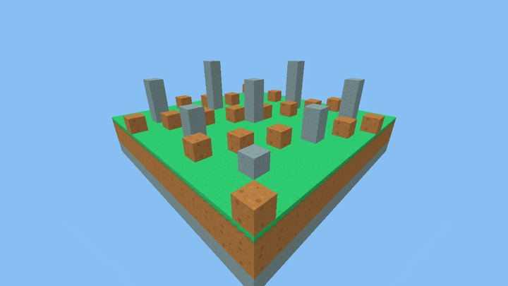
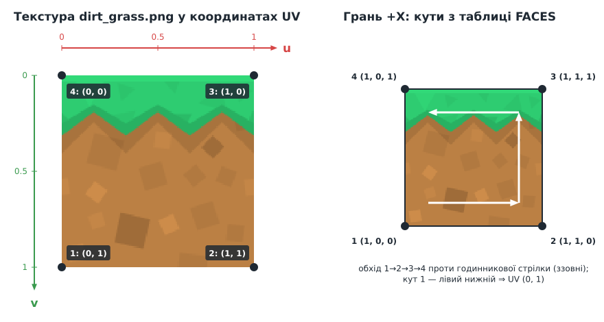
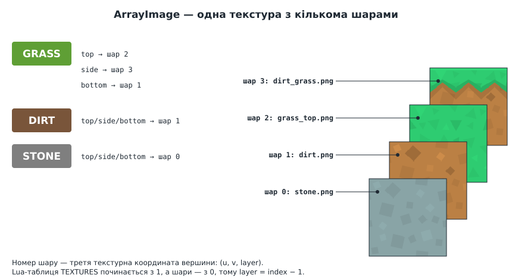
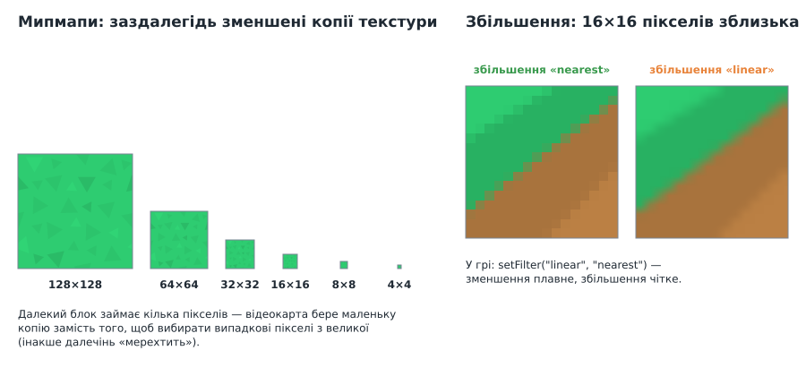
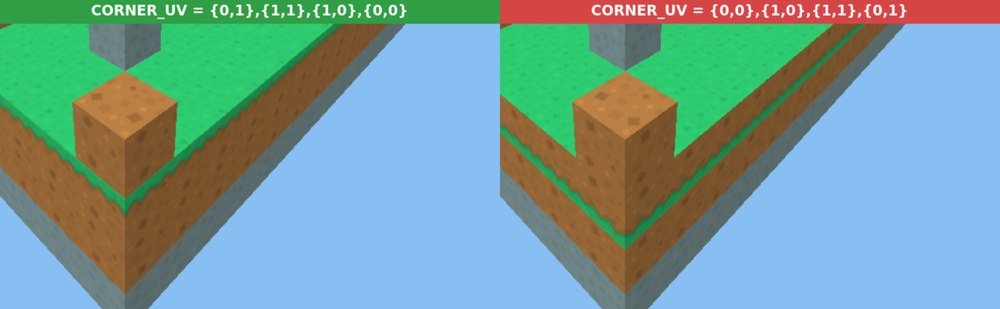
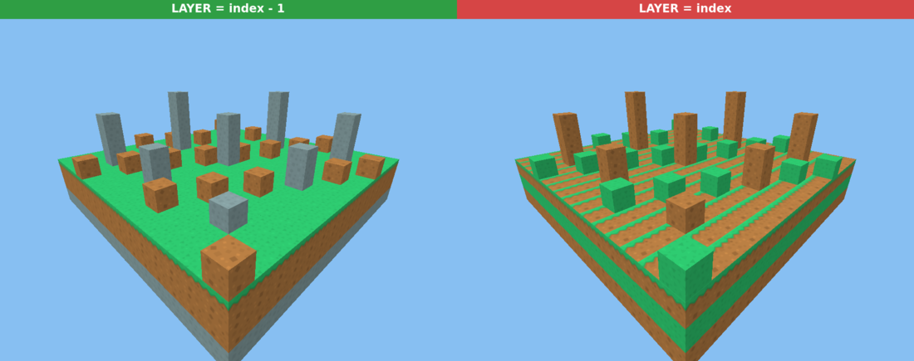

# Урок 5. Текстури та UV-координати

> **Результат уроку:** куби отримують справжні текстури: камінь, земля, трава. Блок трави має різні текстури зверху, збоку й знизу, як у Minecraft.

📦 **Код уроку:** [завантажити code.zip](code.zip). Розпакуйте архів і запустіть `love code`.



## Мета уроку

* Зрозуміти, що таке **текстурні (UV) координати** і як «натягнути» картинку на грань.
* Завантажити кілька зображень в **одну масивну текстуру** (*array texture*).
* Написати власний **піксельний шейдер**.
* Розібратися з **фільтрацією** та **мипмапами**.

| Компетентність стандарту 4113 | Що саме тренуємо |
|---|---|
| ПК 4: обробка растрових зображень | формат PNG, пікселі, масштабування, фільтри |
| ПК 6: обробка тривимірних зображень | застосування матеріалів і текстур до 3D-об'єктів |
| КК.1 Англ. термінологія | *texture, texel, UV mapping, mipmap, filtering, array texture* |

---

## 1. Ресурси

Текстури взято з безкоштовного набору [Kenney Voxel Pack](https://kenney.nl/assets/voxel-pack) з ліцензією **CC0** (суспільне надбання: можна використовувати будь-де без дозволу). Ліцензія лежить поруч: [`code/assets/textures/LICENSE-kenney.txt`](code/assets/textures/LICENSE-kenney.txt).

| Файл | Розмір | Де використовується |
|---|---|---|
| `stone.png` | 128×128 | камінь, усі грані |
| `dirt.png` | 128×128 | земля; низ блока трави |
| `grass_top.png` | 128×128 | верх блока трави |
| `dirt_grass.png` | 128×128 | боки блока трави |

> **Ліцензії важливі.** Ресурси з інтернету не можна брати «бо знайшлися в пошуку». Перевіряйте ліцензію: CC0 і CC-BY дозволяють вільне використання (CC-BY вимагає вказати автора), а без ліцензії використовувати чужу роботу не можна.

## 2. UV-координати

Щоб накласти зображення на грань, кожній вершині вказують, **яка точка зображення** їй відповідає. Ці координати традиційно позначають `u` (по горизонталі) і `v` (по вертикалі), і обидві змінюються від 0 до 1 незалежно від розміру картинки в пікселях.



> **Пастка:** у LÖVE (і загалом для зображень) `v = 0` — це **верхній** рядок пікселів, а `v = 1` — нижній. А в нашому 3D-світі Z спрямована вгору. Тому **нижній** кут грані отримує `v = 1`.

Кути кожної грані в таблиці `FACES` перелічено в однаковому порядку: **лівий нижній, правий нижній, правий верхній, лівий верхній**, якщо дивитися на грань ззовні. Тому всім граням підходить одна таблиця UV:

```lua
-- UV для кутів 1..4: лівий нижній, правий нижній, правий верхній, лівий верхній.
local CORNER_UV = { { 0, 1 }, { 1, 1 }, { 1, 0 }, { 0, 0 } }
```

Між вершинами відеокарта **інтерполює** UV для кожного пікселя (так само, як інтерполювала кольори в уроці 2) і бере з текстури відповідну точку. Таку точку текстури називають **текселем** (*texel*).

## 3. Масив текстур

Можна завантажити кожну картинку окремо (`love.graphics.newImage`), але тоді для кожного типу блока довелося б створювати окрему сітку й окремо її малювати. Кожен виклик малювання (*draw call*) коштує часу.

**Масив текстур** (`ArrayImage`) складає кілька однакових за розміром зображень у «стос» шарів. Одна сітка може використовувати будь-який шар: номер шару стає **третьою текстурною координатою**.



```lua
local TEXTURES = { "stone.png", "dirt.png", "grass_top.png", "dirt_grass.png" }
local LAYER = {}
for index, file in ipairs(TEXTURES) do
    LAYER[file] = index - 1          -- шари нумеруються з 0!
end

local GRASS = { top = "grass_top.png", side = "dirt_grass.png", bottom = "dirt.png" }
```

Формат вершини розширюється:

```lua
local VERTEX_FORMAT = {
    { "VertexPosition", "float", 3 },
    { "VertexTexCoord", "float", 3 },   -- u, v, шар
    { "VertexColor", "byte", 4 },       -- яскравість грані
}
```

> **Вимога:** усі шари масиву мусять мати **однаковий розмір** у пікселях. Якщо додати текстуру 64×64 до набору 128×128, LÖVE видасть помилку при завантаженні.

## 4. Піксельний шейдер

```glsl
uniform ArrayImage MainTex;

void effect() {
    love_PixelColor = Texel(MainTex, VaryingTexCoord.xyz) * VaryingColor;
}
```

* `MainTex` — текстура, яку ми призначили сітці через `mesh:setTexture(textures)`.
* `VaryingTexCoord.xyz` — інтерпольовані `(u, v, шар)` для поточного пікселя.
* `Texel(...)` читає колір з текстури. Множення на `VaryingColor` (яскравість грані) затемнює боки й низ.

Тепер `newShader` отримує обидва шейдери: `love.graphics.newShader(PIXEL_SHADER, VERTEX_SHADER)`.

## 5. Фільтрація і мипмапи



Текстура 128×128 рідко займає на екрані рівно 128×128 пікселів:

* **Зблизька** (збільшення) один тексель розтягується на багато пікселів. Фільтр `"nearest"` бере найближчий тексель, і край виходить чітким, «піксельним», як у Minecraft. Фільтр `"linear"` змішує сусідні текселі й дає розмиття.
* **Здалеку** (зменшення) на один піксель припадає багато текселів. Якщо брати лише один з них, далечінь неприємно «мерехтить» під час руху. **Мипмапи** (*mipmaps*) — заздалегідь підготовлені зменшені копії текстури (64, 32, 16, …). Відеокарта сама обирає копію потрібного розміру.

```lua
local image = love.graphics.newArrayImage(paths, { mipmaps = true })
image:setFilter("linear", "nearest")   -- (зменшення, збільшення)
image:setMipmapFilter("linear")        -- плавний перехід між копіями
```

## 6. Код уроку

Повний код: [`code/main.lua`](code/main.lua). Камера та математика без змін з уроку 4.

Головна зміна — функція `addCube`, яка для кожної грані знаходить шар текстури блока й додає до кожної вершини UV:

```lua
local function addCube(vertices, x, y, z, block)
    for _, face in ipairs(FACES) do
        local layer = LAYER[block[face.texture]]      -- "top" / "side" / "bottom" → файл → шар
        for _, cornerIndex in ipairs(QUAD_ORDER) do
            local corner, uv = face.corners[cornerIndex], CORNER_UV[cornerIndex]
            vertices[#vertices + 1] = {
                x + corner[1], y + corner[2], z + corner[3],
                uv[1], uv[2], layer,
                face.shade, face.shade, face.shade, 1,
            }
        end
    end
end
```

Сцена — острівець 16×16: знизу шар каменю, над ним земля, згори трава, кілька кам'яних стовпів і земляних горбиків.

## 7. ⚠️ Типові помилки

### Помилка 1: перевернуті UV

Легко забути, що `v = 0` — це верх картинки, і записати UV «як у математиці»:

```lua
local CORNER_UV = { { 0, 0 }, { 1, 0 }, { 1, 1 }, { 0, 1 } }   -- НЕПРАВИЛЬНО
```



Трава на боках блоків опинилася **внизу**, під землею. На каменю чи землі цю помилку майже не видно, бо їхні текстури симетричні. Тому для перевірки UV завжди беріть **несиметричну** текстуру, наприклад бік блока трави.

Інші варіанти тієї ж помилки:

| Помилка в UV | Що видно |
|---|---|
| переплутано `u` і `v` | трава росте «вбік», уздовж вертикального краю |
| порядок кутів у `FACES` різний для різних граней | на одних гранях текстура правильна, на інших повернута |
| UV більші за 1 | текстура повторюється кілька разів на грані (іноді це навмисний ефект) |

### Помилка 2: номер шару «з одиниці»

Масиви в Lua починаються з 1, а шари текстури з 0. Якщо забути відняти одиницю:

```lua
LAYER[file] = index   -- НЕПРАВИЛЬНО
```



Кожен блок бере **сусідню** текстуру: камінь стає землею, земля — травою, верх трави — боковою текстурою. Шару 4 для `dirt_grass.png` не існує, тому відеокарта бере найближчий наявний шар, і помилка не призводить до збою, а лише тихо псує картинку. Саме такі «тихі» помилки найнебезпечніші.

## Підсумок

* UV-координати пов'язують вершину з точкою текстури; `v = 0` — **верх** зображення.
* Масив текстур дозволяє намалювати блоки різних типів однією сіткою: шар стає третьою координатою.
* Піксельний шейдер читає тексель через `Texel` і множить на колір вершини.
* `"nearest"` дає чіткі пікселі зблизька, мипмапи прибирають мерехтіння здалеку.

## Запитання для самоперевірки

1. Які UV треба задати кутам, щоб на грань лягла лише **ліва половина** текстури?
2. Додайте новий тип блока «бруківка» з власною текстурою (128×128). Які таблиці доведеться змінити?
3. Встановіть фільтр `setFilter("nearest", "nearest")` і вимкніть мипмапи. Відлетіть далеко й порівняйте, як поводиться трава вдалині.

**Далі:** [Урок 6. Світ із блоків](../06-world/README.md)
