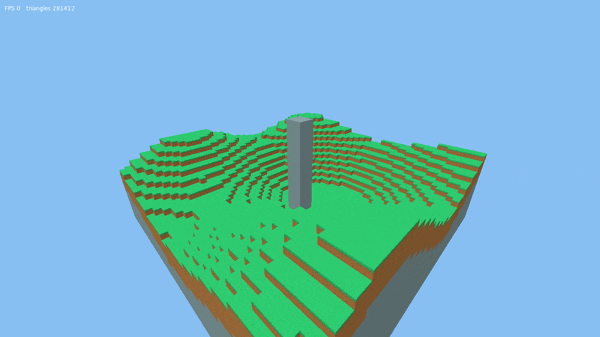
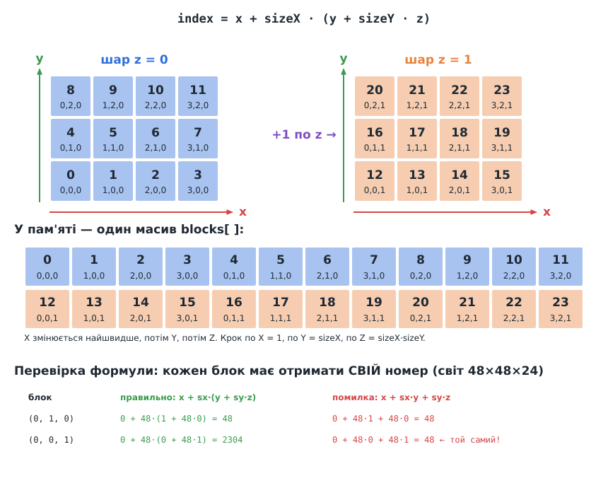
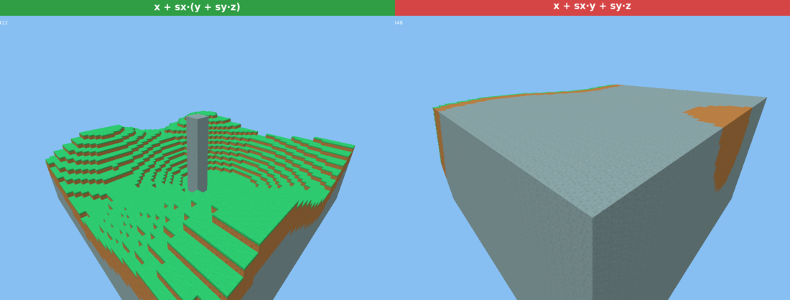

# Урок 6. Світ із блоків

> **Результат уроку:** горбистий острів 48×48×24 блоки з каменю, землі й трави та високий кам'яний стовп. Світ зберігається як **тривимірна сітка**, а сітку трикутників для нього будує окремий модуль. Над світом можна літати.

📦 **Код уроку:** [завантажити code.zip](code.zip). Розпакуйте архів і запустіть `love code`.



## Мета уроку

* Зберігати світ у **плоскому масиві** й навчитися перетворювати координати `(x, y, z)` на індекс.
* Створити **реєстр типів блоків**, щоб нові блоки додавалися без змін у решті коду.
* Розкласти код за **відповідальністю**: дані світу окремо, побудова сітки окремо, малювання окремо.
* Побачити, скільки трикутників дає наївний підхід, щоб у наступному уроці оптимізувати.

---

## 1. Нова структура проєкту

Тепер `main.lua` лише «склеює» модулі, а кожен модуль відповідає за одну річ:

```
06-world/code/
├── main.lua                 -- камера, керування, склеювання
├── assets/textures/         -- текстури (без змін)
└── src/
    ├── math/
    │   ├── vec3.lua
    │   ├── mat4.lua
    │   └── extent3.lua      -- НОВЕ: розмір сітки, індексація
    ├── world/
    │   ├── blocks.lua       -- НОВЕ: реєстр типів блоків
    │   ├── world.lua        -- НОВЕ: сітка блоків
    │   └── generate.lua     -- НОВЕ (тимчасове): генератор острова
    └── render/
        ├── camera.lua
        ├── mesher.lua       -- НОВЕ: світ → вершини
        └── renderer.lua     -- НОВЕ: шейдер, текстури, малювання
```

```
           ┌────────────┐      ┌────────────┐      ┌─────────────┐
 generate ─▶   World    │ ───▶ │   Mesher   │ ───▶ │  Renderer   │──▶ екран
           │ (дані)     │      │ (вершини)  │      │ (відеокарта)│
           └────────────┘      └────────────┘      └─────────────┘
```

`World` нічого не знає про відеокарту, а `Mesher` нічого не знає про шейдери. Завдяки цьому в уроці 8 ми замінимо генератор на завантаження з файлу і не змінимо при цьому жодного рядка в рендерері.

## 2. Як зберігати тривимірний світ

Найпростіше рішення — вкладені таблиці `blocks[x][y][z]`. Воно працює, але кожна вкладена таблиця в Lua займає окремий шматок пам'яті, і доступ до блока перетворюється на три пошуки поспіль.

Ми зберігаємо світ у **одному плоскому масиві** і рахуємо номер блока за формулою:



```lua
function Extent3:index(cell)
    return cell.x + self.x * (cell.y + self.y * cell.z)
end
```

Це схоже на запис числа в позиційній системі числення. У числі `472` цифра сотень важить 100, десятків 10, одиниць 1. Тут «цифра» $x$ важить 1, $y$ важить $\text{sizeX}$, а $z$ важить $\text{sizeX} \cdot \text{sizeY}$. Обернене перетворення (`Extent3:cell`) розкладає число назад на «цифри» діленням з остачею.

> **0 чи 1?** Координати блоків починаються з **0**, як у файлах `.vox`, а масиви Lua з **1**. Тому `World` звертається до `self.blocks[self.size:index(block) + 1]`. Це «+1» з'являється рівно в одному місці, і так має бути.

### `Extent3`: розмір сітки

`Extent3` зберігає розміри `x, y, z` і вміє:

| Метод | Що робить |
|---|---|
| `volume()` | загальна кількість клітинок |
| `contains(cell)` | чи лежить клітинка всередині |
| `index(cell)` / `cell(index)` | координати ↔ номер |

### `World`: сітка блоків

```lua
function World:get(block)
    if not self.size:contains(block) then
        return AIR                    -- поза світом завжди повітря
    end
    return self.blocks[self.size:index(block) + 1]
end
```

Правило «поза межами завжди повітря» позбавляє решту коду від перевірок меж. Мешер може запитувати сусіда будь-якого блока, навіть на краю світу.

## 3. Реєстр блоків

```lua
Blocks.AIR = 0
Blocks.STONE = 1
Blocks.DIRT = 2
Blocks.GRASS = 3

Blocks.defs = {
    [Blocks.STONE] = { name = "stone", top = "stone.png", side = "stone.png", bottom = "stone.png" },
    [Blocks.DIRT] = { name = "dirt", top = "dirt.png", side = "dirt.png", bottom = "dirt.png" },
    [Blocks.GRASS] = { name = "grass", top = "grass_top.png", side = "dirt_grass.png", bottom = "dirt.png" },
}
```

У світі зберігаються лише **маленькі числа** (ідентифікатори), а все інше про блок лежить у реєстрі. Список текстур `Blocks.TEXTURES` і номери шарів **будуються автоматично** з `defs`. Новий блок додається одним рядком у `defs`, без ручного підрахунку шарів (з цієї ручної роботи й виникала помилка уроку 5).

## 4. Генератор острова (тимчасовий)


Висоту поверхні в кожному стовпчику дає сума кількох синусоїд з різними періодами:

```lua
local h = 10 + 3 * math.sin(x / 6) + 3 * math.cos(y / 7) + 2 * math.sin((x + y) / 9)
```

У стовпчику верхній блок — трава, три під ним — земля, решта — камінь. Це **тимчасове** рішення: за умовами проєкту світ має завантажуватися з файлу, який можна редагувати сторонньою програмою. Цим займемося в уроці 8.

## 5. Мешер: наївна версія

Мешер обходить усі блоки світу і для кожного твердого додає **всі шість** граней:

```lua
for z = 0, world.size.z - 1 do
    for y = 0, world.size.y - 1 do
        for x = 0, world.size.x - 1 do
            local block = Vec3.new(x, y, z)
            local id = world:get(block)
            if id ~= Blocks.AIR then
                for _, face in ipairs(FACES) do
                    emitFace(vertices, block, face, Blocks.textureLayer(id, face.texture))
                end
            end
        end
    end
end
```

Таблицю `FACES` тепер записано через `Vec3`, і кожна грань має **нормаль** (`normal`), тобто напрямок, у який вона дивиться назовні. Поки що нормаль не використовується, але в наступному уроці саме за нею ми знайдемо сусіда за гранню.

Подивіться на лічильник у лівому верхньому куті вікна:

```
triangles 281412
```

**281 тисяча трикутників** для маленького острова. Але більшість граней притиснуті до сусідніх блоків, і їх ніколи не видно. Скільки саме, порахуємо в наступному уроці.

Повний код: [`code.zip`](code.zip). Запуск: `love .` з теки `code`.

## 6. ⚠️ Типова помилка: неправильна формула індексу

Формулу легко «спростити», розкривши дужки не до кінця:

```lua
return cell.x + self.x * cell.y + self.y * cell.z   -- НЕПРАВИЛЬНО
```



Тепер у блока `(0, 1, 0)` і блока `(0, 0, 1)` **однаковий номер 48**: обидва записуються в одну клітинку масиву (дивіться таблицю на схемі вище). Генератор пише стовпчики один за одним і постійно перезаписує вже збережені блоки. Коли мешер потім читає світ, для більшості позицій він отримує значення від інших блоків. Острів перетворюється на суцільну кам'яну цеглину, а кількість трикутників зростає до 624 тисяч.

Програма при цьому **не падає й не видає жодних повідомлень**. Такі помилки найкраще ловлять **автоматичні тести**: один тест, який перевіряє, що `cell(index(c)) == c` для всіх клітинок, знайшов би її за мілісекунду. Про це йдеться в [уроці 11](../11-testing/README.md).

## Підсумок

* Світ — це плоский масив ідентифікаторів; номер блока $x + s_x \cdot (y + s_y \cdot z)$.
* Усе про тип блока зберігається в **реєстрі**, а світ містить лише числа.
* Код розділено на дані (`World`), побудову вершин (`Mesher`) і малювання (`Renderer`).
* Наївний мешер дає сотні тисяч трикутників, і більшість із них зайві.

## Запитання для самоперевірки

1. Скільки байтів займе світ 256×256×256, якщо кожен блок зберігати одним байтом? А якщо таблицею Lua `{ id = 1 }`?
2. Яким буде індекс блока `(5, 2, 3)` у світі 48×48×24? Перевірте відповідь через `Extent3:cell`.
3. Змініть генератор так, щоб на висоті нижче 7 замість трави була «вода» з каменю (рівний шар на $z = 6$).

**Далі:** [Урок 7. Оптимізація: приховані грані та чанки](../07-culling-chunks/README.md)
