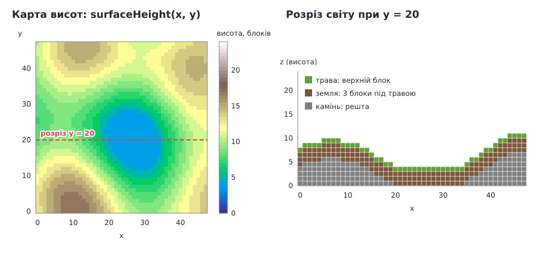

# Урок 6. Світ із блоків

> **Результат уроку:** горбистий острів 48×48×24 блоки з каменю, землі й трави та високий кам'яний стовп. Світ зберігається як **тривимірна сітка**, а сітку трикутників для нього будує окремий модуль. Над світом можна літати.

📦 **Код уроку:** [завантажити code.zip](code.zip). Розпакуйте архів і запустіть `love code`.


<iframe class="lesson-demo" src="demo/index.html?poster=../images/world.gif" title="Демо: політ над островом" loading="lazy" tabindex="-1"></iframe>

## Мета уроку

* Зберігати світ у **плоскому масиві** й навчитися перетворювати координати `(x, y, z)` на індекс.
* Створити **реєстр типів блоків**, щоб нові блоки додавалися без змін у решті коду.
* Розкласти код за **відповідальністю**: дані світу окремо, побудова сітки окремо, малювання окремо.
* Побачити, скільки трикутників дає наївний підхід, щоб у наступному уроці оптимізувати.

---

## 1. Нова структура проєкту

Тепер `main.lua` лише «склеює» модулі, а кожен модуль відповідає за одну річ:

```
06-world/code/
├── main.lua                 -- камера, керування, склеювання
├── assets/textures/         -- текстури (без змін)
└── src/
    ├── math/
    │   ├── vec3.lua
    │   ├── mat4.lua
    │   └── extent3.lua      -- НОВЕ: розмір сітки, індексація
    ├── world/
    │   ├── blocks.lua       -- НОВЕ: реєстр типів блоків
    │   ├── world.lua        -- НОВЕ: сітка блоків
    │   └── generate.lua     -- НОВЕ (тимчасове): генератор острова
    └── render/
        ├── camera.lua
        ├── mesher.lua       -- НОВЕ: світ → вершини
        └── renderer.lua     -- НОВЕ: шейдер, текстури, малювання
```

```
           ┌────────────┐      ┌────────────┐      ┌─────────────┐
 generate ─▶   World    │ ───▶ │   Mesher   │ ───▶ │  Renderer   │──▶ екран
           │ (дані)     │      │ (вершини)  │      │ (відеокарта)│
           └────────────┘      └────────────┘      └─────────────┘
```

`World` нічого не знає про відеокарту, а `Mesher` нічого не знає про шейдери. Завдяки цьому в уроці 8 ми замінимо генератор на завантаження з файлу і не змінимо при цьому жодного рядка в рендерері.

## 2. Як зберігати тривимірний світ

Найпростіше рішення — вкладені таблиці `blocks[x][y][z]`. Воно працює, але кожна вкладена таблиця в Lua займає окремий шматок пам'яті, і доступ до блока перетворюється на три пошуки поспіль.

Ми зберігаємо світ у **одному плоскому масиві** і рахуємо номер блока за формулою:


```lua
function Extent3:index(cell)
    return cell.x + self.x * (cell.y + self.y * cell.z)
end
```

Це схоже на запис числа в позиційній системі числення. У числі `472` цифра сотень важить 100, десятків 10, одиниць 1. Тут «цифра» $x$ важить 1, $y$ важить $\text{sizeX}$, а $z$ важить $\text{sizeX} \cdot \text{sizeY}$. Обернене перетворення (`Extent3:cell`) розкладає число назад на «цифри» діленням з остачею.

> **0 чи 1?** Координати блоків починаються з **0**, як у файлах `.vox`, а масиви Lua з **1**. Тому `World` звертається до `self.blocks[self.size:index(block) + 1]`. Це «+1» з'являється рівно в одному місці, і так має бути.

### `Extent3`: розмір сітки

`Extent3` зберігає розміри `x, y, z` і вміє:

| Метод | Що робить |
|---|---|
| `volume()` | загальна кількість клітинок |
| `contains(cell)` | чи лежить клітинка всередині |
| `index(cell)` / `cell(index)` | координати ↔ номер |

```lua
local Extent3 = {}
Extent3.__index = Extent3

function Extent3.new(x, y, z)
    return setmetatable({ x = x, y = y, z = z }, Extent3)
end

function Extent3.__tostring(a)           -- tostring(size) → "48x48x24"
    return ("%dx%dx%d"):format(a.x, a.y, a.z)
end

function Extent3:volume()
    return self.x * self.y * self.z
end

function Extent3:contains(cell)
    return cell.x >= 0 and cell.y >= 0 and cell.z >= 0
        and cell.x < self.x and cell.y < self.y and cell.z < self.z
end

function Extent3:cell(index)             -- обернена до index
    return Vec3.new(index % self.x, math.floor(index / self.x) % self.y, math.floor(index / (self.x * self.y)))
end
```

`cell` розкладає номер на «цифри», як число $472$ на $4$, $7$, $2$. Остача від ділення на `x` дає $x$. Ціла частина від ділення на `x` «відкидає» цю цифру, і остача від наступного ділення на `y` дає $y$. Те, що лишилося після ділення на $x \cdot y$, — це $z$. Перевірка на світі $48 \times 48 \times 24$: номер $2 + 48 \cdot (1 + 48 \cdot 3) = 6962$ дає $6962 \bmod 48 = 2$, $\lfloor 6962 / 48 \rfloor \bmod 48 = 145 \bmod 48 = 1$, $\lfloor 6962 / 2304 \rfloor = 3$, тобто $(2, 1, 3)$.

`Extent3` — це не `Vec3`: у нього інші методи й інший зміст («розмір», а не «точка»). Окремий клас не дає випадково передати розмір туди, де очікують позицію.

### `World`: сітка блоків

Новий світ заповнено повітрям:

```lua
local AIR = Blocks.AIR

function World.new(size)
    assert(size.x >= 1 and size.y >= 1 and size.z >= 1, "world dimensions must be positive")
    local blocks = {}
    for i = 1, size:volume() do
        blocks[i] = AIR
    end
    return setmetatable({ size = size, blocks = blocks }, World)
end
```

Читаємо блок так:

```lua
function World:get(block)
    if not self.size:contains(block) then
        return AIR                    -- поза світом завжди повітря
    end
    return self.blocks[self.size:index(block) + 1]
end
```

Правило «поза межами завжди повітря» позбавляє решту коду від перевірок меж. Мешер може запитувати сусіда будь-якого блока, навіть на краю світу.

Записуємо блок через `set`. Він мовчки ігнорує позиції поза світом і повертає `true`, лише якщо світ **справді змінився**:

```lua
function World:isSolid(block)
    return self:get(block) ~= AIR
end

function World:set(block, id)
    if not self.size:contains(block) then
        return false                  -- поза світом нічого не змінюється
    end
    local index = self.size:index(block) + 1
    if self.blocks[index] == id then
        return false                  -- такий блок там уже є
    end
    self.blocks[index] = id
    return true
end
```

Генератор цим значенням не користується. Воно знадобиться в уроці 9: якщо гравець клацнув, а світ не змінився, перебудовувати нічого не треба.

## 3. Реєстр блоків

```lua
Blocks.AIR = 0
Blocks.STONE = 1
Blocks.DIRT = 2
Blocks.GRASS = 3

Blocks.defs = {
    [Blocks.STONE] = { name = "stone", top = "stone.png", side = "stone.png", bottom = "stone.png" },
    [Blocks.DIRT] = { name = "dirt", top = "dirt.png", side = "dirt.png", bottom = "dirt.png" },
    [Blocks.GRASS] = { name = "grass", top = "grass_top.png", side = "dirt_grass.png", bottom = "dirt.png" },
}
```

У світі зберігаються лише **маленькі числа** (ідентифікатори), а все інше про блок лежить у реєстрі. Список текстур `Blocks.TEXTURES` і номери шарів **будуються автоматично** з `defs`. Новий блок додається одним рядком у `defs`, без ручного підрахунку шарів (з цієї ручної роботи й виникала помилка уроку 5):

```lua
Blocks.TEXTURES = {}         -- кожен файл один раз, у порядку шарів
local layerOfFile = {}       -- "dirt.png" → номер шару
for _, def in ipairs(Blocks.defs) do
    for _, face in ipairs({ "top", "side", "bottom" }) do
        local file = def[face]
        if not layerOfFile[file] then
            layerOfFile[file] = #Blocks.TEXTURES            -- шари з 0: номер = скільки вже є
            Blocks.TEXTURES[#Blocks.TEXTURES + 1] = file
        end
    end
end

function Blocks.textureLayer(id, face)        -- face: "top", "side" або "bottom"
    return layerOfFile[Blocks.defs[id][face]]
end
```

`dirt.png` трапляється у трьох місцях (земля, низ трави), але шар отримує лише один: перевірка `if not layerOfFile[file]` пропускає файли, які вже мають номер. `ipairs(Blocks.defs)` обходить блоки 1, 2, 3 по порядку, бо повітря (0) у `defs` немає.

## 4. Генератор острова (тимчасовий)



Висоту поверхні в кожному стовпчику дає сума кількох синусоїд з різними періодами:

```lua
local SIZE = Extent3.new(48, 48, 24)

local function surfaceHeight(x, y)
    local h = 10 + 3 * math.sin(x / 6) + 3 * math.cos(y / 7) + 2 * math.sin((x + y) / 9)
    return math.max(4, math.min(SIZE.z - 2, math.floor(h)))   -- clamp (урок 4) у межах світу
end
```

У стовпчику верхній блок — трава, три під ним — земля, решта — камінь:

```lua
function Generate.island()
    local world = World.new(SIZE)
    for x = 0, SIZE.x - 1 do
        for y = 0, SIZE.y - 1 do
            local height = surfaceHeight(x, y)
            for z = 0, height - 1 do
                local block = Blocks.STONE
                if z == height - 1 then
                    block = Blocks.GRASS
                elseif z >= height - 4 then
                    block = Blocks.DIRT
                end
                world:set(Vec3.new(x, y, z), block)
            end
        end
    end
    -- Кам'яний стовп 2x2 до самої стелі світу.
    for z = surfaceHeight(12, 12), SIZE.z - 1 do
        for dx = 0, 1 do
            for dy = 0, 1 do
                world:set(Vec3.new(12 + dx, 12 + dy, z), Blocks.STONE)
            end
        end
    end
    return world
end
```

Це **тимчасове** рішення: за умовами проєкту світ має завантажуватися з файлу, який можна редагувати сторонньою програмою. Цим займемося в уроці 8.

## 5. Мешер: наївна версія

Таблицю граней з уроку 5 переписано через `Vec3`, і кожна грань отримала **нормаль** (`normal`), тобто напрямок, у який вона дивиться назовні:

```lua
local FACES = {
    {
        normal = Vec3.new(1, 0, 0), texture = "side", shade = 0.8,
        corners = { Vec3.new(1, 0, 0), Vec3.new(1, 1, 0), Vec3.new(1, 1, 1), Vec3.new(1, 0, 1) },
    },
    {
        normal = Vec3.new(-1, 0, 0), texture = "side", shade = 0.8,
        corners = { Vec3.new(0, 1, 0), Vec3.new(0, 0, 0), Vec3.new(0, 0, 1), Vec3.new(0, 1, 1) },
    },
    {
        normal = Vec3.new(0, 1, 0), texture = "side", shade = 0.65,
        corners = { Vec3.new(1, 1, 0), Vec3.new(0, 1, 0), Vec3.new(0, 1, 1), Vec3.new(1, 1, 1) },
    },
    {
        normal = Vec3.new(0, -1, 0), texture = "side", shade = 0.65,
        corners = { Vec3.new(0, 0, 0), Vec3.new(1, 0, 0), Vec3.new(1, 0, 1), Vec3.new(0, 0, 1) },
    },
    {
        normal = Vec3.new(0, 0, 1), texture = "top", shade = 1.0,
        corners = { Vec3.new(0, 0, 1), Vec3.new(1, 0, 1), Vec3.new(1, 1, 1), Vec3.new(0, 1, 1) },
    },
    {
        normal = Vec3.new(0, 0, -1), texture = "bottom", shade = 0.5,
        corners = { Vec3.new(0, 1, 0), Vec3.new(1, 1, 0), Vec3.new(1, 0, 0), Vec3.new(0, 0, 0) },
    },
}
local CORNER_UV = { { 0, 1 }, { 1, 1 }, { 1, 0 }, { 0, 0 } }
local QUAD_ORDER = { 1, 2, 3, 1, 3, 4 }
```

Поки що нормаль не використовується, але в наступному уроці саме за нею ми знайдемо сусіда за гранню.

Тіло циклу з `addCube` уроку 5 стало окремою функцією `emitFace`, яка додає **одну** грань. Кути тепер `Vec3`, тому позицію вершини дає звичайне додавання векторів `block + corner`:

```lua
local function emitFace(vertices, block, face, layer)
    local shade = face.shade
    for _, cornerIndex in ipairs(QUAD_ORDER) do
        local position, uv = block + face.corners[cornerIndex], CORNER_UV[cornerIndex]
        vertices[#vertices + 1] = {
            position.x, position.y, position.z,
            uv[1], uv[2], layer,
            shade, shade, shade, 1,
        }
    end
end
```

Мешер обходить усі блоки світу і для кожного твердого додає **всі шість** граней:

```lua
function Mesher.buildWorld(world)
    local vertices = {}
    for z = 0, world.size.z - 1 do
        for y = 0, world.size.y - 1 do
            for x = 0, world.size.x - 1 do
                local block = Vec3.new(x, y, z)
                local id = world:get(block)
                if id ~= Blocks.AIR then
                    for _, face in ipairs(FACES) do
                        emitFace(vertices, block, face, Blocks.textureLayer(id, face.texture))
                    end
                end
            end
        end
    end
    return vertices
end
```

Мешер повертає звичайну таблицю вершин, а не сітку LÖVE. Тому він не залежить від відеокарти, і його можна перевірити без вікна (урок 11).

## 6. Рендерер

`Renderer` збирає разом усе, що стосується відеокарти: формат вершини, шейдери й масив текстур з уроку 5 (без змін) і сітку, побудовану мешером.

```lua
local Renderer = {}
Renderer.__index = Renderer

function Renderer.new(world, textureDir)
    local paths = {}
    for i, name in ipairs(Blocks.TEXTURES) do        -- список тепер дає реєстр блоків
        paths[i] = textureDir .. "/" .. name
    end
    local textures = love.graphics.newArrayImage(paths, { mipmaps = true })
    textures:setFilter("linear", "nearest")
    textures:setMipmapFilter("linear")

    local vertices = Mesher.buildWorld(world)
    local mesh = love.graphics.newMesh(VERTEX_FORMAT, vertices, "triangles", "static")
    mesh:setTexture(textures)

    return setmetatable({
        shader = love.graphics.newShader(PIXEL_SHADER, VERTEX_SHADER),
        textures = textures,
        mesh = mesh,
        triangleCount = #vertices / 3,               -- для лічильника на екрані
    }, Renderer)
end

function Renderer:draw(viewProjection)
    love.graphics.push("all")
    love.graphics.setShader(self.shader)
    self.shader:send("viewProjection", "row", viewProjection)
    love.graphics.setDepthMode("lequal", true)
    love.graphics.draw(self.mesh)
    love.graphics.pop()
end
```

`VERTEX_FORMAT`, `VERTEX_SHADER` і `PIXEL_SHADER` перенесено з `main.lua` уроку 5 без змін.

## 7. `main.lua`: склеюємо модулі

```lua
local world, renderer, camera

function love.load()
    love.graphics.setBackgroundColor(0.53, 0.75, 0.95)
    local started = love.timer.getTime()
    world = Generate.island()
    renderer = Renderer.new(world, "assets/textures")
    print(("world %s built in %.2f s"):format(tostring(world.size), love.timer.getTime() - started))

    -- Камера над одним кутом світу дивиться на його центр.
    local size = world.size
    local position = Vec3.new(-0.1 * size.x, -0.1 * size.y, size.z + 6)
    local yaw = math.atan2(size.y / 2 - position.y, size.x / 2 - position.x)
    camera = Camera.new(position, yaw, math.rad(-25), math.rad(70), 0.05, 1000)
    love.mouse.setRelativeMode(true)
end

function love.draw()
    local width, height = love.graphics.getDimensions()
    renderer:draw(camera:viewProjection(width / height))
    love.graphics.print(("FPS %d   triangles %d"):format(love.timer.getFPS(), renderer.triangleCount), 10, 10)
end
```

* `love.timer.getTime()` повертає час у секундах. Різниця двох значень показує, скільки тривала побудова світу. `print` виводить її в **консоль** (термінал, з якого запущено `love`), а не у вікно.
* `math.atan2(dy, dx)` — кут напрямку на точку $(dx, dy)$, тобто той самий `yaw` з уроку 4, але навпаки: від напрямку до кута. Так камера одразу дивиться на центр світу.
* Миша й клавіатура (`love.update`, `love.mousemoved` тощо) не змінилися з уроку 4.

Лічильник трикутників і час побудови з'явилися не для краси: у наступному уроці вони доведуть, що оптимізація спрацювала.

## 8. Скільки це трикутників

Подивіться на лічильник у лівому верхньому куті вікна:

```
triangles 281412
```

**281 тисяча трикутників** для маленького острова. Але більшість граней притиснуті до сусідніх блоків, і їх ніколи не видно. Скільки саме, порахуємо в наступному уроці.

Повний код: [`code.zip`](code.zip). Запуск: `love .` з теки `code`.

## 9. ⚠️ Типова помилка: неправильна формула індексу

Формулу легко «спростити», розкривши дужки не до кінця:

```lua
return cell.x + self.x * cell.y + self.y * cell.z   -- НЕПРАВИЛЬНО
```


Тепер у блока `(0, 1, 0)` і блока `(0, 0, 1)` **однаковий номер 48**: обидва записуються в одну клітинку масиву (дивіться таблицю на схемі вище). Генератор пише стовпчики один за одним і постійно перезаписує вже збережені блоки. Коли мешер потім читає світ, для більшості позицій він отримує значення від інших блоків. Острів перетворюється на суцільну кам'яну цеглину, а кількість трикутників зростає до 624 тисяч.

Програма при цьому **не падає й не видає жодних повідомлень**. Такі помилки найкраще ловлять **автоматичні тести**: один тест, який перевіряє, що `cell(index(c)) == c` для всіх клітинок, знайшов би її за мілісекунду. Про це йдеться в [уроці 11](../11-testing/README.md).

## Підсумок

* Світ — це плоский масив ідентифікаторів; номер блока $x + s_x \cdot (y + s_y \cdot z)$.
* Усе про тип блока зберігається в **реєстрі**, а світ містить лише числа.
* Код розділено на дані (`World`), побудову вершин (`Mesher`) і малювання (`Renderer`).
* Наївний мешер дає сотні тисяч трикутників, і більшість із них зайві.

## Запитання для самоперевірки

1. Скільки байтів займе світ 256×256×256, якщо кожен блок зберігати одним байтом? А якщо таблицею Lua `{ id = 1 }`?
2. Яким буде індекс блока `(5, 2, 3)` у світі 48×48×24? Перевірте відповідь через `Extent3:cell`.
3. Змініть генератор так, щоб на висоті нижче 7 замість трави була «вода» з каменю (рівний шар на $z = 6$).

**Далі:** [Урок 7. Оптимізація: приховані грані та чанки](../07-culling-chunks/README.md)
