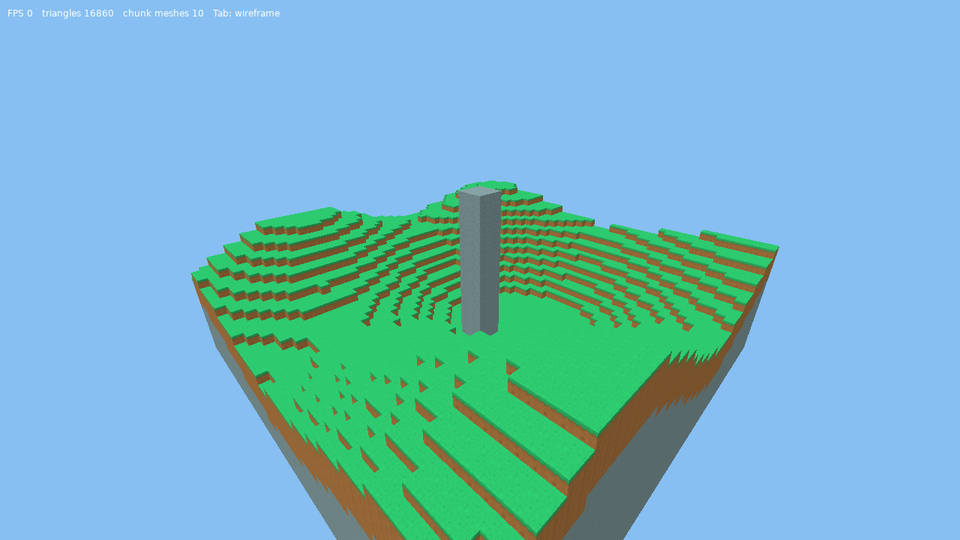
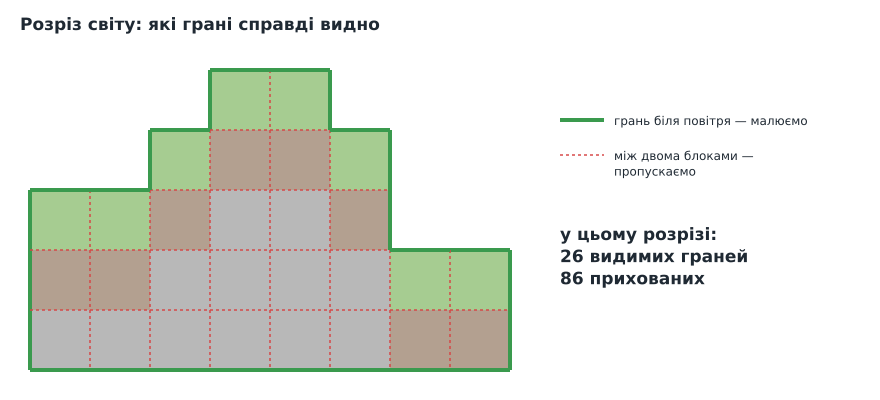
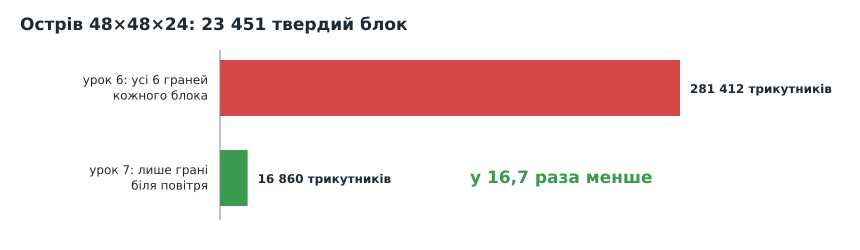
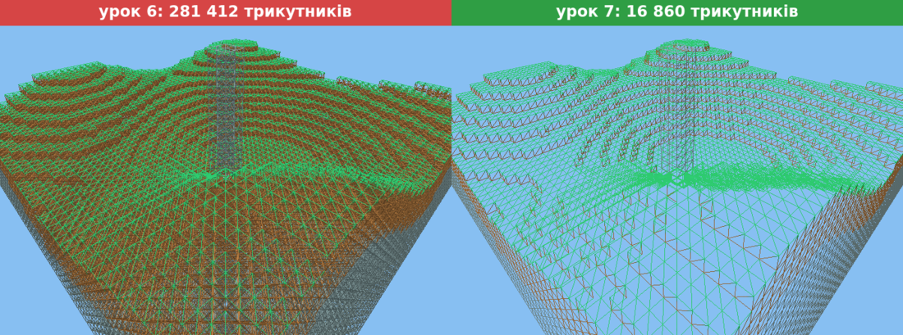
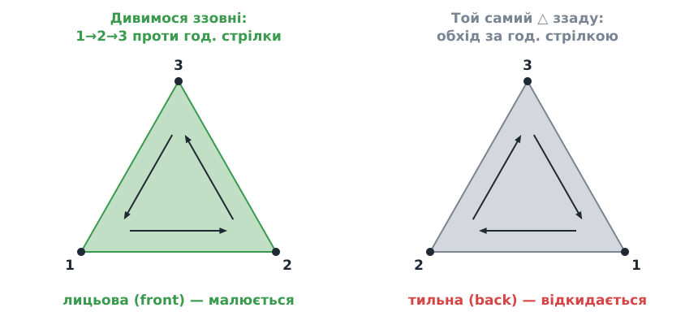
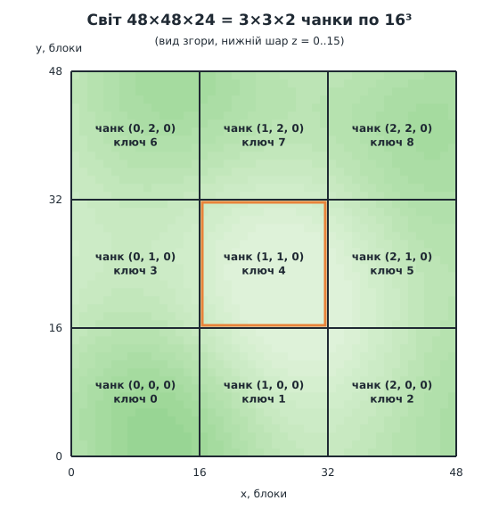
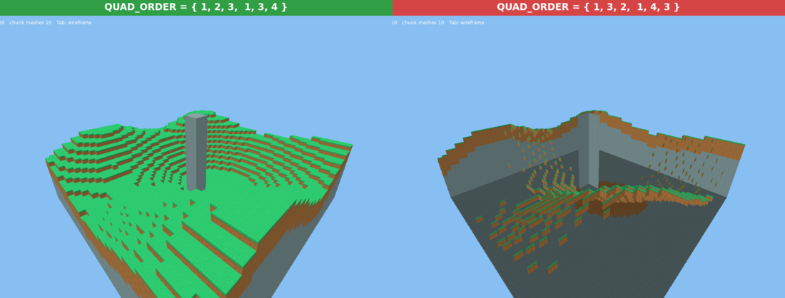
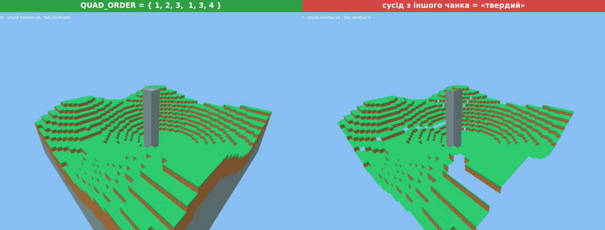

# Урок 7. Оптимізація: приховані грані та чанки

> **Результат уроку:** той самий острів, але з **у 16,7 раза меншою кількістю трикутників**, які будуються в 9 разів швидше. Світ поділено на **чанки** 16×16×16, і кожен має власну сітку. Клавіша **Tab** показує каркас.

📦 **Код уроку:** [завантажити code.zip](code.zip). Розпакуйте архів і запустіть `love code`.



<iframe class="lesson-demo" src="demo/index.html?poster=../images/result.png" title="Демо: острів після оптимізації, частину часу в каркасному режимі" loading="lazy" tabindex="-1"></iframe>

## Мета уроку

* Не малювати грані, яких **ніколи не видно** (між двома блоками).
* Навчити відеокарту відкидати грані, повернуті **спиною до камери**, і зрозуміти, як це залежить від **порядку обходу вершин**.
* Поділити світ на **чанки**, щоб у наступних уроках перебудовувати після зміни блока лише невелику частину світу.
* Навчитися **вимірювати** результат оптимізації, а не вгадувати його.

---

## 1. Скільки граней справді видно



Грань між двома твердими блоками **не видно ніколи**, хоч би де стояла камера. Видимі лише грані між твердим блоком і **повітрям**. Перевірка одна:

```lua
for _, face in ipairs(FACES) do
    -- Грань видно, лише якщо за нею повітря.
    if not world:isSolid(block + face.normal) then
        emitFace(vertices, block, face, Blocks.textureLayer(id, face.texture))
    end
end
```

Ось навіщо в уроці 6 ми додали до кожної грані **нормаль**: `block + face.normal` — це координати сусіднього блока за цією гранню. А оскільки `World:get` повертає повітря для всього, що лежить поза світом, грані на краю світу малюються без жодних додаткових перевірок.

### Результат, виміряний, а не вгаданий



| | Урок 6 | Урок 7 |
|---|---|---|
| Трикутників | 281 412 | **16 860** |
| Час побудови сітки | 0,28 с | **0,03 с** |

Ось як виглядає каркас (**Tab**) до і після:



> **Правило оптимізації:** спочатку **виміряйте**, потім оптимізуйте, потім **виміряйте знову**. Лічильник трикутників у кутку екрана і повідомлення про час побудови в консолі з'явилися ще в уроці 6 саме для того, щоб зараз ми могли довести, що оптимізація спрацювала.

## 2. Відсікання задніх граней

Навіть з усіх видимих граней куба камера одночасно бачить **не більше трьох**. Решта повернуті до неї спиною. Відеокарта може відкидати такі трикутники сама, ще до розфарбовування пікселів:

```lua
love.graphics.setMeshCullMode("back")
```

Звідки відеокарта знає, де в трикутника «спина»? З **порядку обходу вершин** (*winding order*):



Якщо після проєкції на екран вершини `1 → 2 → 3` йдуть **проти годинникової стрілки**, трикутник повернутий до нас лицем. Якщо **за годинниковою**, ми дивимося на нього ззаду.

Ось чому ще з уроку 3 кути кожної грані в `FACES` перелічено **проти годинникової стрілки, якщо дивитися ззовні**, а `QUAD_ORDER = { 1, 2, 3, 1, 3, 4 }` цей порядок зберігає. Тепер ця домовленість почала працювати.

## 3. Чанки



**Чанк** (*chunk*, «шматок») — куб світу 16×16×16 блоків з **власною сіткою**. Острів 48×48×24 ділиться на 3×3×2 = 18 чанків. Деякі з них (верхні, де лише небо) порожні й сітки не мають.

Навіщо ділити, якщо одна сітка малюється не гірше?

* **Зміни світу.** В уроці 9 ми ламатимемо й ставитимемо блоки. Перебудова сітки всього світу (0,03 с, а для великого світу й секунди) при кожному кліку дала б помітне «гальмування». Перебудова одного чанка займає мілісекунди.
* **Масштаб.** У великому світі можна малювати лише чанки поблизу камери, а далекі не будувати зовсім. У нашому маленькому світі ми цього не робимо, але структуру вже підготовлено.

Розмір світу в чанках обчислюється з округленням **вгору**: світ шириною 50 блоків займе 4 чанки, і останній буде неповним.

```lua
function Extent3:divideRoundingUp(divisor)
    return Extent3.new(math.ceil(self.x / divisor), math.ceil(self.y / divisor), math.ceil(self.z / divisor))
end
```

Кожен чанк отримує **ключ** — плоский індекс у сітці чанків (та сама формула з уроку 6, лише для чанків):

```lua
for key = 0, self.chunks:volume() - 1 do
    self:buildChunk(key)
end

function Renderer:buildChunk(key)
    local chunk = self.chunks:cell(key)                          -- ключ → координати чанка
    local vertices = Mesher.buildChunk(self.world, chunk * self.chunkSize, self.chunkSize)
    if #vertices > 0 then
        ...
        self.meshes[key] = mesh
    end
end
```

`Mesher.buildChunk` обходить лише блоки свого куба (обрізаного межами світу), але **сусідів перевіряє у всьому світі**. Це важливо, і саме тут криється друга типова помилка.

Повний код: [`code.zip`](code.zip). Нове порівняно з уроком 6: `Mesher.buildChunk`, чанки в `renderer.lua`, `Vec3.fromAxes` і `Vec3:floor`, `Extent3:divideRoundingUp`.

## 4. ⚠️ Типові помилки

### Помилка 1: неправильний порядок обходу

Якщо переставити вершини в `QUAD_ORDER`, кожен трикутник стане обходитися за годинниковою стрілкою:

```lua
local QUAD_ORDER = { 1, 3, 2, 1, 4, 3 }   -- НЕПРАВИЛЬНО: обхід за годинниковою стрілкою
```



Тепер відеокарта вважає «спиною» саме лицьові грані й відкидає їх. Ми бачимо **внутрішні** боки дальніх граней: острів показується «навиворіт», як макет без передньої стінки. Без відсікання задніх граней помилки не було б видно взагалі, тому її часто помічають лише тоді, коли відсікання вмикають.

### Помилка 2: сусід з іншого чанка

Може виникнути спокуса перевіряти сусідів лише **всередині свого чанка**, а все, що за його межами, вважати твердим («інший чанк сам розбереться»):

```lua
local inChunk = n.x >= origin.x and ... and n.z <= last.z
if inChunk and not world:isSolid(n) then   -- НЕПРАВИЛЬНО
```



На межах чанків з'являються **прямі смуги дір**: грані, які дивляться в сусідній чанк, ніколи не малюються, навіть якщо там повітря. Зникають і всі грані на краю світу. Лічильник показує лише 7 298 трикутників замість 16 860, і це «прискорення» насправді є помилкою.

Правило: **світ спільний для всіх чанків**. Чанк визначає лише, *які блоки* обходити, а питання «що за гранню?» завжди адресуємо світу.

## Підсумок

* Малюємо лише грані між блоком і повітрям: у 16,7 раза менше трикутників.
* Відсікання задніх граней працює завдяки **порядку обходу** вершин проти годинникової стрілки.
* Світ поділено на **чанки** 16³ з окремими сітками, і це основа для швидких змін світу.
* Оптимізацію перевіряємо **вимірюванням**.

## Запитання для самоперевірки

1. Скільки трикутників дасть один окремий блок, що висить у повітрі? А два блоки поруч?
2. Чому для **верхньої** межі світу не потрібна окрема перевірка?
3. Змініть `CHUNK_SIZE` на 8 і на 32. Як змінилися кількість сіток і кількість трикутників? Чому трикутників стільки ж?

**Далі:** [Урок 8. Формат .vox: завантажуємо світ з файлу](../08-vox/README.md)
