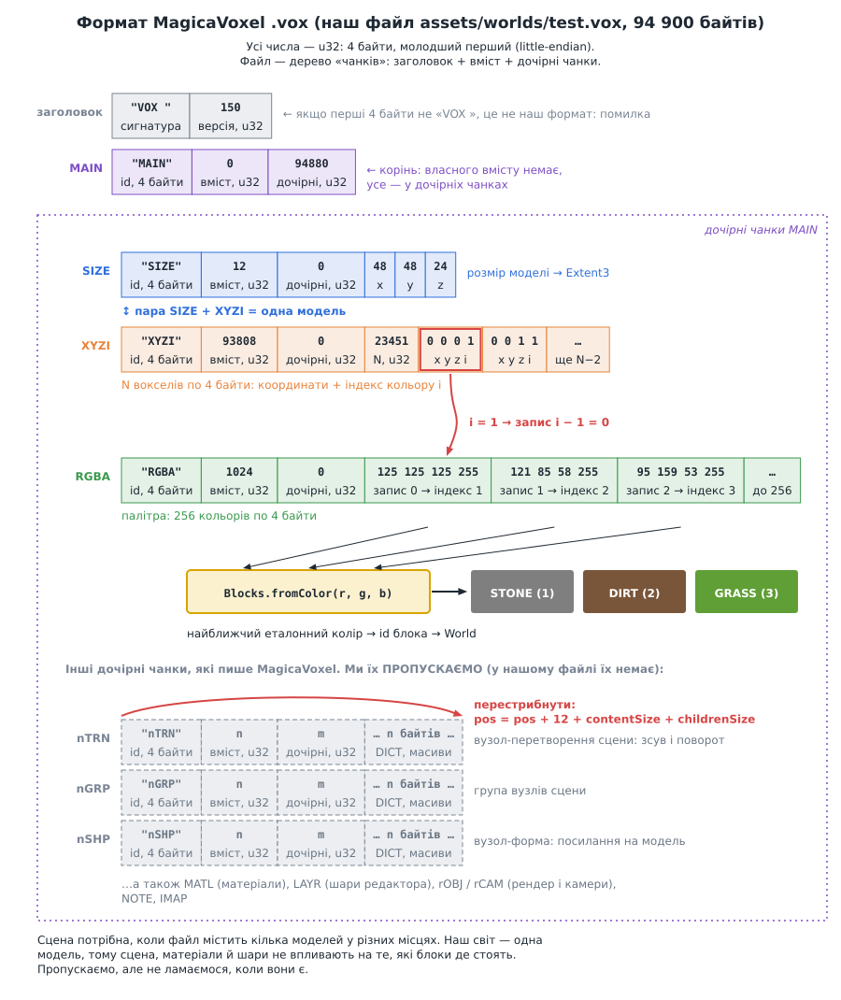
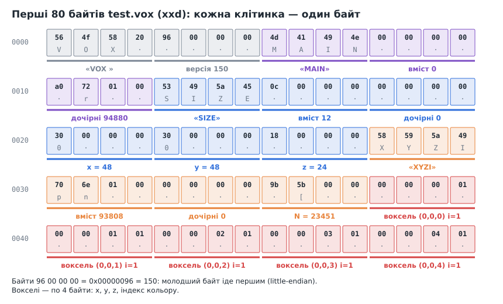
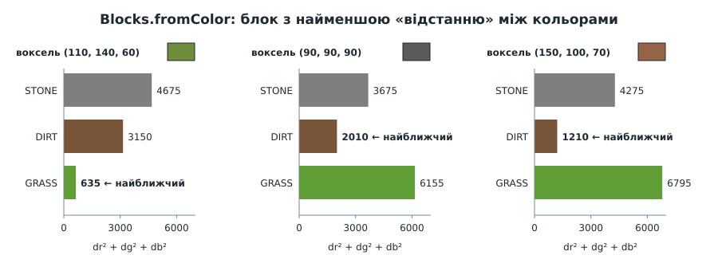

# Урок 8. Формат .vox: завантажуємо світ з файлу

> **Результат уроку:** світ більше не генерується кодом, а **завантажується з файлу** `assets/worlds/test.vox` у відкритому форматі MagicaVoxel. Файл можна відкрити й змінити у безкоштовному редакторі **Goxel**, а потім запустити гру з новим світом: `love . мій_світ.vox`.

📦 **Код уроку:** [завантажити code.zip](code.zip). Розпакуйте архів і запустіть `love code`.


<iframe class="lesson-demo" src="demo/index.html?poster=../images/result.png" title="Демо: світ, завантажений з файлу" loading="lazy" tabindex="-1"></iframe>

## Мета уроку

* Прочитати **двійковий** (бінарний) формат файлу за специфікацією.
* Зрозуміти **порядок байтів** (little-endian) і **чанкову** будову файлу.
* Свідомо **пропустити** ту частину формату, яка нам не потрібна, і не зламатися, коли вона трапиться у файлі.
* Перетворити колір вокселя на тип блока.
* Обробляти помилки так, щоб користувач бачив зрозуміле повідомлення.

---

## 1. Чому саме `.vox`

Технічне завдання проєкту вимагає: *«формат світу має бути відкритим, щоб його можна було редагувати й переглядати сторонніми програмами, і нам не доводилося писати власні інструменти»*.

Формат `.vox` редактора MagicaVoxel цій вимозі відповідає:

* **специфікація відкрита**: [MagicaVoxel-file-format-vox.txt](https://github.com/ephtracy/voxel-model/blob/master/MagicaVoxel-file-format-vox.txt);
* його підтримують десятки програм, зокрема безкоштовний редактор з відкритим кодом **[Goxel](https://goxel.xyz)**;
* **вісь Z у ньому спрямована вгору**, як і в нашій грі з уроку 3.


> **Робота з Goxel.** У Goxel формат `.vox` — це формат **імпорту / експорту**, а не «рідний».
> * Відкрити: `goxel assets/worlds/test.vox` або **File → Import → MagicaVoxel (.vox)**.
> * Зберегти: **File → Export → MagicaVoxel (.vox)**. Звичайна команда *Save* запише файл у власному форматі Goxel `.gox`, який гра не прочитає.

## 2. Будова файлу



Файл складається з **чанків** (*chunks*; це слово не пов'язане з чанками світу з уроку 7). У кожного чанка однаковий заголовок з 12 байтів:

| Поле | Розмір | Зміст |
|---|---|---|
| id | 4 байти | чотири літери: `MAIN`, `SIZE`, `XYZI`, `RGBA`, … |
| contentSize | u32 | скільки байтів займає власний вміст чанка |
| childrenSize | u32 | скільки байтів займають вкладені (дочірні) чанки |

Після заголовка файлу (`"VOX "` + версія) іде один чанк `MAIN`, а все корисне лежить у його дочірніх чанках.

| Чанк | Читаємо? | Що містить |
|---|---|---|
| `SIZE` | **так** | розмір моделі: x, y, z |
| `XYZI` | **так** | вокселі: N записів по 4 байти `x, y, z, індекс кольору` |
| `RGBA` | **так** | палітра з 256 кольорів по 4 байти `r, g, b, a` |
| `nTRN`, `nGRP`, `nSHP` | ні | **граф сцени**: розміщення й повороти кількох моделей |
| `MATL` | ні | матеріали: скло, метал, світіння (для рендеру MagicaVoxel) |
| `LAYR` | ні | шари редактора: назви, видимість |
| `rOBJ`, `rCAM`, `NOTE`, `IMAP` | ні | налаштування рендеру, камери, нотатки, порядок палітри |

### Чому ми пропускаємо частину формату

Наш світ — **одна модель**, а блок має лише тип, без матеріалів. Граф сцени потрібен, щоб розставити **кілька** моделей у різних місцях. Матеріали й камери потрібні рендереру MagicaVoxel, а не нам. Підтримка цих чанків додала б сотні рядків коду, і світ від цього не змінився б.

Пропустити чанки можна, лише якщо **не зламатися**, коли вони трапляться. Тут допомагає чанкова будова: розмір кожного чанка записано в заголовку, тож будь-який невідомий чанк можна **перестрибнути, не читаючи**:

```lua
-- Будь-який інший чанк (nTRN, MATL, LAYR, ...) просто перестрибуємо.
pos = body + contentSize + childrenSize
```

Завдяки цьому файл, збережений у MagicaVoxel з усіма цими чанками, наша гра завантажує без проблем. (Goxel при експорті пише лише `SIZE`, `XYZI` і `RGBA`, тож його файли ще простіші.)

## 3. Байти в шістнадцятковому вигляді

Ось як виглядає початок нашого файлу (команда `xxd assets/worlds/test.vox | head`):



### Порядок байтів (little-endian)


Число `u32` займає 4 байти, і в `.vox` **молодший байт записано першим**. Тому число 150 виглядає як `96 00 00 00`, а не `00 00 00 96`. Так само записують числа процесори x86 та ARM.

Кожна функція розбору може натрапити на пошкоджений файл. Для таких випадків у `vox.lua` є одна допоміжна функція:

```lua
local function fail(message, ...)
    error("vox: " .. message:format(...), 0)
end
```

* `error(повідомлення)` зупиняє виконання з помилкою. Другий аргумент `0` прибирає з повідомлення назву файлу й номер рядка: гравцеві потрібен зміст помилки, а не адреса в нашому коді.
* `...` означає «усі інші аргументи». `fail("bad chunk '%s' at %d", id, pos)` передасть `id` і `pos` у `format`, і вони стануть на місця `%s` і `%d`.

Тепер читання числа:

```lua
local function readU32(data, pos)
    local b1, b2, b3, b4 = data:byte(pos, pos + 3)
    if not b4 then
        fail("unexpected end of file at offset %d", pos - 1)
    end
    return b1 + b2 * 0x100 + b3 * 0x10000 + b4 * 0x1000000
end
```

`string.byte(s, i, j)` повертає числові коди байтів з `i` по `j`. Рядки в Lua можуть містити будь-які байти, зокрема нульові, тому для двійкових даних вони підходять.

## 4. Розбір файлу: `src/world/vox.lua`

Заголовок чанка читаємо й одразу перевіряємо, що він сам і весь чанк уміщаються у файл:

```lua
local HEADER_SIZE = 12 -- id чанка (4) + розмір вмісту (4) + розмір дочірніх чанків (4)

local function readChunkHeader(data, pos)
    if pos + HEADER_SIZE - 1 > #data then
        fail("truncated chunk header at offset %d", pos - 1)
    end
    local id = data:sub(pos, pos + 3)          -- 4 літери: "SIZE", "XYZI", ...
    local contentSize = readU32(data, pos + 4)
    local childrenSize = readU32(data, pos + 8)
    if pos + HEADER_SIZE + contentSize + childrenSize - 1 > #data then
        fail("chunk '%s' at offset %d extends past end of file", id, pos - 1)
    end
    return id, contentSize, childrenSize
end
```

`data:sub(i, j)` вирізає з рядка символи з `i` по `j`. Позиції в Lua рахуються з 1, а зсуви (*offsets*) у специфікації та в `xxd` — з 0, тому в повідомленнях ми пишемо `pos - 1`. Тоді число в повідомленні збігається з тим, що людина побачить у шістнадцятковому переглядачі.

Сам файл починається з сигнатури `"VOX "`, версії й чанка `MAIN`:

```lua
function Vox.parse(data)
    if type(data) ~= "string" or #data < 8 or data:sub(1, 4) ~= "VOX " then
        fail("not a MagicaVoxel file (missing 'VOX ' header)")
    end
    local version = readU32(data, 5)

    local id, contentSize, childrenSize = readChunkHeader(data, 9)
    if id ~= "MAIN" then
        fail("expected MAIN chunk, found '%s'", id)
    end

    local pos = 9 + HEADER_SIZE + contentSize       -- перший дочірній чанк
    local finish = pos + childrenSize               -- кінець дочірніх чанків
    local models, palette, pendingSize = {}, nil, nil
    -- ... цикл нижче ...
```

Головний цикл обходить дочірні чанки `MAIN`:

```lua
while pos < finish do
    id, contentSize, childrenSize = readChunkHeader(data, pos)
    local body = pos + HEADER_SIZE
    if id == "SIZE" then
        pendingSize = Extent3.new(readU32(data, body), readU32(data, body + 4), readU32(data, body + 8))
    elseif id == "XYZI" then
        if not pendingSize then
            fail("XYZI chunk at offset %d has no preceding SIZE chunk", pos - 1)
        end
        models[#models + 1] = { size = pendingSize, voxels = readVoxels(data, body, contentSize) }
        pendingSize = nil
    elseif id == "RGBA" then
        if contentSize < 255 * 4 then
            fail("RGBA chunk is too small (%d bytes)", contentSize)
        end
        palette = readPalette(data, body)
    end
    -- Будь-який інший чанк (nTRN, MATL, LAYR, ...) просто перестрибуємо.
    pos = body + contentSize + childrenSize
end

if #models == 0 then
    fail("file contains no models")
end
return { version = version, models = models, palette = palette }
```

* `SIZE` і наступний за ним `XYZI` утворюють **пару**, що описує одну модель.
* У файлі може бути кілька моделей. Ми завантажуємо **першу**, а для решти друкуємо попередження (розділ 5).

Вокселі в `XYZI` — це число `N`, а за ним `N` записів по 4 байти:

```lua
local function readVoxels(data, pos, contentSize)
    local count = readU32(data, pos)
    if 4 + count * 4 > contentSize then
        fail("XYZI chunk declares %d voxels but holds only %d bytes", count, contentSize)
    end
    local voxels = {}
    for i = 0, count - 1 do
        local p = pos + 4 + i * 4
        local x, y, z, colorIndex = data:byte(p, p + 3)
        voxels[#voxels + 1] = { position = Vec3.new(x, y, z), colorIndex = colorIndex }
    end
    return voxels
end
```

Перевірка `4 + count * 4 > contentSize` не дає пошкодженому файлу, який «обіцяє» мільйон вокселів, змусити нас читати чужі байти.

### Палітра: зсув на одиницю, закладений у формат

Індекс кольору вокселя змінюється від **1** до 255 (0 означає «порожньо»). А запис **0** чанка `RGBA` — це колір індексу **1**:

```lua
local function readPalette(data, pos)
    -- Запис i чанка (від 0) — це колір індексу палітри i + 1.
    local palette = {}
    for index = 1, 255 do
        local r, g, b, a = data:byte(pos + (index - 1) * 4, pos + (index - 1) * 4 + 3)
        palette[index] = { r, g, b, a }
    end
    return palette
end
```

На щастя, індекси палітри від 1 збігаються з індексами масивів Lua, тож `palette[colorIndex]` працює напряму.

### Захист від пошкоджених файлів

Парсер **не довіряє** файлу. Кожне читання перевіряє межі, а всі помилки мають зрозумілий текст:

| Перевірка | Повідомлення |
|---|---|
| немає сигнатури `"VOX "` | `not a MagicaVoxel file` |
| заголовок чанка обрізано | `truncated chunk header at offset …` |
| чанк виходить за кінець файлу | `chunk '…' at offset … extends past end of file` |
| `XYZI` без `SIZE` | `XYZI chunk … has no preceding SIZE chunk` |
| кількість вокселів більша за вміст | `XYZI chunk declares … voxels but holds only … bytes` |

Повідомлення ще треба доповнити: «not a MagicaVoxel file» без назви файлу мало що каже. Цим займається `WorldLoader.load` у `src/world/load.lua`:

```lua
function WorldLoader.load(path)
    local ok, result = pcall(function()
        local vox = Vox.parse(readFile(path))
        if #vox.models > 1 then
            print(("warning: '%s' has %d models; only the first is loaded"):format(path, #vox.models))
        end
        return WorldLoader.fromVox(vox)
    end)
    if not ok then
        error(("Failed to load world '%s':\n%s"):format(path, result), 0)
    end
    return result
end
```

**`pcall`** (*protected call*, «захищений виклик») виконує функцію і **перехоплює** помилку, замість того щоб зупинити програму. Він повертає два значення:

* `true` і результат функції, якщо все гаразд;
* `false` і текст помилки, якщо всередині спрацював `error` (наприклад, наш `fail`).

Тут ми перехоплюємо помилку лише для того, щоб додати до неї шлях до файлу, і знову викликаємо `error`. Якщо передати грі текстовий файл, LÖVE покаже не незрозумілу помилку з глибини коду, а таке:

```
Failed to load world 'notes.txt':
vox: not a MagicaVoxel file (missing 'VOX ' header)
```

## 5. Колір → тип блока

У файлі немає «типів блоків», є лише кольори. Перетворити колір на блок можна двома способами:

1. **за індексом палітри**: «індекс 1 — камінь». Проте редактори **самі** переставляють індекси при збереженні, тож після редагування в Goxel світ «перефарбувався б».
2. **за кольором**: кожен тип блока має **еталонний колір**, і воксель стає блоком з найближчим еталоном. Цей спосіб переживає будь-яке редагування, тому ми обираємо його.

| Блок | Еталон RGB |
|---|---|
| камінь | 125, 125, 125 |
| земля | 121, 85, 58 |
| трава | 95, 159, 53 |

Еталон — нове поле `color` у реєстрі блоків з уроку 6:

```lua
Blocks.defs = {
    [Blocks.STONE] = {
        name = "stone", color = { 125, 125, 125 },
        top = "stone.png", side = "stone.png", bottom = "stone.png",
    },
    [Blocks.DIRT] = {
        name = "dirt", color = { 121, 85, 58 },
        top = "dirt.png", side = "dirt.png", bottom = "dirt.png",
    },
    [Blocks.GRASS] = {
        name = "grass", color = { 95, 159, 53 },
        top = "grass_top.png", side = "dirt_grass.png", bottom = "dirt.png",
    },
}
```



«Відстань» між кольорами — це звичайна відстань між точками у тривимірному просторі `(r, g, b)`. Корінь можна не добувати, бо для порівняння достатньо квадратів:

```lua
function Blocks.fromColor(r, g, b)
    local bestId, bestDistance = Blocks.STONE, math.huge
    for id, def in ipairs(Blocks.defs) do
        local dr, dg, db = r - def.color[1], g - def.color[2], b - def.color[3]
        local distance = dr * dr + dg * dg + db * db
        if distance < bestDistance then
            bestId, bestDistance = id, distance
        end
    end
    return bestId
end
```

Зверніть увагу на середній приклад: темно-сірий `(90, 90, 90)` став **землею**, а не каменем. Відстань у RGB не завжди збігається з тим, як колір сприймає людина. Тому малюйте у редакторі кольорами, близькими до еталонних.

`WorldLoader.fromVox` обчислює блок **один раз для кожного індексу палітри** (максимум 255 разів), а не для кожного з 23 451 вокселя, і будує з першої моделі світ:

```lua
function WorldLoader.fromVox(vox)
    if not vox.palette then
        error("world file has no color palette (RGBA chunk)", 0)
    end
    local blockForIndex = {}                      -- індекс палітри → тип блока
    for index, color in ipairs(vox.palette) do
        blockForIndex[index] = Blocks.fromColor(color[1], color[2], color[3])
    end

    local model = vox.models[1]
    local world = World.new(model.size)
    for _, voxel in ipairs(model.voxels) do
        world:set(voxel.position, blockForIndex[voxel.colorIndex] or Blocks.STONE)
    end
    return world
end
```

Світ створюється порожнім (`World.new` з уроку 6) і заповнюється тими самими викликами `world:set`, якими раніше користувався генератор. Решта гри різниці не помічає.

## 6. Запуск

```sh
love .                          # assets/worlds/test.vox
love . ~/Desktop/my_world.vox   # будь-який інший файл
```

```lua
function love.load(args)
    ...
    world = WorldLoader.load(args[1] or DEFAULT_WORLD)
```

`args` — аргументи командного рядка після шляху до гри. `args[1] or DEFAULT_WORLD` бере перший аргумент, а якщо його немає, то світ за замовчуванням `"assets/worlds/test.vox"`.

LÖVE читає файли з теки гри (`love.filesystem`), а для шляху поза нею `readFile` використовує звичайний `io.open`:

```lua
local function readFile(path)
    if love.filesystem.getInfo(path, "file") then
        return assert(love.filesystem.read(path))   -- файл з теки гри
    end
    local file, err = io.open(path, "rb")           -- "rb": читати як двійкові дані
    if not file then
        error(("cannot open world file: %s"):format(err), 0)
    end
    local data = file:read("*a")                    -- "*a": увесь файл одним рядком
    file:close()
    return data
end
```

Модуль `src/world/generate.lua` з уроків 6–7 більше не потрібен, і ми його видалили. Повний код: [`code.zip`](code.zip).

## 7. ⚠️ Типові помилки

### Помилка 1: палітра без зсуву

Легко прочитати палітру «як масив» і забути, що запис 0 належить індексу 1:

```lua
local r, g, b, a = data:byte(pos + index * 4, pos + index * 4 + 3)   -- НЕПРАВИЛЬНО
```


Кожен індекс отримує колір **сусіда**: камінь (1) бере колір землі (2), земля бере колір трави (3), трава бере неіснуючий четвертий колір (чорний), і `fromColor` перетворює його на землю. Острів стає майже повністю земляним. Програма не падає, але світ неправильний.

### Помилка 2: «Y вгору»

Багато рушіїв (OpenGL, Unity, Godot) вважають, що вгору спрямована вісь **Y**. Якщо, звикнувши до цього, «виправити» осі при читанні:

```lua
voxels[#voxels + 1] = { position = Vec3.new(x, z, y), ... }   -- НЕПРАВИЛЬНО для нашої гри
```


Острів **лежить на боці**: його поверхня стала вертикальною стіною, а 48 блоків, що мали йти «вглиб», пішли вгору. Ще в уроці 3 ми свідомо обрали Z вгору, щоб збігтися з `.vox`, тому переставляти нічого не треба. Правило: **перш ніж «виправляти» осі, перевірте, яку систему координат використовують обидві сторони.**

## Підсумок

* `.vox` — двійковий формат з чанків; кожен чанк можна перестрибнути за розміром із заголовка.
* Читаємо лише `SIZE`, `XYZI`, `RGBA`. Граф сцени, матеріали й шари для нашого світу не потрібні, але й не заважають.
* Числа — little-endian u32; індекс палітри $i$ береться з запису $i - 1$.
* Тип блока визначається **найближчим еталонним кольором**, тож світ переживає редагування в Goxel.
* Парсер перевіряє межі й дає зрозумілі повідомлення про помилки.

## Запитання для самоперевірки

1. Як записати в little-endian число 1000? (Підказка: $1000 = 3 \cdot 256 + 232$.)
2. Відкрийте світ у Goxel, побудуйте «будиночок» з кольором `(121, 85, 58)`, експортуйте у `.vox` і запустіть гру з цим файлом. З яких блоків складається будиночок?
3. Чому `fromColor` не добуває квадратний корінь, і чи вплинуло б це на результат?

**Далі:** [Урок 9. Взаємодія: приціл, ламаємо і ставимо блоки](../09-interaction/README.md)
