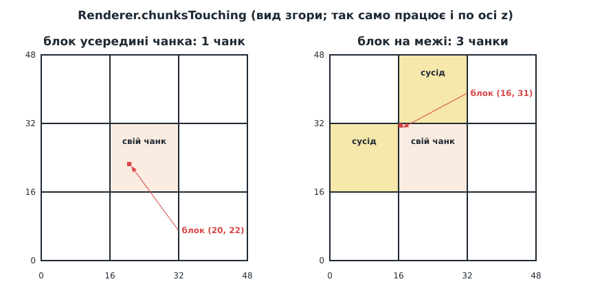

# Урок 9. Взаємодія: приціл, ламаємо і ставимо блоки

> **Результат уроку:** це вже гра. У центрі екрана з'явився **приціл**: **лівий клік** ламає блок, на який він наведений, **правий клік** ставить блок землі. Змінені частини світу миттєво перебудовуються.

📦 **Код уроку:** [завантажити code.zip](code.zip). Розпакуйте архів і запустіть `love code`.


<iframe class="lesson-demo" src="demo/index.html?poster=../images/interaction.gif" title="Демо: обліт острова з прицілом" loading="lazy" tabindex="-1"></iframe>

## Мета уроку

* Визначити, **на який блок** дивиться гравець: пустити **промінь** крізь сітку блоків.
* Дізнатися, **до якої грані** прибудовувати новий блок.
* Змінювати світ і **перебудовувати лише потрібні чанки**, зокрема сусідні.
* Описати **правила гри** (куди можна ставити, куди ні).

---

## 1. Нові та змінені файли

```
src/
├── math/vec3.lua          -- + __eq, unit, smallestAxis, AXES, ZERO
├── world/raycast.lua      -- НОВЕ: промінь крізь сітку блоків
├── render/crosshair.lua   -- НОВЕ: приціл
└── render/renderer.lua    -- + перебудова змінених чанків
main.lua                   -- + interact(): ламати / ставити
```

## 2. Промінь

Гравець «дивиться» з точки `camera.position` у напрямку `camera:forward()`. Точки променя описує **параметричне рівняння**:

```
P(t) = origin + direction · t,      t ≥ 0  (t — відстань у блоках, бо direction одиничний)
```

Потрібно знайти **перший твердий блок** уздовж цього променя, не далі `REACH = 8` блоків.

### Чому не перевіряти точки через рівні проміжки

Найпростіша ідея: брати точки через кожні 0,1 блока й перевіряти, чи потрапили в твердий блок. Але це водночас **повільно** (80 перевірок, більшість з них в одному блоці) і **неточно**: промінь, що зачіпає лише кут блока, може «проскочити» між двома точками.


### Алгоритм Amanatides & Woo

Алгоритм (1987 р.) відвідує **кожну** клітинку, яку перетинає промінь, рівно один раз і по порядку. Ключова думка: з однієї клітинки промінь може вийти лише в одну з сусідніх, **по тій осі, межу якої він перетне раніше**.

Для кожної осі зберігаємо два числа:

| Змінна | Зміст |
|---|---|
| `nextBoundary[axis]` | на якій відстані `t` промінь перетне **найближчу** межу клітинки по цій осі |
| `boundarySpacing[axis]` | на скільки зростає `t` між **двома сусідніми** межами по цій осі: `|1 / direction[axis]|` |

Алгоритм постійно робить щось «для кожної осі». Тому `Vec3` отримав кілька помічників у тому ж стилі, що й `fromAxes` з уроку 7:

```lua
Vec3.AXES = { "x", "y", "z" }
Vec3.ZERO = Vec3.new(0, 0, 0)        -- спільний для всіх; вектори незмінні, тож це безпечно

function Vec3:floor()                -- блок, що містить точку: (2.7, 0.3, -0.5) → (2, 0, -1)
    return Vec3.new(math.floor(self.x), math.floor(self.y), math.floor(self.z))
end

function Vec3.unit(axis)             -- unit("y") = (0, 1, 0)
    return Vec3.fromAxes(function(other) return other == axis and 1 or 0 end)
end

function Vec3:smallestAxis()         -- назва осі з найменшою координатою
    local best = "x"
    for _, axis in ipairs(Vec3.AXES) do
        if self[axis] <= self[best] then
            best = axis
        end
    end
    return best
end
```

`math.floor` округлює **вниз**, а не до нуля: `math.floor(-0.5)` дає `-1`. Саме так і треба, бо точка з $x = -0.5$ лежить у блоці $[-1, 0]$.

Спершу знаходимо стартовий блок і обидва числа для кожної осі:

```lua
local function sign(value)
    return value > 0 and 1 or (value < 0 and -1 or 0)
end

function Raycast.cast(isSolid, origin, direction, maxDistance)
    local block = origin:floor()
    -- У який бік рухається промінь по кожній осі: +1, -1 або 0.
    local step = Vec3.fromAxes(function(axis) return sign(direction[axis]) end)
    -- Відстань уздовж променя між двома межами блоків по кожній осі.
    local boundarySpacing = Vec3.fromAxes(function(axis) return math.abs(1 / direction[axis]) end)
    -- Відстань уздовж променя до найближчої межі блока по кожній осі.
    local nextBoundary = Vec3.fromAxes(function(axis)
        if step[axis] == 0 then
            return math.huge
        end
        local boundary = block[axis] + (step[axis] > 0 and 1 or 0)
        return (boundary - origin[axis]) / direction[axis]
    end)
    -- ... цикл нижче ...
```

Найближча межа — це **права** межа блока (`block + 1`), якщо промінь рухається в додатному напрямку, і **ліва** (`block`), якщо у від'ємному. Відстань до неї знаходимо з рівняння променя: $\text{origin} + \text{direction} \cdot t = \text{boundary}$, звідки $t = (\text{boundary} - \text{origin}) / \text{direction}$.

Приклад: промінь з $x = 0.5$ у напрямку $x = +1$. Перша межа на $x = 1$, отже $t = 0.5$; кожна наступна далі на $|1 / 1| = 1$.

Далі крокуємо від межі до межі:

```lua
local normal = Vec3.ZERO
local distance = 0
while distance <= maxDistance do
    if isSolid(block) then
        return { block = block, normal = normal }
    end
    local axis = nextBoundary:smallestAxis()        -- яку межу перетнемо першою
    distance = nextBoundary[axis]
    block = block + Vec3.unit(axis) * step[axis]    -- крок у сусідню клітинку
    normal = Vec3.unit(axis) * -step[axis]          -- грань, крізь яку ввійшли
    nextBoundary = nextBoundary + Vec3.unit(axis) * boundarySpacing[axis]
end
return nil
```

* Якщо промінь паралельний якійсь осі (`direction[axis] == 0`), межі по ній він не перетне ніколи. Тоді `nextBoundary = math.huge` (нескінченність), і `smallestAxis` цю вісь ніколи не обере. Ділення `1 / 0` в Lua дає `inf`, а не помилку, тому `boundarySpacing` теж працює.
* **Нормаль** — це грань, крізь яку промінь **увійшов** у блок. Вона дивиться **проти** кроку: рухаючись у `+X`, ми входимо крізь грань `−X`.

`Raycast.cast` приймає не світ, а **функцію** `isSolid`. Тому модуль не залежить від `World` і його можна перевірити на будь-якій вигаданій сітці (див. урок 11).

## 3. Ламаємо і ставимо

Промінь пускаємо з камери в напрямку погляду. Світ передаємо у вигляді функції, як і обіцяли:

```lua
local REACH = 8 -- на скільки блоків дотягується гравець

local function target()
    return Raycast.cast(function(block) return world:isSolid(block) end, camera.position, camera:forward(), REACH)
end
```

```lua
local function interact(action)
    local hit = target()
    if not hit then
        return                              -- нічого в межах досяжності
    end
    local block, id = hit.block, Blocks.AIR -- ламати: блок стає повітрям
    if action == "place" then
        if hit.normal == Vec3.ZERO then
            return                          -- камера всередині блока: немає грані
        end
        block, id = hit.block + hit.normal, Blocks.DIRT
        if block == camera.position:floor() then
            return                          -- не замуровуємо камеру в блок
        end
    end
    if world:set(block, id) then
        renderer:blockChanged(block)
    end
end
```

* **Ламати** — простіше: блок, у який влучив промінь, стає повітрям.
* **Ставити** — блок з'являється **перед** гранню, на яку ми дивимося: `hit.block + hit.normal`. Ось навіщо промінь повертає нормаль.
* Два правила-винятки описують ситуації, які інакше зламали б гру: нульова нормаль (камера опинилася всередині блока) і спроба поставити блок туди, де стоїть сама камера.
* `World:set` повертає `true`, лише якщо світ **справді змінився**. Тому повторний клік у те саме місце не перебудовує чанки даремно.

`a == b` для двох `Vec3` працює завдяки новому метаметоду `__eq`: без нього Lua порівнювала б, чи це **та сама таблиця**, і `Vec3.new(1, 2, 3) == Vec3.new(1, 2, 3)` давало б `false`.

```lua
function Vec3.__eq(a, b)
    return a.x == b.x and a.y == b.y and a.z == b.z
end
```

Те, що `World:set` повертає `true` лише при справжній зміні, ми заклали ще в уроці 6. Тепер це знадобилося.

Ціль показуємо в кутку екрана: `love.draw` друкує `target <блок>` під прицілом (розділ 5).

### Миша

```lua
function love.mousepressed(_, _, button)
    if not love.mouse.getRelativeMode() then
        love.mouse.setRelativeMode(true) -- клік у незахоплене вікно лише повертає мишу
    elseif button == 1 then
        interact("break")
    elseif button == 2 then
        interact("place")
    end
end
```

Перший клік після **Alt+Tab** лише повертає захоплення миші. Інакше, клацнувши у вікно, щоб повернутися в гру, гравець випадково зламав би блок.

## 4. Перебудова чанків

Перебудовувати сітку прямо в обробнику кліку погана ідея: за один кадр може бути кілька кліків. Тому зміна лише **позначає** чанки «брудними» (*dirty flag*), а перебудова відбувається один раз за кадр у `renderer:update()`.

«Брудні» чанки зберігаємо як **множину**: таблицю, де ключ — номер чанка, а значення просто `true`. Позначити той самий чанк двічі — те саме, що один раз:

```lua
function Renderer:markChunkDirty(chunk)
    if self.chunks:contains(chunk) then              -- чанки поза світом ігноруємо
        self.dirty[self.chunks:index(chunk)] = true
    end
end

function Renderer:update()
    for key in pairs(self.dirty) do
        self:rebuildChunk(key)
    end
    self.dirty = {}
end
```

`love.update` тепер закінчується викликом `renderer:update()`.

Те саме відбувається й на старті: замість того щоб будувати чанки одразу (урок 7), `Renderer.new` позначає брудними всі, і перший `update` їх будує:

```lua
for key = 0, self.chunks:volume() - 1 do
    self.dirty[key] = true
end
```

### Які чанки «брудні»



Зміна блока завжди зачіпає **його власний** чанк. Але якщо блок лежить **на межі** чанка, від нього залежить і грань сусіднього блока в **сусідньому** чанку: зламали блок, і ця грань має з'явитися; поставили блок, і вона має зникнути.

```lua
function Renderer.chunksTouching(block, chunkSize)
    local chunk = (block / chunkSize):floor()
    local inChunk = block - chunk * chunkSize -- 0..chunkSize-1 по кожній осі
    local chunks = { chunk }
    for _, axis in ipairs(Vec3.AXES) do
        if inChunk[axis] == 0 then
            chunks[#chunks + 1] = chunk - Vec3.unit(axis)
        end
        if inChunk[axis] == chunkSize - 1 then
            chunks[#chunks + 1] = chunk + Vec3.unit(axis)
        end
    end
    return chunks
end
```

* `block / chunkSize` використовує новий метаметод `__div` (ділення вектора на число), а `:floor()` відкидає дробову частину. Блок $(17, 3, 40)$ при розмірі 16 лежить у чанку $(1, 0, 2)$.
* `inChunk` — позиція блока **всередині** чанка. $0$ означає «на лівій межі», $\text{chunkSize} - 1$ означає «на правій».

```lua
function Vec3.__div(a, b)          -- v / s
    return Vec3.new(a.x / b, a.y / b, a.z / b)
end
```

Блок у куті чанка зачіпає до **4** чанків (свій і по одному сусіду на кожну вісь). Чанки поза світом `markChunkDirty` просто ігнорує. Залишилося позначити всі ці чанки:

```lua
function Renderer:blockChanged(block)
    for _, chunk in ipairs(Renderer.chunksTouching(block, self.chunkSize)) do
        self:markChunkDirty(chunk)
    end
end
```

### Перебудова і пам'ять відеокарти

`rebuildChunk` — це `buildChunk` з уроку 7, але спершу він прибирає стару сітку:

```lua
function Renderer:rebuildChunk(key)
    local chunk = self.chunks:cell(key)
    local size = self.chunkSize

    if self.meshes[key] then
        self.meshes[key]:release()   -- звільняємо пам'ять відеокарти одразу
        self.meshes[key] = nil
    end
    local vertices = Mesher.buildChunk(self.world, chunk * size, size)
    if #vertices > 0 then            -- якщо чанк спорожнів, сітки не буде зовсім
        local mesh = love.graphics.newMesh(VERTEX_FORMAT, vertices, "triangles", "static")
        mesh:setTexture(self.textures)
        self.meshes[key] = mesh
    end
end
```

Сітка займає пам'ять **відеокарти**, а збирач сміття Lua бачить лише маленький об'єкт-обгортку й не поспішає його прибирати. Після сотні кліків стара пам'ять накопичилася б. `release()` звільняє її одразу.

## 5. Приціл

`Crosshair.draw()` малює білий хрестик у центрі екрана:

```lua
local SIZE = 0.012 -- половина довжини лінії як частка меншої сторони екрана

function Crosshair.draw()
    local graphics = love.graphics
    local width, height = graphics.getDimensions()
    local cx, cy, size = width / 2, height / 2, math.max(8, SIZE * math.min(width, height))
    graphics.push("all")
    graphics.setLineWidth(2)
    graphics.setColor(1, 1, 1, 0.9)
    graphics.line(cx - size, cy, cx + size, cy)
    graphics.line(cx, cy - size, cx, cy + size)
    graphics.pop()
end
```

* Розмір прив'язано до меншої сторони вікна, тож на великому моніторі приціл не стає крихітним, а `math.max(8, ...)` не дає йому зникнути в маленькому вікні.
* `push("all")` / `pop()` (урок 3) повертають колір і товщину ліній, щоб приціл не «зіпсував» налаштування для решти малювання.
* `local graphics = love.graphics` — просто коротше ім'я, щоб не писати `love.graphics` шість разів.

Приціл малюємо **після** світу, тож він завжди поверх:

```lua
function love.draw()
    local width, height = love.graphics.getDimensions()
    renderer:draw(camera:viewProjection(width / height))
    Crosshair.draw()

    local hit = target()
    love.graphics.print(("target %s"):format(hit and tostring(hit.block) or "-"), 10, 10)
end
```

Повний код: [`code.zip`](code.zip).

## 6. ⚠️ Типова помилка: забули про сусідній чанк

Найочевидніше рішення — перебудовувати лише чанк, у якому лежить блок:

```lua
function Renderer:blockChanged(block)
    self:markChunkDirty((block / self.chunkSize):floor())   -- НЕПРАВИЛЬНО: лише власний чанк
end
```

Майже скрізь це працює. Але копнемо яму на межі чанків, при $x = 16$:


Ліва стінка ями належить блокам з $x = 15$, тобто **іншому** чанку. Поки поруч стояв твердий блок, цю грань не малювали (урок 7). Тепер поруч повітря, і грань має з'явитися, але її чанк ніхто не перебудував. Крізь стінку видно **небо**.

Ця помилка **залежить від місця**: у 15 випадках з 16 (усередині чанка) все працює, і на тестовому кліку її легко не помітити. Такі помилки називають **граничними випадками** (*edge cases*), і перевіряти потрібно саме межі: $0$, $\text{chunkSize} - 1$, край світу.

## Підсумок

* Промінь відвідує клітинки по черзі: щоразу переходимо через **найближчу** межу.
* Промінь повертає блок і **нормаль** грані; новий блок ставимо в `hit.block + hit.normal`.
* Зміни позначають чанки «брудними»; перебудова відбувається раз на кадр.
* Зміна блока на межі зачіпає **сусідні** чанки.

## Запитання для самоперевірки

1. Яку нормаль поверне промінь, що вертикально падає вниз на верхню грань блока?
2. Скільки чанків позначить `chunksTouching` для блока `(0, 0, 0)`? А скільки з них справді будуть перебудовані?
3. Додайте клавіші **1**, **2**, **3**, що обирають, який блок ставити: камінь, землю або траву.

**Далі:** [Урок 10. Фінальне складання](../10-final/README.md)
