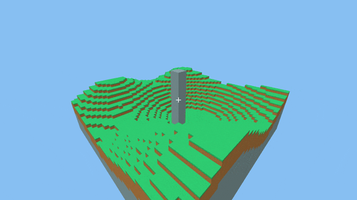
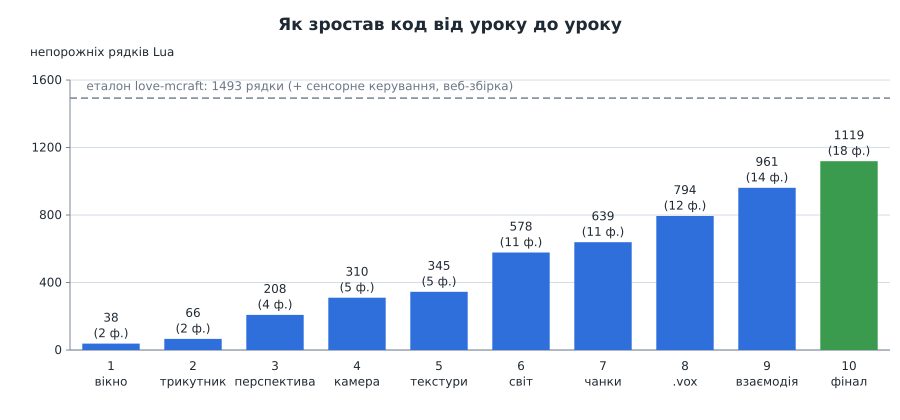
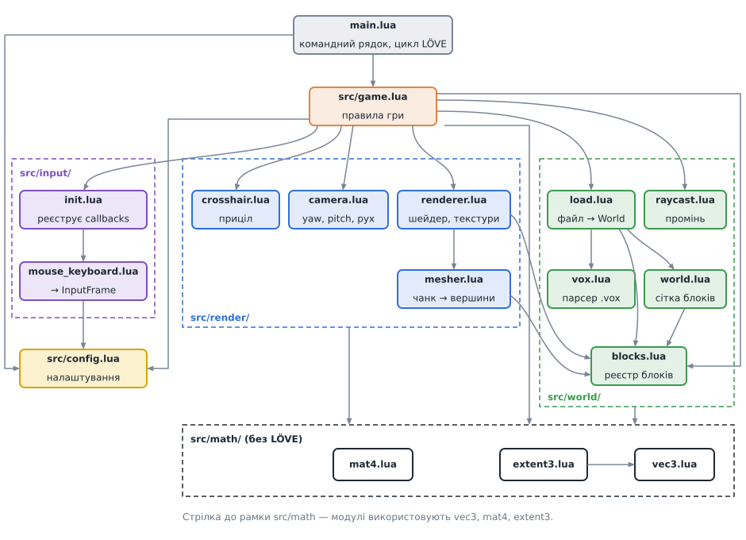
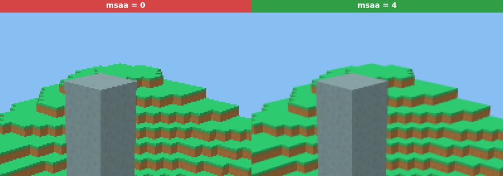
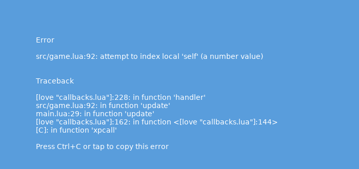

# Урок 10. Фінальне складання

> **Результат уроку:** завершена гра для ПК, яка за можливостями збігається з еталоном **love-mcraft**. Можна літати, ламати й ставити блоки, завантажувати будь-який світ `.vox`, перемикати повний екран (**G**). Код розкладено за відповідальністю, а всі налаштування зібрано в одному файлі.

📦 **Код уроку:** [завантажити code.zip](code.zip). Розпакуйте архів і запустіть `love code`.



<iframe class="lesson-demo" src="demo/index.html?poster=../images/final.gif" title="Демо: проліт над островом" loading="lazy" tabindex="-1"></iframe>

## Мета уроку

* Провести **рефакторинг**: змінити будову коду, не змінюючи поведінки.
* Винести налаштування в **конфігурацію**, ввід в **окремий модуль**, правила гри в **модуль `Game`**.
* Зробити `main.lua` мінімальною точкою входу.
* Підготувати проєкт до перевірки автоматичними засобами (`luacheck`).

---

## 1. Навіщо рефакторинг, якщо все працює

Подивіться, як ріс код від уроку до уроку:



`main.lua` уроку 9 одночасно розбирає аргументи, зберігає камеру, обробляє мишу й клавіатуру, вирішує, куди ставити блоки, і малює. Поки файл короткий, це зручно. Але кожна нова можливість (вибір блока, звук, меню) додаватиме туди ще по шматку, і невдовзі будь-яка зміна почне ламати щось сусіднє.

**Рефакторинг** — зміна будови коду **без зміни поведінки**. Після нього гра працює рівно так само, як в уроці 9, але кожен файл відповідає за одну річ.

## 2. Фінальна архітектура



| Файл | Відповідальність |
|---|---|
| `main.lua` | розбирає командний рядок; передає `love.update` / `love.draw` грі |
| `conf.lua` | налаштування вікна LÖVE до старту |
| `src/config.lua` | **усі** числа, які можна «підкрутити»: швидкості, кут огляду, клавіші |
| `src/game.lua` | гра: світ + камера + рендерер + ввід; **правила** ламання і будівництва |
| `src/input/` | миша й клавіатура → `InputFrame` раз на кадр |
| `src/render/` | камера, рендерер, мешер, приціл |
| `src/world/` | блоки, світ, `.vox`, завантаження, промінь |
| `src/math/` | `Vec3`, `Extent3`, `Mat4`; **не залежать від LÖVE** |

Стрілки на схемі йдуть **згори вниз**: модулі нижнього рівня (`math`, `world`) нічого не знають про верхні (`game`, `main`). Завдяки цьому їх можна перевіряти окремо, без запуску гри (урок 11).

## 3. Конфігурація: `src/config.lua`

```lua
return {
    worldPath = "assets/worlds/test.vox",
    textureDir = "assets/textures",
    chunkSize = 16,

    fov = math.rad(70),
    nearPlane = 0.05,
    farPlane = 1000,
    skyColor = { 0.53, 0.75, 0.95 },

    moveSpeed = 8,
    fastMultiplier = 3,
    mouseSensitivity = 0.0025,
    reach = 8,

    keys = {
        forward = "w", back = "s", left = "a", right = "d",
        up = "space", down = "lshift", fast = "lctrl",
        quit = "escape",
        fullscreen = "g",
    },
    mouseButtons = { breakBlock = 1, placeBlock = 2 },
}
```

Раніше ці числа були розкидані по `main.lua`, `camera.lua` і `renderer.lua`. Тепер, щоб змінити клавішу чи швидкість, потрібно знайти **одне** місце. У коді не залишилося «магічних чисел» без назви.

## 4. Ввід: `src/input/`

Обробка миші й клавіатури переїхала з `main.lua` в окремий клас. Він **накопичує** події протягом кадру і віддає їх грі одним пакетом:

```lua
--- @class InputFrame
--- @field forward number Від -1 до 1, як їх приймає Camera:move.
--- @field right number
--- @field up number
--- @field fast boolean
--- @field yaw number Поворот камери з минулого кадру, радіани.
--- @field pitch number
--- @field actions BlockAction[] Кліки, від найстаршого.
```

```lua
function Game:update(dt)
    local frame = self.input:takeFrame()
    self.camera:rotate(frame.yaw, frame.pitch)
    local speed = Config.moveSpeed * (frame.fast and Config.fastMultiplier or 1)
    self.camera:move(dt, frame.forward, frame.right, frame.up, speed)
    for _, action in ipairs(frame.actions) do
        self:interact(action)
    end
    self.renderer:update()
end
```

`Game` не знає, **звідки** прийшов ввід. Еталонний проєкт love-mcraft саме так додає сенсорне керування для телефонів: другий клас з тим самим методом `takeFrame()`, і `Game` при цьому не змінюється.

`src/input/init.lua` робить теку модулем: `require("src.input")` завантажує саме цей файл. Він створює `MouseKeyboardInput` і реєструє зворотні виклики LÖVE (`love.mousemoved`, `love.mousepressed`, `love.keypressed`, `love.focus`).

## 5. Правила гри: `Game.chooseEdit`

Функцію `interact` з уроку 9 розділено на дві частини:

* `Game.chooseEdit(world, camera, action)` **лише вирішує**, який блок і на що змінити, і повертає `{ block, id }` або `nil`. Вона нічого не змінює й не малює.
* `Game:interact(action)` **виконує** рішення: змінює світ і позначає чанки.

Таке розділення зручне для перевірки. `chooseEdit` можна викликати з вигаданим світом і камерою та порівняти результат з очікуваним, нічого не відкриваючи на екрані.

## 6. Інші зміни

| Зміна | Навіщо |
|---|---|
| `Camera.new({ position = ..., yaw = ..., fov = ... })` | параметри з **іменами** замість шести чисел поспіль: важче переплутати порядок |
| `Renderer.new(world, { chunkSize = ..., textureDir = ... })` | те саме |
| перевірка `getTextureTypes()["array"]` | на старій відеокарті — зрозуміле повідомлення замість дивної помилки шейдера |
| `t.window.msaa = 4` | згладжування «драбинок» на краях блоків |
| `t.modules.audio = false` тощо | не завантажувати модулі, які гра не використовує |
| клавіша **G** | повний екран |
| невідомий параметр `--щось` | зрозуміле повідомлення про використання |

### Згладжування (MSAA)



**MSAA** (*multisample anti-aliasing*) перевіряє кілька точок усередині кожного пікселя на краю трикутника і змішує результат. «Драбинки» на краях зникають, а текстури всередині граней лишаються чіткими.

## 7. Запуск і перевірка якості

```sh
cd 10-final/code
love .                      # світ за замовчуванням
love . /шлях/до/світу.vox   # інший світ
luacheck .                  # статичний аналіз коду (якщо встановлено)
```

**`luacheck`** — це *лінтер*, програма, яка читає код **без запуску** і шукає типові помилки: опечатки в назвах змінних, невикористані змінні, випадкові глобальні змінні. Налаштування лежать у `.luacheckrc`. Для фінального коду luacheck не знаходить жодного зауваження.

Повний код: [`code.zip`](code.zip).

## 8. ⚠️ Типова помилка: крапка замість двокрапки

Під час рефакторингу виклики методів змінюються масово, і легко написати:

```lua
function love.update(dt)
    game.update(dt)   -- НЕПРАВИЛЬНО: має бути game:update(dt)
end
```



`game:update(dt)` — скорочення для `game.update(game, dt)`. З крапкою `self` отримує число `dt`, і перше ж звернення `self.input` падає з помилкою **«attempt to index local 'self' (a number value)»**.

Читати таке повідомлення слід так:

1. **Перший рядок** (`src/game.lua:92`) показує, де сталася помилка.
2. **Traceback** читаємо знизу вгору, це ланцюжок викликів. `main.lua:29` — місце, звідки викликали метод, і саме там помилка.
3. Фраза «`self` (a number value)» майже завжди означає, що замість `:` стоїть `.`.

> **Порада:** не бійтеся екрана помилки. Він показує **файл і рядок**. Найгірші помилки ті, що не дають жодного повідомлення: перевернуті UV, зсунута палітра, дірки між чанками. Саме від них захищають автоматичні тести.

## 9. Порівняння з еталоном

| Можливість | love-mcraft (еталон) | Курс |
|---|---|---|
| Світ з `.vox`, редагування в Goxel | ✅ | ✅ |
| Камера, рух, ламання й будівництво | ✅ | ✅ |
| Текстури, приховані грані, чанки | ✅ | ✅ |
| Повний екран, Esc, захоплення миші | ✅ | ✅ |
| Сенсорне керування (телефони, планшети) | ✅ | ❌ курс лише для ПК |
| Запуск у браузері (love.js, WebAssembly) | ✅ | ❌ курс лише для ПК |
| Автоматичні тести | ✅ 15 наборів тестів | вступ, див. урок 11 |
| Перевірка типів (lua-language-server), CI на GitHub | ✅ | ❌ лише згадано |

## Підсумок

* Рефакторинг змінює будову коду, не змінюючи поведінки.
* Налаштування — в `config.lua`; ввід — в `src/input/`; правила гри — в `Game`.
* Модулі нижнього рівня не залежать від верхніх, тому їх можна перевіряти окремо.
* Повідомлення про помилку вказує файл і рядок; traceback читаємо знизу вгору.

## Запитання для самоперевірки

1. Змініть керування на стрілки замість WASD. Скільки файлів довелося змінити?
2. Чому `Game.chooseEdit` викликається через крапку, а `Game:interact` через двокрапку?
3. Додайте до `config.lua` параметр `placeBlock` (який блок ставити) і використайте його в `Game.chooseEdit`.

**Далі:** [Урок 11. Тестування: вступ](../11-testing/README.md)
