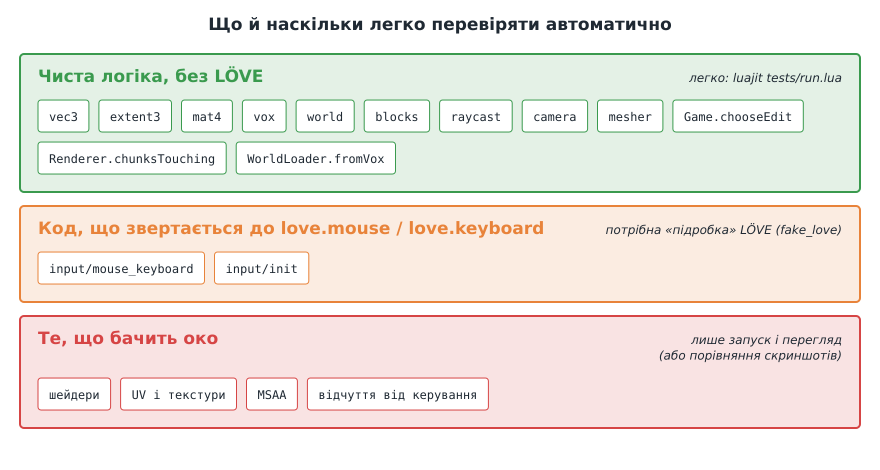

# Урок 11. Тестування: вступ

> **Результат уроку:** до фінальної гри додано теку `tests/` з крихітним тестовим каркасом і двома наборами тестів. Команда `luajit tests/run.lua` за частку секунди перевіряє індексацію світу й промінь, **не запускаючи гру**. Ми побачимо, як тест ловить помилку з уроку 6, яку на екрані легко пропустити.

📦 **Код уроку:** [завантажити code.zip](code.zip). Розпакуйте архів і запустіть `love code`.

## Мета уроку

* Зрозуміти, що таке **автоматичний тест** і чому в реальних проєктах без тестів не обходяться.
* Написати й запустити кілька простих тестів.
* Дізнатися, **чому в цьому курсі тестам відведено лише вступ** і як рухатися далі самостійно.

---

## 1. Що таке автоматичний тест

**Тест** — маленька програма, яка викликає ваш код з відомими вхідними даними і **перевіряє**, що результат такий, як очікувалося. Якщо ні, тест повідомляє, *що саме* і *де* пішло не так.

```lua
t.test("extent3: index of the first cells", function()
    local size = Extent3.new(4, 3, 2)
    t.eq(size:index(Vec3.new(0, 0, 0)), 0)
    t.eq(size:index(Vec3.new(1, 0, 0)), 1, "x step is 1")
    t.eq(size:index(Vec3.new(0, 1, 0)), 4, "y step is size.x")
    t.eq(size:index(Vec3.new(0, 0, 1)), 12, "z step is size.x * size.y")
end)
```

Тест, що перевіряє **один модуль окремо** від решти програми, називають **модульним** (*unit test*).

## 2. Чому це важливо

Згадайте помилки, які ми показували в курсі:

| Урок | Помилка | Чи падає програма? |
|---|---|---|
| 5 | шари текстур зсунуто на 1 | ні, просто неправильні текстури |
| 6 | неправильна формула індексу | ні, світ стає «цеглиною» |
| 7 | сусід з іншого чанка | ні, дірки на межах |
| 8 | палітру зсунуто на 1 | ні, світ «перефарбовано» |
| 9 | забули про сусідній чанк | ні, і помилку видно лише на межі чанка |

Жодна з них **не дає повідомлення про помилку**. Їх помічає лише людина, яка подивиться в потрібне місце під потрібним кутом. Автоматичні тести дають:

1. **Захист від регресій.** *Регресія* — це коли нова зміна ламає те, що працювало. Тести запускають після **кожної** зміни, і вони за секунду перевіряють те, що людина перевіряла б годину.
2. **Сміливість змінювати код.** Рефакторинг з уроку 10 зачепив половину файлів. З тестами видно одразу, що поведінка не змінилася.
3. **Перевірку граничних випадків.** Тест без втоми перебере **всі** 55 296 клітинок світу (див. нижче) або спеціально перевірить межу чанка, куди людина не здогадається заглянути.
4. **Документацію.** Тест `"raycast: looking down hits the top face"` пояснює, як має поводитися код, краще за коментар, і, на відміну від коментаря, не застаріває непомітно.

## 3. Що легко перевіряти



Тепер зрозуміло, навіщо в уроках 6–10 ми так ретельно відокремлювали `src/math` і `src/world` від LÖVE і передавали в `Raycast.cast` **функцію** `isSolid`, а не світ: такі модулі можна перевіряти звичайним `luajit`, без вікна й відеокарти. Код, що звертається до `love.mouse` чи `love.keyboard`, теж можна перевірити, якщо підмінити глобальну таблицю `love` «підробкою», як це робить еталонний проєкт (`tests/fake_love.lua`). А от правильність шейдера чи UV-координат простіше оцінити очима.

## 4. Найменший тестовий каркас

Існують готові бібліотеки для тестування (наприклад, [busted](https://lunarmodules.github.io/busted/)), але принцип простий, і вистачить 40 рядків: [`code/tests/lib.lua`](code/tests/lib.lua).

```lua
local lib = { cases = {} }

function lib.test(name, fn)                 -- зареєструвати тест
    lib.cases[#lib.cases + 1] = { name = name, fn = fn }
end

function lib.eq(actual, expected, message)  -- перевірка (assertion)
    if actual ~= expected then
        fail(("%sexpected %s, got %s"):format(message and message .. ": " or "", tostring(expected), tostring(actual)))
    end
end

function lib.run()                          -- запустити всі тести
    local failures = 0
    for _, case in ipairs(lib.cases) do
        local ok, err = pcall(case.fn)      -- помилка в одному тесті не зупиняє інші
        if not ok then
            failures = failures + 1
            print(("FAIL  %s\n      %s"):format(case.name, err))
        end
    end
    print(("%d passed, %d failed"):format(#lib.cases - failures, failures))
    return failures
end
```

Головне — `pcall`. Невдала перевірка викликає `error`, `pcall` її перехоплює, і каркас переходить до наступного тесту.

## 5. Тести курсу

```
11-testing/code/tests/
├── lib.lua            -- каркас
├── run.lua            -- запускає всі набори
├── test_extent3.lua   -- індексація світу (урок 6)
└── test_raycast.lua   -- промінь (урок 9)
```

### Індексація: кожна клітинка має отримати свій номер

```lua
t.test("extent3: every cell gets its own index, and cell() reverses index()", function()
    local size = Extent3.new(48, 48, 24)
    local seen = {}
    for z = 0, size.z - 1 do
        for y = 0, size.y - 1 do
            for x = 0, size.x - 1 do
                local cell = Vec3.new(x, y, z)
                local index = size:index(cell)
                local other = seen[index]
                t.ok(not other, ("cells %s and %s share index %d"):format(tostring(other), tostring(cell), index))
                seen[index] = cell
                t.eq(size:cell(index), cell)
            end
        end
    end
end)
```

Тест перевіряє **всі** $48 \times 48 \times 24 = 55\,296$ клітинок світу: двох однакових номерів не буває, а `cell` повертає з номера ту саму клітинку.

### Промінь: вигаданий світ з одного блока

```lua
local function onlyBlock(target)
    return function(block) return block == target end
end

t.test("raycast: hits the block ahead through the face facing the ray", function()
    local hit = Raycast.cast(onlyBlock(Vec3.new(5, 0, 0)), Vec3.new(0.5, 0.5, 0.5), Vec3.new(1, 0, 0), 10)
    t.ok(hit, "expected a hit")
    t.eq(hit.block, Vec3.new(5, 0, 0))
    t.eq(hit.normal, Vec3.new(-1, 0, 0), "entered through the -X face")
end)
```

Для перевірки не потрібні ні `World`, ні файл `.vox`: «світ» — це одна функція.

### Запуск

```sh
cd 11-testing/code
luajit tests/run.lua
```

```
6 passed, 0 failed
```

Увесь набір виконується приблизно за **0,02 секунди**.

## 6. Тест ловить помилку

Повернемо в `src/math/extent3.lua` помилку з [уроку 6](../06-world/README.md):

```lua
return cell.x + self.x * cell.y + self.y * cell.z   -- НЕПРАВИЛЬНО
```

і запустимо тести:

```
FAIL  extent3: index of the first cells
      ./tests/test_extent3.lua:10: z step is size.x * size.y: expected 12, got 3
FAIL  extent3: every cell gets its own index, and cell() reverses index()
      ./tests/test_extent3.lua:22: cells (0, 1, 0) and (0, 0, 1) share index 48
4 passed, 2 failed
```

Порівняйте з уроком 6: там ми **дивилися** на дивну кам'яну цеглину й шукали причину. Тут тест за 0,02 с називає **файл, рядок і саму причину**: клітинки `(0, 1, 0)` і `(0, 0, 1)` отримали однаковий номер 48. Ту саму пару ми розбирали на схемі в уроці 6.

Команда `luajit tests/run.lua` повертає код завершення `1`, якщо є хоч одна невдача. Тому тести легко підключити до автоматичної перевірки: еталонний проєкт запускає їх на GitHub після кожного `git push` (*continuous integration*, CI).

## 7. Чому в курсі лише вступ

Тестування — велика окрема тема, і тестувати кожен крок курсу ми свідомо не стали:

* **Час.** Для кожного уроку довелося б писати власні тести, а потім **переписувати** їх, коли код змінюється (а в цьому курсі він змінюється постійно: урок 7 переробляє мешер з уроку 6, урок 10 змінює конструктори `Camera` і `Renderer`). Обсяг навчального матеріалу помітно зріс би, а фокус курсу — 3D-графіка.
* **Наочність.** Головні помилки курсу візуальні, і їх краще один раз **побачити** на скриншоті, ніж прочитати в рядку `expected 12, got 3`.
* **Підготовка вже зроблена.** Код курсу написано так, щоб його *можна* було тестувати: чиста математика, функція `isSolid`, рішення `Game.chooseEdit` окремо від виконання. Ці звички важливіші за кількість тестів.

У справжньому проєкті тести пишуть **разом із кодом**. Еталонний love-mcraft має 15 наборів з 83 тестами: від `Vec3` до правил гри.

## 8. Що робити далі самостійно

1. Напишіть тест для `Blocks.fromColor`: еталонні кольори мають перетворюватися на свої блоки.
2. Напишіть тест для `Renderer.chunksTouching`: блок `(16, 31, 5)` при `chunkSize = 16` має зачіпати 3 чанки (див. урок 9).
3. Напишіть тест для `Vox.parse`, що перевіряє повідомлення для файлу без сигнатури `"VOX "`.
4. Подивіться, як влаштовано `tests/` в еталонному проєкті, зокрема `fake_love.lua`.

## Підсумок

* Автоматичний тест викликає код з відомими даними й перевіряє результат.
* Тести ловлять «тихі» помилки, які не дають повідомлень, і захищають від регресій.
* Чиста логіка, відокремлена від LÖVE, тестується найпростіше.
* У курсі тестам відведено лише вступ через обсяг; у реальних проєктах їх пишуть разом із кодом.

**Назад до змісту:** [README](../README.md)
