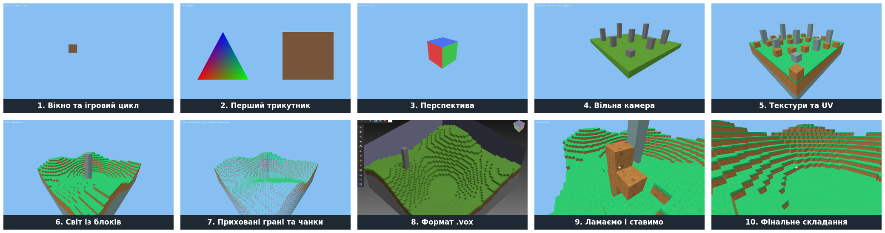

# Minecraft на LÖVE: 3D-графіка з нуля

Навчальний курс для здобувачів освіти за професією **4113 «Оператор з обробки інформації та програмного забезпечення»**.

За 11 уроків ми напишемо мовою Lua невелику гру в стилі Minecraft для ПК: від порожнього вікна до світу з блоків, який можна облітати, ламати й будувати. Кожен урок закінчується **програмою, що запускається**, а кожна нова ідея (вектори, матриці, UV-координати, двійковий формат файлу, промінь крізь сітку) пояснюється схемою чи анімацією.



## Зміст

* [Урок 0. Вступ до курсу](00-intro/README.md)
* [Урок 1. Вікно та ігровий цикл](01-window/README.md)
* [Урок 2. Перший трикутник](02-triangle/README.md)
* [Урок 3. Перспектива: вектори, матриці та обертовий куб](03-perspective/README.md)
* [Урок 4. Вільна камера: миша і клавіатура](04-camera/README.md)
* [Урок 5. Текстури та UV-координати](05-textures/README.md)
* [Урок 6. Світ із блоків](06-world/README.md)
* [Урок 7. Оптимізація: приховані грані та чанки](07-culling-chunks/README.md)
* [Урок 8. Формат .vox: завантажуємо світ з файлу](08-vox/README.md)
* [Урок 9. Взаємодія: приціл, ламаємо і ставимо блоки](09-interaction/README.md)
* [Урок 10. Фінальне складання](10-final/README.md)
* [Урок 11. Тестування: вступ](11-testing/README.md)
* [Словник термінів](GLOSSARY.md)

## Швидкий старт

```sh
cd 10-final/code
love .
```

Потрібен [LÖVE 11.5](https://love2d.org). Докладніше про підготовку — в [уроці 0](00-intro/README.md).
